<p align="center">
  <picture>
    <source media="(prefers-color-scheme: dark)" srcset="brand/STARNET_22_Logo_Bianco.svg">
    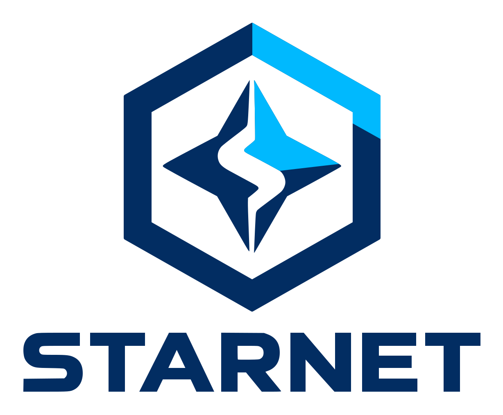
  </picture>
</p>

# STARNET Polaris

**La stella polare del tuo PC e della tua rete.** Diagnostica di computer e rete, in un unico programma, che **spiega ogni
valore**: per ciascuna misura dice cos'è, come si legge, quanto è grave e cosa fare per migliorarla. Le azioni correttive
confluiscono in un piano unico, ordinato per gravità, impatto e facilità.

Del **computer** controlla versione e supporto di Windows, memoria, **salute dei dischi HDD e SSD** (attributi SMART e registro
NVMe come in CrystalDiskInfo, usura, temperatura, errori), spazio, programmi all'avvio, processi, spegnimenti imprevisti,
schermate blu, **Microsoft Defender** (protezione, minacce e scansioni su richiesta), aggiornamenti e batteria; compila la
**scheda tecnica** come CPU-Z e offre **test di velocità** del processore e dei dischi, questi con il profilo di CrystalDiskMark.
La **cassetta degli attrezzi** apre gli strumenti di Windows e **CrystalDiskInfo e CrystalDiskMark, inclusi nel pacchetto**.
Della **rete** misura Wi-Fi, router, Internet e DNS.

Funziona in casa come in uno studio, in un'azienda o in una **struttura sanitaria**: riconosce le reti con più access point e
con dominio, censisce la sottorete, verifica la separazione tra le zone e i servizi critici e guida un'autovalutazione delle
misure organizzative. Una biblioteca di **66 guide** in italiano spiega come usare il programma, il computer e la rete, dalle
basi alle reti cliniche.

Il nome nasce dal marchio STARNET: Polaris è la stella polare, quella che indica la direzione. Qui indica cosa sistemare per primo.

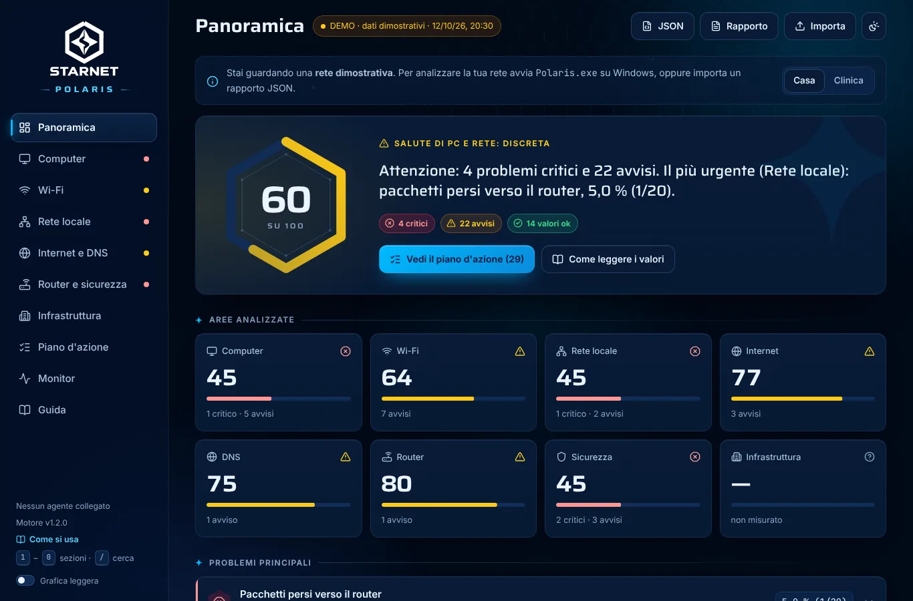

<sub>Sopra: dati dimostrativi. Sotto: la finestra su Windows reale (macchina di collaudo della CI) con i dati misurati.</sub>


## Interfaccia

Costruita attorno al marchio STARNET: i colori sono il blu profondo `#022D62` e il ciano `#00B9FE` del logo, la geometria è
l'esagono della sua cornice, i titoli usano un carattere esteso vicino alla scritta STARNET. Il logo compare come vuole la sua
guida: bianco sui fondi scuri, a colori sui fondi chiari, senza ombre né deformazioni.

Il movimento riprende il marchio:
- all'avvio la cornice si disegna in senso orario dal vertice alto, come il tratto ciano, e le due metà della stella si incastrano
  lungo la S;
- il punteggio è un esagono che si riempie allo stesso modo;
- durante l'analisi il simbolo sta al centro, la sua cornice si completa con l'avanzamento reale e le sonde, man mano che
  finiscono, si collegano in una costellazione;
- le sezioni entrano in cascata, i numeri si assestano con una molla, il monitor scorre in modo continuo.

Se in Windows le animazioni sono disattivate restano solo brevi dissolvenze: niente spostamenti, rotazioni o scorrimenti.

- **Tastiera**: `1`…`9` e `0` per le sezioni, `/` per cercare nella guida, frecce nei selettori e nelle risposte dell'autovalutazione;
  ogni comando è raggiungibile con Tab.
- **Grafica leggera**: senza accelerazione grafica (macchine virtuali, desktop remoto) Polaris se ne accorge dai fotogrammi lenti e
  toglie sfocature e trasparenze; si può anche attivare a mano in fondo alla barra laterale.
- Contrasto conforme a WCAG 2.1 AA in entrambi i temi; la gravità è sempre indicata da icona e testo, non solo dal colore.

| Wi-Fi e spettro radio | Piano d'azione (tema chiaro) | Mobile |
| --- | --- | --- |
| 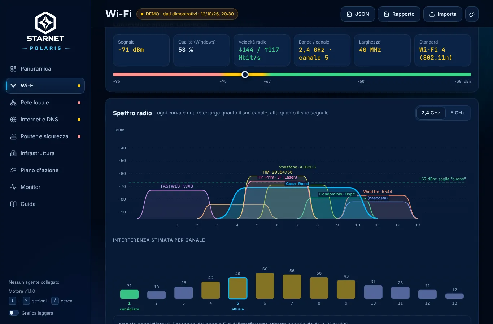 | 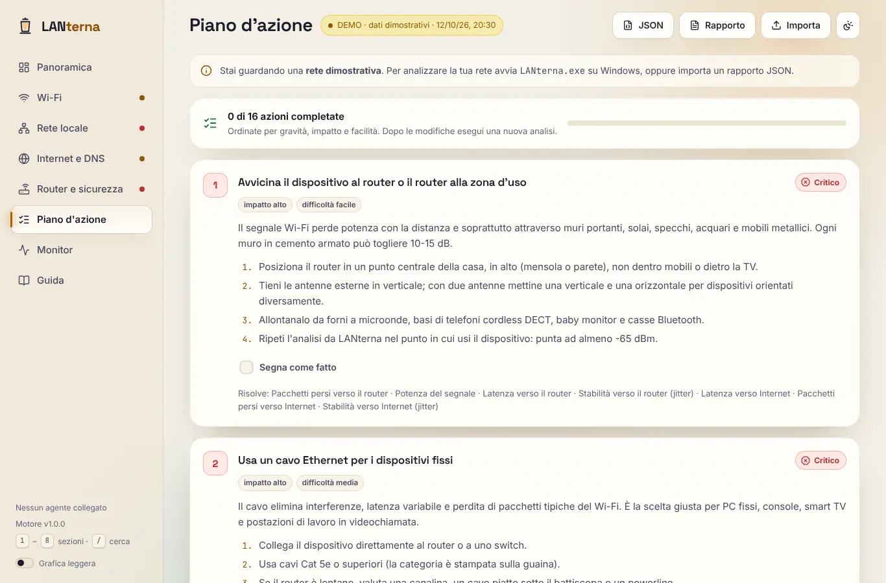 | 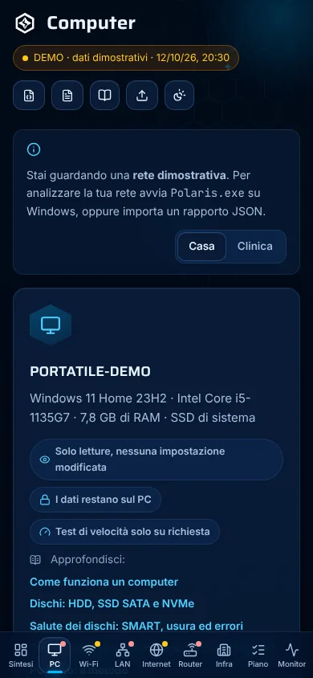 |

## Il computer

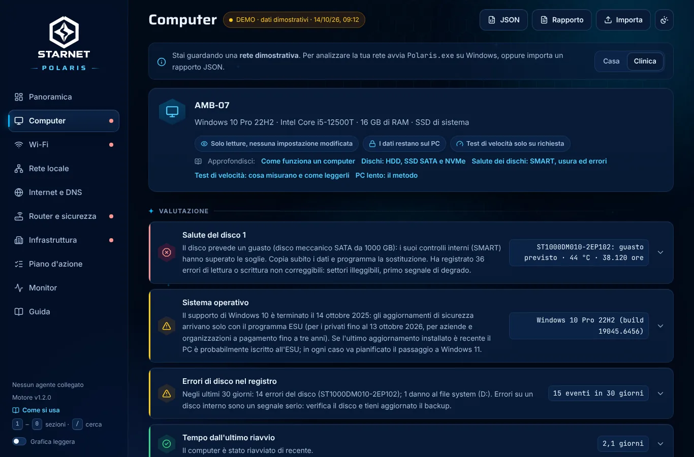

La sezione **Computer** descrive il PC da cui parte l'analisi, letto in **sola lettura** con le funzioni di Windows e un unico
script PowerShell nascosto: nessuna impostazione viene modificata.

- **Dischi**: tipo (SSD NVMe, SSD SATA, HDD, USB) e stato Buono, Attenzione o Critico con le regole di CrystalDiskInfo. Da
  amministratore Polaris legge il disco direttamente, in sola lettura: tabella degli attributi SMART dei dischi SATA (attuale,
  peggiore, soglia, dato grezzo), registro di salute NVMe (usura, riserva disponibile, dati scritti, spegnimenti non sicuri,
  errori del supporto), temperatura con la massima registrata. Errori di disco e file system dal registro eventi, collegati al
  disco coinvolto; spazio di ogni volume.
- **Sistema**: versione di Windows con le date di fine supporto (Windows 11 per versione ed edizione, Windows 10 ed ESU),
  memoria installata e in uso, carico del processore con i processi più pesanti, programmi all'avvio, tempo dall'ultimo
  riavvio (con l'effetto dell'avvio rapido) e riavvii in sospeso.
- **Stabilità e sicurezza**: spegnimenti imprevisti, schermate blu con il codice di arresto spiegato, errori hardware WHEA
  degli ultimi 30 giorni; antivirus dal Centro sicurezza; data dell'ultimo aggiornamento.
- **Microsoft Defender**: protezione in tempo reale e da manomissioni, firme, ultime scansioni e cronologia delle minacce (nome,
  gravità e stato, senza percorsi dei file né nomi utente). Su richiesta, scansione rapida o completa e aggiornamento delle firme
  con lo strumento ufficiale `MpCmdRun`; una scansione si può interrompere.
- **Scheda tecnica**, come in CPU-Z: processore (famiglia, modello e stepping, core P ed E, cache per livello, istruzioni,
  virtualizzazione), scheda madre e BIOS, moduli di memoria con slot, tipo e velocità, firmware UEFI, Secure Boot, TPM, scheda
  video e schermo. Giudizi su canali e velocità della memoria, Secure Boot, TPM e requisiti verificabili di Windows 11.
- **Alimentazione**: salute della batteria, piano di alimentazione, driver della scheda video.
- **Test di velocità** (solo su richiesta): il processore comprime dati con un thread e con tutti per circa 25 secondi e rivela
  il calo dovuto a calore o limiti di potenza; il disco scrive e rilegge un file temporaneo fino a 1 GB senza cache di Windows
  con il profilo di CrystalDiskMark (SEQ1M Q8T1, SEQ1M Q1T1, RND4K Q32T1, RND4K Q1T1, in lettura e scrittura) e lo cancella
  alla fine anche se il test si interrompe (`FILE_FLAG_DELETE_ON_CLOSE`). I risultati si confrontano con quelli tipici del tipo
  di disco ed entrano nel rapporto; le prove precedenti restano sul PC per il confronto "prima e dopo".
- **Cassetta degli attrezzi**: 16 strumenti di Windows (Gestione attività, Monitoraggio affidabilità, Visualizzatore eventi,
  Diagnostica memoria...) e 14 programmi gratuiti di diagnostica, con che cosa fanno, licenza, sito ufficiale e dove Polaris fa
  una cosa simile. **CrystalDiskInfo 9.9.2 e CrystalDiskMark 9.0.3 sono inclusi** nella cartella `strumenti`: copie originali
  e non modificate (licenza MIT, eseguibili firmati da CrystalMark Inc.) che si aprono con un clic, senza installare nulla.
  Polaris li avvia solo se l'eseguibile ha l'impronta SHA-256 attesa. Gli altri programmi (CPU-Z, HWiNFO, Malwarebytes...) non
  sono inclusi perché le licenze non lo permettono o non lo rendono opportuno: Polaris li riconosce se sono installati e apre il
  sito ufficiale. Tutto passa da una lista bianca: dall'interfaccia arriva solo un identificativo, mai un percorso o un comando.

Il punteggio della panoramica descrive PC e rete insieme; un disco che sta per guastarsi diventa il problema più urgente e la
prima azione del piano (copiare i dati). Nei rapporti la cartella dell'utente diventa `%USERPROFILE%` e non compaiono numeri di
serie.

| Test di velocità | Dischi e attributi SMART |
| --- | --- |
| 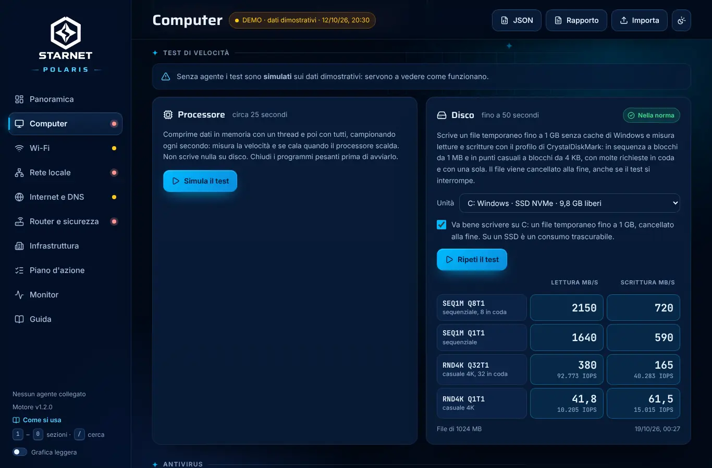 | 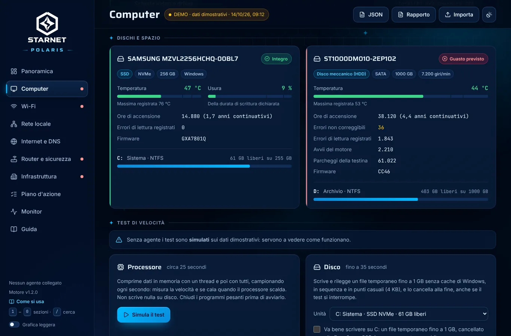 |

| Scheda tecnica | Microsoft Defender | Programmi inclusi (agente reale) |
| --- | --- | --- |
| 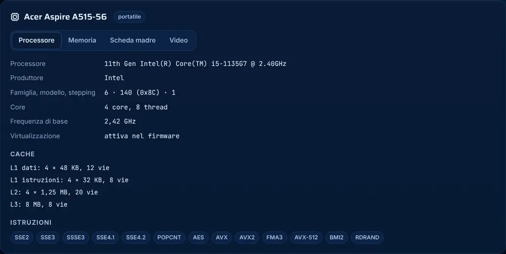 | 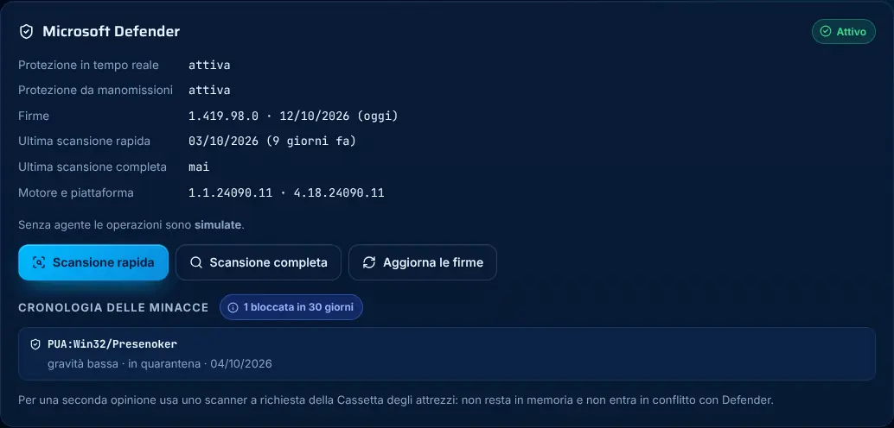 | 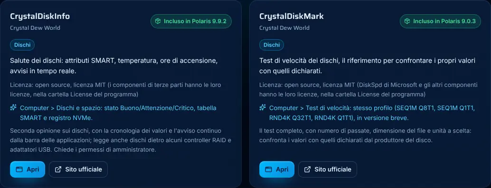 |

## Cosa misura

| Area | Misure |
| --- | --- |
| Computer | versione e supporto di Windows, RAM installata e in uso, carico del processore e processi, salute dei dischi (stato, attributi SMART, registro NVMe, usura, temperatura, errori), tipo del disco di sistema, spazio per volume, programmi all'avvio, riavvio e riavvii in sospeso, spegnimenti imprevisti, schermate blu, errori hardware e di disco nel registro, antivirus e Microsoft Defender (protezione, firme, scansioni, minacce), ultimo aggiornamento, batteria, piano di alimentazione, driver video, scheda tecnica (processore, memoria e canali, scheda madre, firmware, Secure Boot, TPM, video) |
| Test di velocità (su richiesta) | processore con un thread e con tutti, punta e velocità mantenuta; disco con il profilo di CrystalDiskMark (SEQ1M Q8T1, SEQ1M Q1T1, RND4K Q32T1, RND4K Q1T1), in MB/s e IOPS |
| Antivirus (su richiesta) | scansione rapida o completa e aggiornamento delle firme di Microsoft Defender |
| Wi-Fi | potenza in dBm, qualità, velocità radio, banda, standard (Wi-Fi 4…7), larghezza di canale, reti sullo stesso canale, canali 2,4 GHz sovrapposti, carico dichiarato dall'access point (BSS Load), sicurezza (WPA2/WPA3 Personal ed Enterprise, TKIP, PMF, WPS), canale consigliato per 2,4 e 5 GHz |
| Reti con più access point | AP della rete con canali, segnale, carico e roaming assistito (802.11k, 802.11v, 802.11r e Mobility Domain), AP propri sullo stesso canale, PC agganciato a un AP lontano (sticky client), stessa rete annunciata con protezioni diverse (possibile AP gemello) |
| Rete locale | indirizzo, DHCP e server DHCP (APIPA), gateway, latenza/perdite/jitter verso il router, velocità della porta Ethernet, IPv6, sottoreti molto ampie, dominio e DNS aziendali, stesso MAC per più indirizzi, MAC del router cambiato rispetto all'analisi precedente, dispositivi visti di recente |
| Internet | latenza, perdite e jitter verso Cloudflare, Google e Quad9, traceroute, MTU del percorso, navigazione HTTPS reale |
| DNS | tempo di risposta del DNS in uso e confronto con i resolver pubblici |
| Router e sicurezza | servizi esposti dal *proprio* router (Telnet, FTP, SMB…), UPnP IGD e indirizzo pubblico, pannello di gestione HTTP/HTTPS, profili del firewall di Windows |
| Infrastruttura (su richiesta) | inventario della sottorete, test di segmentazione tra le zone, raggiungibilità e tempi dei servizi critici, autovalutazione organizzativa in sei aree |
| Monitor | un ping al secondo verso router e Internet per tutta la sessione (fino a 12 ore, anche cambiando sezione), con picchi, interruzioni e relativa ora; esportazione CSV |

## Reti complesse e strutture sanitarie

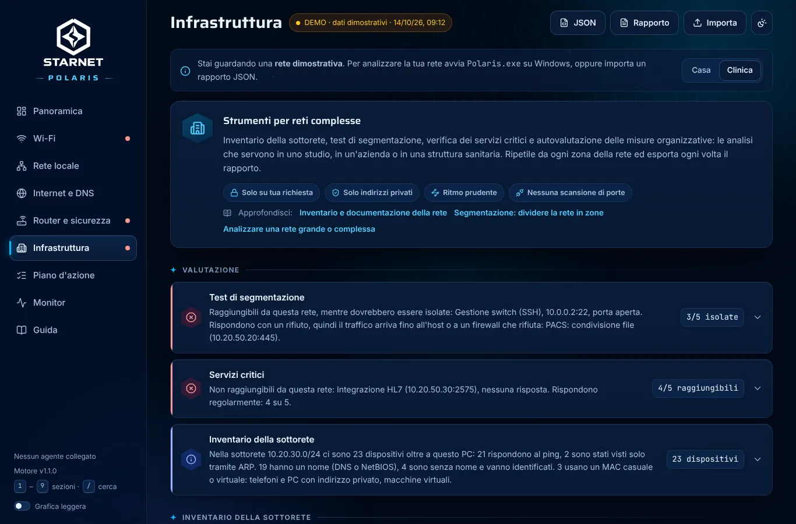

La sezione **Infrastruttura** raccoglie gli strumenti per le reti con più zone. Contattano altri dispositivi, quindi seguono
regole precise: partono **solo su richiesta**, l'inventario chiede la conferma di essere autorizzati (con l'attività concordata
con l'ingegneria clinica dove ci sono dispositivi medicali), si rivolgono **solo a indirizzi privati**, con un **ritmo prudente**
e **senza scansioni di porte**.

- **Inventario della sottorete**: un ping a ogni indirizzo (circa 30 al secondo, 8 alla volta), poi la tabella ARP, che rivela
  anche i dispositivi che ignorano il ping, e i nomi da DNS inverso e NetBIOS. Elenco filtrabile ed esportabile in CSV; segnala i
  dispositivi senza nome, i MAC casuali e la sottorete quasi piena. Oltre /22 si esamina solo il blocco /24 del PC.
- **Test di segmentazione e servizi critici**: si indicano le destinazioni che da questa zona devono rispondere (cartella
  clinica, PACS, HL7, DNS, controller di dominio…) e quelle che devono restare isolate (dispositivi medicali, gestione degli
  apparati, telecamere, ospiti). Per ognuna una connessione TCP alla porta indicata o due ping; le destinazioni si ricordano per
  rete. Una risposta da una zona che doveva essere isolata è un problema critico.
- **Autovalutazione**: 28 domande su segmentazione, dispositivi medicali, accessi e fornitori, backup, continuità e gestione
  degli incidenti. Le risposte restano sul PC ed entrano nel rapporto; ogni lacuna aggiunge al piano l'azione corrispondente. È
  una dichiarazione, non una verifica, e non sostituisce un audit.

Nelle reti con dominio Polaris non suggerisce di cambiare DNS sul PC (romperebbe i nomi interni) ma di potenziare il DNS interno.
Senza agente, le due reti dimostrative (*Casa* e *Clinica*) mostrano tutte le funzioni con dati e simulazioni dichiarati come tali.

| AP della rete (demo Clinica) | Esiti delle verifiche | Autovalutazione (tema chiaro) |
| --- | --- | --- |
|  |  |  |

## Guide

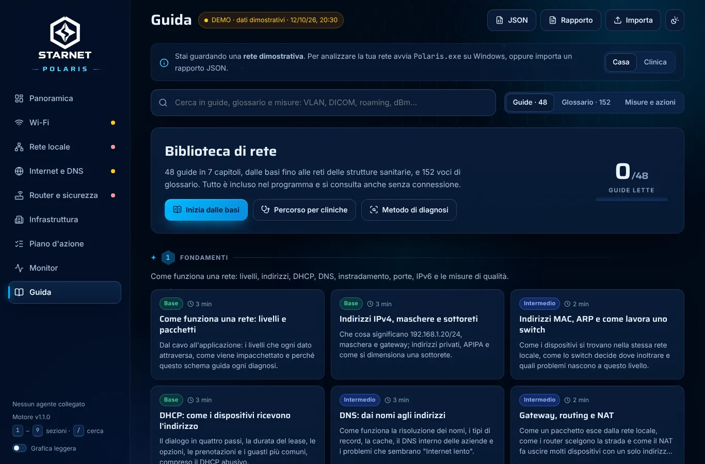

66 guide in nove capitoli (usare STARNET Polaris, il computer, fondamenti, Wi-Fi, rete cablata, servizi, sicurezza, reti
complesse e sanità, diagnosi), un glossario di 188 voci e la ricerca unificata su guide, glossario, misure e azioni. La guida
d'uso parte dai primi passi e arriva alla riga di comando e alla cassetta degli attrezzi; il capitolo sul computer spiega
componenti, scheda tecnica, dischi HDD e SSD, attributi SMART, test di velocità, memoria, avvio, aggiornamenti, antivirus e
Microsoft Defender, registro eventi, batteria e il metodo per un PC lento. Le date di supporto di
Windows citate sono quelle note a metà 2026 e vanno verificate sul sito Microsoft. Ogni valore misurato e ogni azione del piano rimandano
alla guida che li spiega; sette diagrammi animati illustrano livelli, sottoreti, DHCP, canali, roaming, VLAN e zone di una rete
sanitaria. I riferimenti normativi citati (GDPR, NIS2, dispositivi medicali) sono una sintesi da verificare sui testi ufficiali,
non una consulenza legale.

## Piattaforme

| Piattaforma | Stato |
| --- | --- |
| **Windows 10/11** | programma portatile (`Polaris.exe`, nessuna installazione) con finestra nativa WebView2, rapporto da riga di comando e interfaccia nel browser |
| Android | progettato, da realizzare: [docs/ANDROID.md](docs/ANDROID.md) |
| ESP32 | progettato, da realizzare: [docs/ESP32.md](docs/ESP32.md) |

Tutte le piattaforme condividono lo **stesso nucleo**: interfaccia e motore di analisi in TypeScript (`core/`). Le sonde di ogni
piattaforma producono solo dati grezzi in un formato comune; l'interpretazione è sempre la stessa. Dettagli in
[docs/ARCHITETTURA.md](docs/ARCHITETTURA.md).

## Uso su Windows

Scarica `STARNET-Polaris-windows-amd64.zip`, estrai la cartella e fai doppio clic su `Polaris.exe`. L'analisi parte da sola e dura circa 25 secondi.
Nella cartella `strumenti` ci sono CrystalDiskInfo e CrystalDiskMark: si aprono dalla cassetta degli attrezzi.

```text
polaris-cli report                  rapporto a schermo
polaris-cli report --verbose        con spiegazioni e passi da seguire
polaris-cli report --out r.txt      salva il rapporto (UTF-8, si apre col Blocco note)
polaris-cli report --json           dati grezzi, riapribili nell'interfaccia con "Importa"
polaris-cli serve --open            interfaccia nel browser su http://127.0.0.1:8737
polaris-cli bench cpu               test di velocità del processore (circa 25 secondi)
polaris-cli bench disk --drive D:   test di un'unità (file temporaneo cancellato alla fine)
polaris-cli defender status         stato di Microsoft Defender e minacce
polaris-cli defender quick          scansione rapida (full: completa; update: firme)
```

Su Windows 11 24H2 e successivi la lettura delle reti Wi-Fi richiede il permesso di posizione per le app desktop: Polaris lo
rileva e spiega come attivarlo. Non servono privilegi di amministratore; avviando Polaris come amministratore compaiono anche
attributi SMART, registro NVMe, temperatura, usura ed errori dei dischi.

## Sviluppo

Requisiti: Node.js 20+, Go 1.24+; per i programmi inclusi curl e unzip (o Python 3). Si compila da Linux, macOS o Windows.

```bash
cd core && npm ci && npm test        # motore di analisi (vitest)
npm run dev                          # interfaccia con i dati dimostrativi su http://localhost:5173
cd ../windows && go test ./...       # agente Windows (gira anche su Linux)
cd .. && scripts/build-windows.sh    # build/STARNET-Polaris/ e build/STARNET-Polaris-windows-amd64.zip
```

La build scarica gli archivi originali di CrystalDiskInfo e CrystalDiskMark dalla pagina SourceForge del produttore, li verifica
con l'impronta SHA-256 fissata in `scripts/strumenti.sh` e li estrae senza modifiche in `strumenti/`; gli archivi restano in
`build/cache-strumenti/`. Con `STRUMENTI=no scripts/build-windows.sh` il pacchetto esce senza programmi inclusi.

`npm run dev` usa i dati dimostrativi (la rete *Casa*; dal selettore nell'avviso si passa a *Clinica*); con `polaris-cli serve`
avviato, il server di sviluppo inoltra `/api` all'agente vero.

Fino alla versione 0.2.0 il programma si chiamava LANterna: il repository e il modulo Go conservano quel nome interno.
I master del marchio sono in `brand/`; `node scripts/brand.mjs` rigenera i tracciati usati dall'interfaccia.

## Verifiche

Cosa è stato verificato e come, inclusa l'esecuzione dell'exe sotto Wine e su Windows reale in CI, e cosa resta da provare su un
PC con scheda Wi-Fi: [docs/VERIFICHE.md](docs/VERIFICHE.md).

## Privacy e sicurezza

- Tutto resta sul PC: nessun dato viene inviato a servizi esterni.
- Il server locale ascolta solo su `127.0.0.1`, rifiuta host diversi (DNS rebinding) e richieste da altre origini.
- Il controllo dei servizi esposti riguarda **esclusivamente il gateway** della rete a cui si è collegati, senza autenticarsi.
- Inventario e verifiche partono solo su richiesta, solo verso indirizzi privati (RFC 1918 e ULA IPv6) e senza scansioni di
  porte: l'inventario contatta i dispositivi della sola sottorete del PC, le verifiche solo le destinazioni indicate
  dall'utente. Le API locali rifiutano richieste senza conferma, con destinazioni non valide o pubbliche.
- Per le misure vengono contattati: il router, i resolver pubblici 1.1.1.1, 8.8.8.8 e 9.9.9.9, `www.google.com/generate_204` e
  `cp.cloudflare.com/generate_204`.
- I dati del computer si leggono senza modificare nulla; i test di velocità partono solo su richiesta, quello del disco con una
  conferma esplicita, lasciando almeno 2 GB liberi e cancellando il file di prova. Nei rapporti la cartella dell'utente è
  sostituita da `%USERPROFILE%`, i numeri di serie dei dischi non vengono letti e degli eventi si conservano solo origine,
  codice, numero e data (il dettaglio solo per schermate blu, dischi e file system).
- Di Microsoft Defender si leggono stato e cronologia delle minacce con nome, gravità e stato, senza percorsi dei file né nomi
  utente; scansioni e aggiornamento delle firme partono solo su richiesta (la scansione completa con una conferma).
- La cassetta degli attrezzi apre solo voci della sua lista bianca. I programmi inclusi si avviano solo se l'eseguibile è
  quello originale: una copia modificata o sostituita viene segnalata e non parte.

## Licenze

I componenti di terze parti inclusi nell'eseguibile e le loro licenze sono in [THIRD_PARTY_NOTICES.md](THIRD_PARTY_NOTICES.md)
(MIT, BSD, ISC, Apache-2.0, SIL Open Font License 1.1 per i font e la licenza del loader WebView2 di Microsoft), generato da
`scripts/notices.sh` a partire da ciò che finisce davvero nel bundle. Lo stesso file elenca i programmi della cartella
`strumenti` (CrystalDiskInfo e CrystalDiskMark, licenza MIT) con archivi, impronte e i componenti che contengono, ognuno con i
testi completi nella propria cartella `License`. Tra questi c'è la libreria AMD_RC2t7 di CrystalDiskInfo, con una licenza
propria: si ridistribuisce solo dentro il pacchetto del programma, senza modifiche, e chiede un accordo aggiuntivo se le sue
funzioni o i suoi risultati vengono venduti. Se Polaris venisse distribuito a pagamento, queste condizioni andrebbero verificate. La licenza di STARNET Polaris stessa non è ancora stata scelta. Il marchio STARNET (cartella `brand/`) appartiene al suo
titolare e non è coperto da quelle licenze.
