<p align="center">
  <picture>
    <source media="(prefers-color-scheme: dark)" srcset="brand/STARNET_22_Logo_Bianco.svg">
    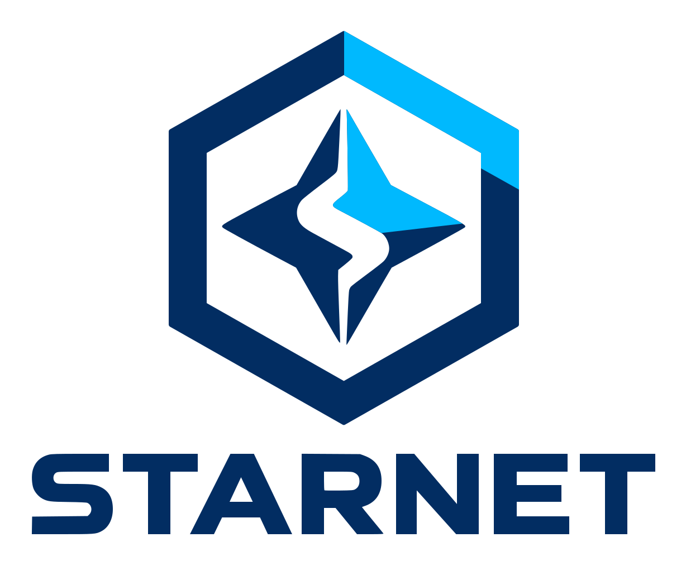
  </picture>
</p>

# STARNET Polaris

**La stella polare del tuo PC e della tua rete.** Diagnostica di computer e rete, in un unico programma, che **spiega ogni
valore**: per ciascuna misura dice cos'è, come si legge, quanto è grave e cosa fare per migliorarla. Le azioni correttive
confluiscono in un piano unico, ordinato per gravità, impatto e facilità, che **guida passo passo sul PC**: per ogni passo il
percorso di Windows con i nomi italiani di menu e pulsanti, nella versione del PC analizzato, il pulsante che apre la pagina
giusta e i comandi da copiare; dentro ogni azione compaiono i programmi utili, con il pulsante per aprirli.

Del **computer** controlla versione e supporto di Windows, memoria, **salute dei dischi HDD e SSD** (attributi SMART e registro
NVMe come in CrystalDiskInfo, usura, temperatura, errori), **cosa occupa spazio** come WizTree, programmi all'avvio, processi, spegnimenti imprevisti,
**schermate blu con la lettura dei minidump** come BlueScreenView, **Microsoft Defender** (protezione, minacce e scansioni su richiesta), aggiornamenti e batteria; compila la
**scheda tecnica** come CPU-Z, con la **velocità dei core in tempo reale**, e offre **test di velocità** del processore e dei dischi,
questi con il profilo di CrystalDiskMark.
La **cassetta degli attrezzi** apre gli strumenti di Windows e **CrystalDiskInfo, CrystalDiskMark e BlueScreenView, inclusi nel
pacchetto**; CPU-Z, HWiNFO, Autoruns e gli altri programmi che non si possono ridistribuire li **scarica dal sito ufficiale**, solo
su richiesta, e li avvia solo con la firma digitale del produttore. Per i PC senza Internet prepara un **kit** da portare su una
chiavetta. Un **documento stampabile** riassume lo stato del PC, da consegnare o salvare in PDF.
Della **rete** misura Wi-Fi, router, Internet e DNS e disegna la **mappa della rete**: un grafico interattivo con l'icona di ogni
dispositivo, riconosciuto da solo (router, switch, access point, PC, stampanti, NAS, telecamere, dispositivi medicali...), e i
percorsi animati del traffico; sotto la mappa **il traffico passo passo** ricostruisce i pacchetti di un sito web, del DHCP, di un
ping, del traceroute e dei servizi verificati con gli indirizzi e i tempi dell'analisi. Su richiesta **scopre le altre reti e le VLAN** senza doverle scrivere (annunci dello switch,
Active Directory, SNMP in sola lettura), disegna la **mappa del Wi-Fi stanza per stanza**, controlla i **certificati dei
servizi interni** e, con il tuo consenso ogni volta, misura la **velocità di Internet** con Measurement Lab.

Funziona in casa come in uno studio, in un'azienda o in una **struttura sanitaria**: riconosce le reti con più access point e
con dominio, censisce la sottorete, verifica la separazione tra le zone e i servizi critici e guida un'autovalutazione delle
misure organizzative. Una biblioteca di **79 guide** in italiano, con schemi animati e **videoguide narrate dalla voce
italiana di Windows**, spiega come usare il programma, il computer e la rete, dalle basi alle reti cliniche.

Il nome nasce dal marchio STARNET: Polaris è la stella polare, quella che indica la direzione. Qui indica cosa sistemare per primo.

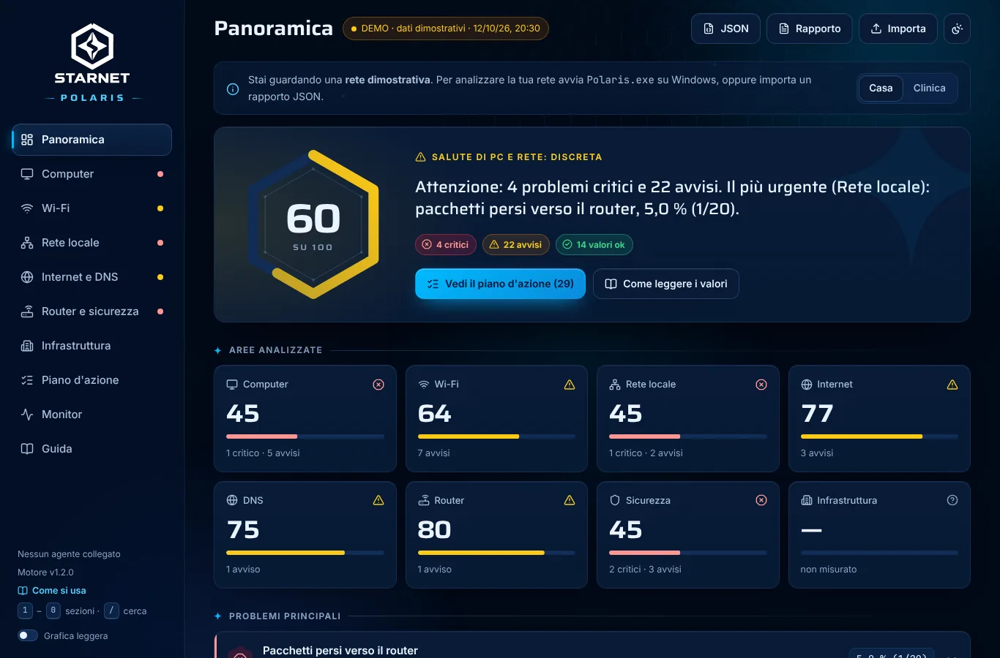

<sub>Sopra: dati dimostrativi. Sotto: la finestra su Windows reale (macchina di collaudo della CI) con i dati misurati.</sub>

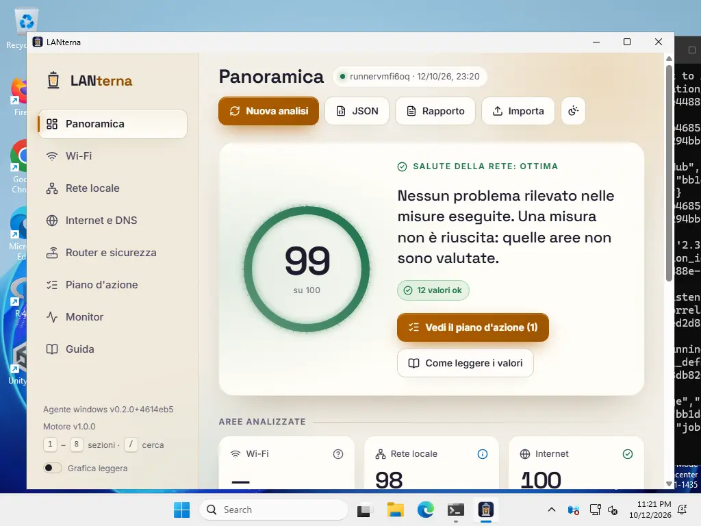

## Interfaccia

Costruita attorno al marchio STARNET: i colori sono il blu profondo `#022D62` e il ciano `#00B9FE` del logo, la geometria è
l'esagono della sua cornice, i titoli usano un carattere esteso vicino alla scritta STARNET. Il logo compare come vuole la sua
guida: bianco sui fondi scuri, a colori sui fondi chiari, senza ombre né deformazioni.

Il movimento riprende il marchio:
- all'avvio la cornice si disegna in senso orario dal vertice alto, come il tratto ciano, e le due metà della stella si incastrano
  lungo la S;
- il punteggio è un esagono che si riempie allo stesso modo;
- durante l'analisi il simbolo sta al centro, la sua cornice si completa con l'avanzamento reale e le sonde, man mano che
  finiscono, si collegano in una costellazione;
- le sezioni entrano in cascata, i numeri si assestano con una molla, il monitor scorre in modo continuo;
- le icone della sezione scelta si disegnano, quelle delle operazioni in corso si animano (scansione, test, download), i
  caricamenti percorrono l'esagono del marchio e i dati in arrivo hanno segnaposto con un riflesso.

Se in Windows le animazioni sono disattivate restano solo brevi dissolvenze: niente spostamenti, rotazioni o scorrimenti.

**Suoni**: segnali brevi e a volume basso, generati dal programma senza file audio, per il cambio di sezione, le aperture, le
operazioni riuscite, la fine di analisi e test, avvisi, errori, minacce trovate e, nel monitor, l'interruzione e il ritorno della
connessione. Si spengono con l'altoparlante nella barra in alto e la scelta resta salvata.

- **Tastiera**: `1`…`9` e `0` per le sezioni, `/` per cercare nella guida, frecce nei selettori e nelle risposte dell'autovalutazione;
  ogni comando è raggiungibile con Tab.
- **Grafica leggera**: senza accelerazione grafica (macchine virtuali, desktop remoto) Polaris se ne accorge dai fotogrammi lenti e
  toglie sfocature e trasparenze; si può anche attivare a mano in fondo alla barra laterale.
- Contrasto conforme a WCAG 2.1 AA in entrambi i temi; la gravità è sempre indicata da icona e testo, non solo dal colore.

| Wi-Fi e spettro radio | Piano d'azione con i passi guidati (tema chiaro) | Mobile |
| --- | --- | --- |
| 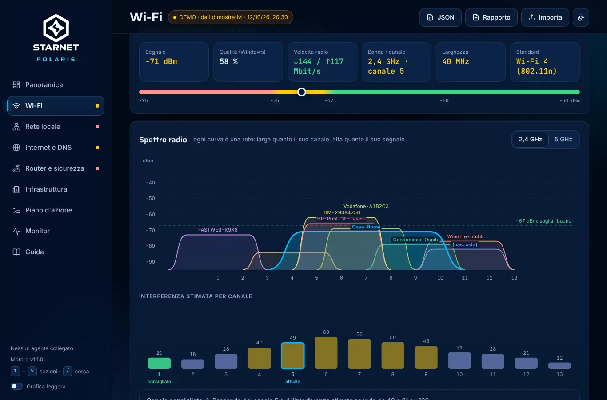 | 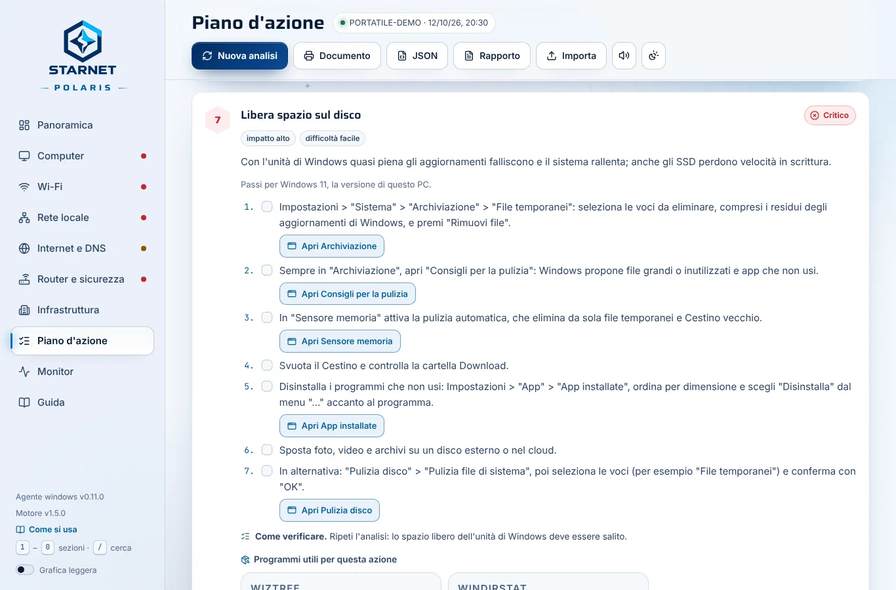 | 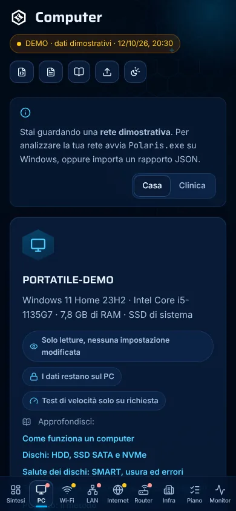 |

## Il piano d'azione, passo passo

Ogni azione del piano dice perché farla e come, un passo alla volta:

- **la versione giusta di Windows**: i passi seguono Windows 11 o Windows 10, secondo il PC analizzato, con i nomi italiani di
  menu e pulsanti tra virgolette. Sono stati verificati l'8 novembre 2026 su almeno due fonti indipendenti (guide italiane e
  pagine dei produttori di PC), perché le pagine italiane di Microsoft sono in parte tradotte automaticamente, e riletti da una
  revisione indipendente: le voci con una sola fonte o con fonti in disaccordo sono descritte senza virgolette. Valgono per Windows 11 24H2 e Windows 10 22H2: con altri aggiornamenti
  possono cambiare leggermente, e il programma lo dice;
- **Apri…**: il pulsante del passo apre la pagina di Impostazioni, del Pannello di controllo o lo strumento di Windows indicato
  (42 pagine e strumenti, da una lista bianca: dall'interfaccia arriva solo un identificativo). Apre e basta: le modifiche le fa chi usa il
  PC;
- **Apri il pannello del router**: apre nel browser l'indirizzo del router trovato dall'ultima analisi, solo se è un indirizzo
  IPv4 privato, in HTTPS quando il router lo offre; mai un indirizzo arrivato dall'interfaccia;
- **Copia**: i comandi (per esempio `chkdsk C: /scan`) si copiano e si incollano nel Prompt dei comandi; Polaris non li esegue
  mai. Quando il rapporto indica un driver ricorrente nelle schermate blu, il comando per cercarlo contiene già il suo nome,
  solo se è un semplice nome di file `.sys`;
- avvertenze per i passi che richiedono l'amministratore, che si fanno sul router o su un altro dispositivo; spunta per ogni
  passo, "Come verificare" e "Nuova analisi";
- **Programmi utili per questa azione**: i programmi della cassetta degli attrezzi che servono all'azione, con lo stato e i
  pulsanti per aprirli o scaricarli; se Polaris fa già la stessa cosa, la scheda lo dice e porta alla sezione.

Il rapporto di testo (`polaris-cli report --verbose`) contiene gli stessi passi, per la versione di Windows del PC.

## Il computer

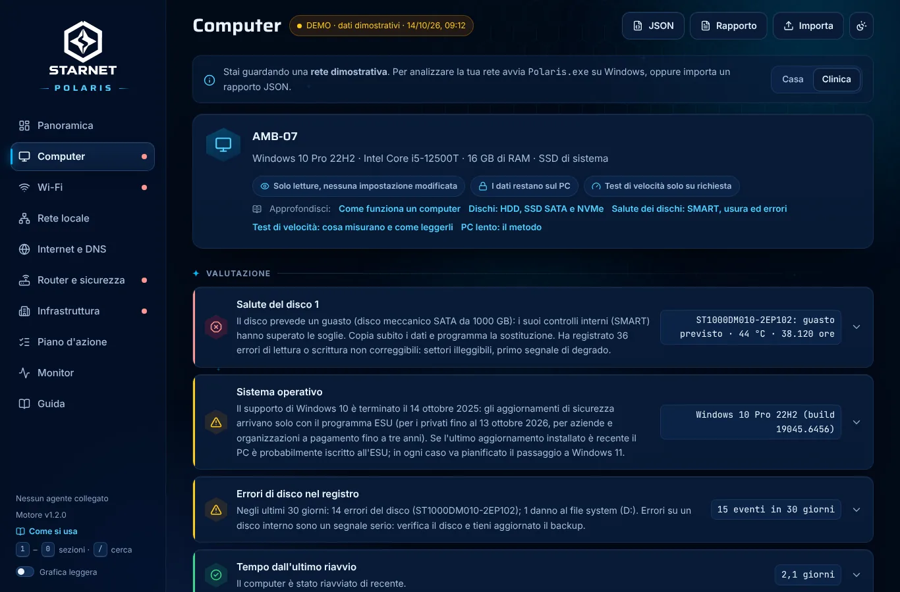

La sezione **Computer** descrive il PC da cui parte l'analisi, letto in **sola lettura** con le funzioni di Windows e un unico
script PowerShell nascosto: nessuna impostazione viene modificata.

- **Dischi**: tipo (SSD NVMe, SSD SATA, HDD, USB) e stato Buono, Attenzione o Critico con le regole di CrystalDiskInfo. Da
  amministratore Polaris legge il disco direttamente, in sola lettura: tabella degli attributi SMART dei dischi SATA (attuale,
  peggiore, soglia, dato grezzo), registro di salute NVMe (usura, riserva disponibile, dati scritti, spegnimenti non sicuri,
  errori del supporto), temperatura con la massima registrata. Errori di disco e file system dal registro eventi, collegati al
  disco coinvolto; spazio di ogni volume.
- **Sistema**: versione di Windows con le date di fine supporto (Windows 11 per versione ed edizione, Windows 10 ed ESU),
  memoria installata e in uso, carico del processore con i processi più pesanti, programmi all'avvio, tempo dall'ultimo
  riavvio (con l'effetto dell'avvio rapido) e riavvii in sospeso.
- **Stabilità e sicurezza**: spegnimenti imprevisti, schermate blu con il codice di arresto spiegato, errori hardware WHEA
  degli ultimi 30 giorni; antivirus dal Centro sicurezza; data dell'ultimo aggiornamento.
- **File delle schermate blu**, come BlueScreenView ma senza installare nulla: Polaris legge da solo i minidump che Windows
  salva a ogni schermata blu (i 50 più recenti e l'intestazione di `MEMORY.DMP`), in sola lettura. Per ognuno data e ora,
  codice di arresto con nome e significato, i quattro parametri, versione di Windows e tipo del file; per i minidump a 64 bit
  anche i driver caricati e il **driver indicato come indizio**, con il metodo usato (l'indirizzo che Microsoft documenta per
  quel codice, altrimenti il primo modulo fuori dal nucleo di Windows nello stack salvato). Niente indizio per gli errori
  segnalati dall'hardware (0x124) e per gli arresti provocati di proposito. Il motore segnala lo stesso driver o lo stesso
  codice in più schermate blu e le impostazioni che impediscono di salvare i file; mostra anche le impostazioni dei dump
  (lette, mai cambiate). Leggere i file richiede di avviare Polaris come amministratore: senza, la scheda lo dice e mostra
  codice e parametri dal registro eventi. Il formato è ricostruito da documentazione pubblica, provato su file costruiti ad
  arte e, per l'intestazione, su un dump vero di Windows creato in CI (vedi Verifiche); per l'analisi completa dello stack
  serve WinDbg, e BlueScreenView resta nel pacchetto.
- **Microsoft Defender**: protezione in tempo reale e da manomissioni, firme, ultime scansioni e cronologia delle minacce (nome,
  gravità e stato, senza percorsi dei file né nomi utente). Su richiesta, scansione rapida o completa e aggiornamento delle firme
  con lo strumento ufficiale `MpCmdRun`; una scansione si può interrompere.
- **Scheda tecnica**, come in CPU-Z: processore (famiglia, modello e stepping, core P ed E, cache per livello, istruzioni,
  virtualizzazione), scheda madre e BIOS, moduli di memoria con slot, tipo e velocità, firmware UEFI, Secure Boot, TPM, scheda
  video e schermo. Giudizi su canali e velocità della memoria, Secure Boot, TPM e requisiti verificabili di Windows 11.
- **Velocità dei core in tempo reale**, come il "Core Speed" di CPU-Z: una lettura al secondo della frequenza effettiva (media dei
  core come in Gestione attività, core più veloce, percentuale rispetto alla base con il turbo, massima della sessione, carico),
  grafico dell'ultimo minuto e una barra per processore logico. I valori vengono dai contatori delle prestazioni di Windows, senza
  driver; bus e moltiplicatore sono quelli nominali dichiarati dal firmware.
- **Sensori in tempo reale**, come la finestra dei sensori di HWiNFO ma senza driver: una lettura al secondo con valore attuale,
  minimo, massimo e media di utilizzo, frequenze e limite di prestazioni del processore, consumi (se il PC espone i contatori
  Energy Meter), zone termiche ACPI, scheda video (utilizzo per motore, memoria e, quando il driver li fornisce, temperatura,
  ventola, potenza, frequenze e tensione), memoria, attività e temperatura dei dischi, rete, batteria e sistema. Grafico di ogni
  sensore, righe di dettaglio per processore logico, avvisi con suono quando una temperatura supera la soglia di attenzione o
  un sensore entra in allarme, registro CSV per Excel (da riga di comando scritto riga per riga, anche per ore).
  Ciò che richiede un driver in kernel (temperature, tensioni e ventole di processore e scheda madre) resta a HWiNFO, e Polaris
  lo dice.
- **Cosa occupa spazio**, come WizTree ma senza installare nulla: su richiesta legge l'elenco di file e cartelle di un'unità
  (decine o centinaia di voci per chiamata con `GetFileInformationByHandleEx`, in parallelo), senza aprire i file e senza
  cancellare nulla. Mostra la barra dell'unità, una mappa a riquadri navigabile, la tabella delle cartelle con "Apri in Esplora
  file", i 100 file più grandi, i tipi di file e le cartelle note di Windows (file temporanei, Windows.old, aggiornamenti, cache
  dei browser, Cestino, WinSxS, ibernazione, dischi virtuali...) divise in "si libera con Windows", "da rivedere", "da
  impostazione" e "non toccare", ognuna con il modo sicuro di recuperare spazio. Conta lo spazio occupato davvero sul disco, i
  file di Windows con più nomi (collegamenti fisici tra WinSxS e System32) una volta sola e i file solo online di OneDrive a
  parte, senza scaricarli; non segue giunzioni e link simbolici; dice quanto spazio non si vede dai file leggibili. Nei percorsi
  il profilo diventa `%USERPROFILE%`, gli altri utenti `‹utente N›` (anche in Windows.old e sulle altre unità), gli indirizzi
  e-mail `‹e-mail›` e i SID del Cestino perdono la parte che identifica il PC. Il motore stima lo spazio recuperabile e aggiunge al piano
  le azioni mirate (rimuovere Windows.old, liberare i file temporanei, rivedere i download, compattare i dischi virtuali).
- **Alimentazione**: salute della batteria, piano di alimentazione, driver della scheda video.
- **Dispositivi e driver**, come Gestione dispositivi (dalla 0.12.0): i dispositivi con un problema e il suo codice spiegato
  (Codice 10, 28, 43...), i driver di terze parti per rete, dischi, Bluetooth, audio e chipset dal più vecchio, la verifica delle
  firme dei driver (modalità test, debug del kernel, integrità della memoria) e il collegamento con il driver indicato dalle
  schermate blu. Solo codici del produttore (VEN/DEV, VID/PID), mai identificativi con numeri di serie; nell'elenco dei
  dispositivi i nomi che possono essere scelti dall'utente (telefoni, dispositivi Bluetooth, code di stampa) sono sostituiti dal
  tipo.
- **Avvio e affidabilità**: durata dell'avvio misurata da Windows (mediana degli ultimi avvii, fino al desktop e dopo
  l'accesso) e componenti segnalati come lenti, programmi che si chiudono da soli o si bloccano con il modulo in errore, indice
  di stabilità di Monitoraggio affidabilità.
- **Aggiornamenti e controlli di Windows**: aggiornamenti non riusciti con il codice di errore spiegato, servizio Windows
  Update e criteri, esito della Diagnostica memoria Windows, volumi da controllare all'avvio e stato del file system.
- **Protezione dei dati e degli accessi**: cifratura del disco (BitLocker o crittografia del dispositivo, con le protezioni
  della chiave ma mai la chiave di ripristino), punti di ripristino, backup di Windows e cartelle in OneDrive, account locali
  senza nomi (amministratori, Administrator e Guest, password non richiesta), accesso automatico (della password solo se è
  presente), Desktop remoto con NLA, Controllo dell'account utente e blocco automatico dello schermo.
- **Stampanti**: stato di ogni stampante (non in linea, carta o toner esauriti, inceppamenti), lavori fermi in coda e servizio
  di stampa, mai titoli dei documenti né nomi di chi stampa. La stampante ha il nome che le dà Windows, per riconoscerla;
  quelle reindirizzate da Desktop remoto, il cui nome contiene quello del computer remoto, compaiono come «Stampante
  reindirizzata (Desktop remoto)». Della porta resta il nome solo se non dice nulla di chi usa il PC (USB001, WSD, un
  indirizzo privato...): gli altri nomi di rete, che spesso contengono l'indirizzo MAC della stampante, diventano «nome di
  rete», i file «file».
- **Dispositivi USB**, come UsbTreeView: controller, hub e porte occupate con produttore e modello, versione USB e
  **velocità a cui ogni dispositivo sta funzionando davvero**; porte in errore (sovraccarico, corrente o banda insufficiente,
  dispositivo non riconosciuto) e dispositivi USB 3 che vanno a velocità USB 2, con la causa più probabile (porta, cavo o hub
  USB 2). Polaris legge ciò che gli hub hanno registrato al collegamento, senza interrogare i dispositivi e senza numeri di
  serie.
- **Test di velocità** (solo su richiesta): il processore comprime dati con un thread e con tutti per circa 25 secondi e rivela
  il calo dovuto a calore o limiti di potenza; il disco scrive e rilegge un file temporaneo fino a 1 GB senza cache di Windows
  con il profilo di CrystalDiskMark (SEQ1M Q8T1, SEQ1M Q1T1, RND4K Q32T1, RND4K Q1T1, in lettura e scrittura) e lo cancella
  alla fine anche se il test si interrompe (`FILE_FLAG_DELETE_ON_CLOSE`). I risultati si confrontano con quelli tipici del tipo
  di disco ed entrano nel rapporto; le prove precedenti restano sul PC per il confronto "prima e dopo".
- **Test della RAM con Windows acceso** (dalla 0.12.0, solo su richiesta e con conferma), come HCI MemTest: Polaris riserva
  la memoria libera lasciandone una parte a Windows, la blocca in RAM e la prova con più schemi (indirizzo in ogni cella,
  inversioni con schemi fissi e casuali, sequenza casuale, spostamento di blocchi, decadimento dei bit nella versione lunga) per
  3, 10 o 30 minuti, su tutti i processori; si interrompe quando vuoi e si ferma da solo se Windows resta a corto di memoria.
  La memoria usata da Windows si prova da chiavetta con Memtest86+, che Polaris aiuta a preparare.
- **Cassetta degli attrezzi**: 16 strumenti di Windows (Gestione attività, Monitoraggio affidabilità, Visualizzatore eventi,
  Diagnostica memoria...) e 19 programmi gratuiti di diagnostica, con che cosa fanno, licenza, sito ufficiale e dove Polaris fa
  una cosa simile. Tutto passa da una lista bianca: dall'interfaccia arriva solo un identificativo, mai un percorso o un comando.
  - **Inclusi** nella cartella `strumenti`: CrystalDiskInfo 9.9.2 e CrystalDiskMark 9.0.3 (licenza MIT, eseguibili firmati da
    CrystalMark Inc.), BlueScreenView 1.55 (gratuito, ridistribuibile senza modifiche) e UsbTreeView 4.8.0 (freeware di Uwe
    Sieber, che ne consente l'inclusione senza modifiche: solo la versione per l'architettura del pacchetto). Copie originali
    che si aprono con un clic, senza installare nulla; Polaris le avvia solo se l'eseguibile ha l'impronta SHA-256 attesa.
  - **Scaricati dal sito ufficiale**, solo su richiesta: CPU-Z, HWiNFO, AdwCleaner, Microsoft Safety Scanner, ESET Online
    Scanner, Autoruns, Process Explorer, WizTree e Rufus; Memtest86+ è un'immagine da scrivere su una chiavetta con Rufus,
    verificata con l'impronta pubblicata dal progetto: Polaris non la apre, mostra la cartella che la contiene. HCI MemTest è un
    collegamento al sito. Prima di scaricare Polaris dice da dove, chi deve aver firmato, quanto pesa e
    con quali condizioni d'uso. Il download segue solo https e gli host del produttore, scarta file troppo grandi o pagine web al
    posto del programma, controlla l'impronta SHA-256 delle versioni fissate e la firma digitale (stato valido ed editore atteso)
    al download e a ogni avvio. I programmi restano in `%LOCALAPPDATA%\STARNET Polaris\strumenti`; una copia modificata non
    parte e si elimina dalla cassetta.
  - **Kit per i PC senza Internet**: su un PC collegato Polaris scarica i programmi scelti nella cartella `strumenti-scaricati`
    accanto a Polaris.exe; copiata la cartella di Polaris su una chiavetta, sui PC senza rete li trova lì e li avvia con le stesse
    verifiche. Il kit è per uso proprio: le licenze dei produttori non ne consentono la ridistribuzione.
- **Documento stampabile**: in A4, con punteggio e voto, le cinque cose da sistemare per prime, sistema, sicurezza, dischi e
  spazio, valutazione completa, scheda tecnica, stabilità, test di velocità, piano d'azione con caselle da spuntare e spazio per
  note e firma. Dall'interfaccia si stampa, si salva in PDF o si scarica in HTML autonomo; da riga di comando
  `polaris-cli report --html`. Non contiene numeri di serie, indirizzi MAC né l'IP pubblico.

Il punteggio della panoramica descrive PC e rete insieme; un disco che sta per guastarsi diventa il problema più urgente e la
prima azione del piano (copiare i dati). Nei rapporti la cartella dell'utente diventa `%USERPROFILE%` e non compaiono numeri di
serie.

| Test di velocità | Dischi e attributi SMART |
| --- | --- |
| 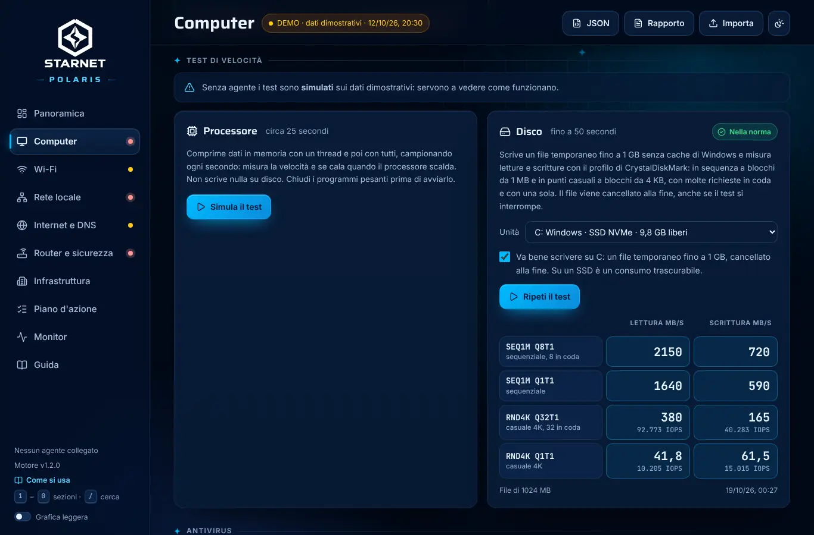 | 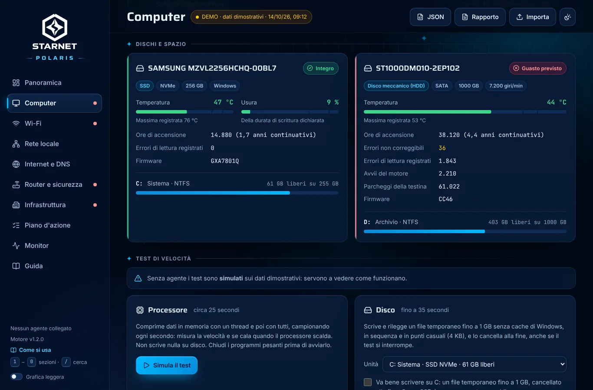 |

| Scheda tecnica | Microsoft Defender | Programmi inclusi (exe reale sotto Wine) |
| --- | --- | --- |
| 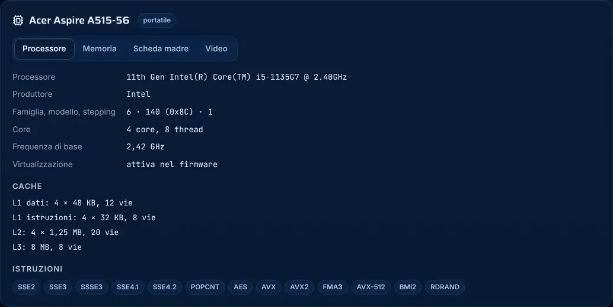 | 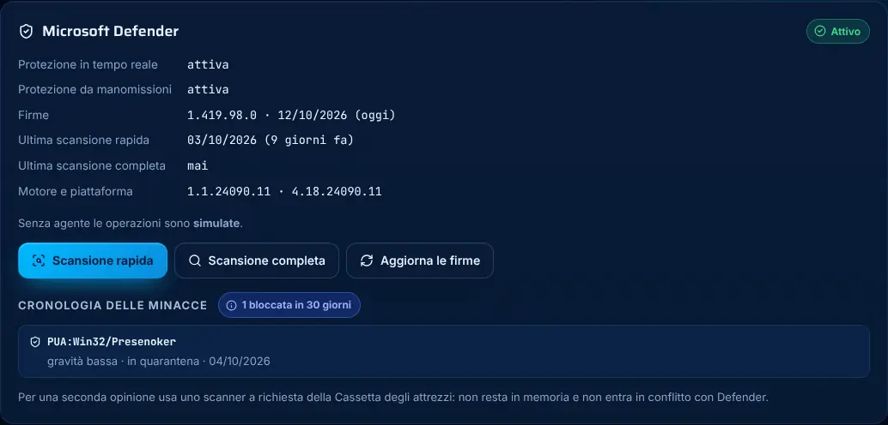 | 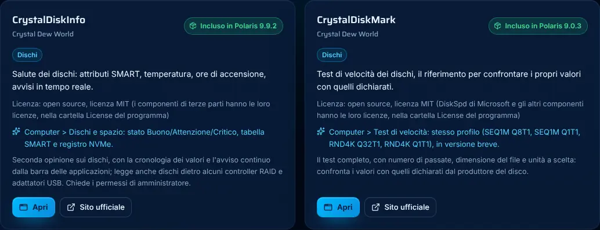 |

| Documento stampabile | Kit per i PC senza Internet (agente simulato) |
| --- | --- |
| 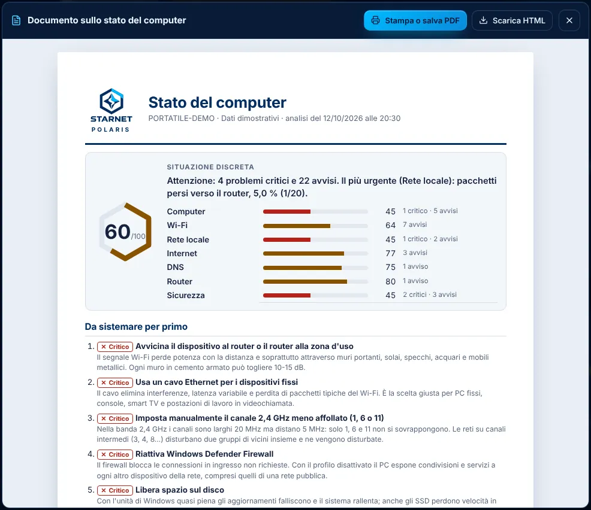 | 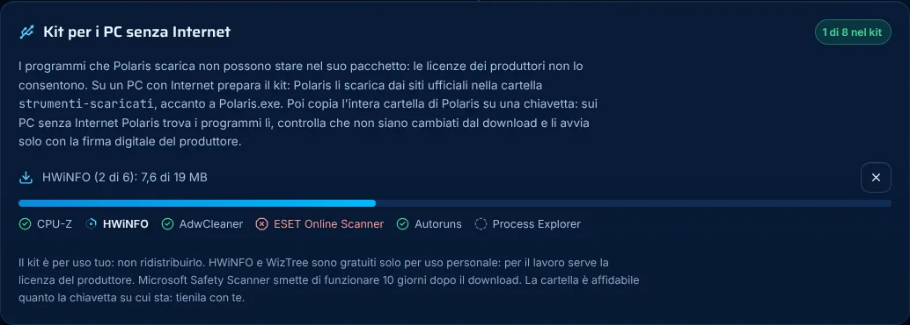 |

| Sensori in tempo reale (demo: il portatile si scalda e limita il processore) |
| --- |
| 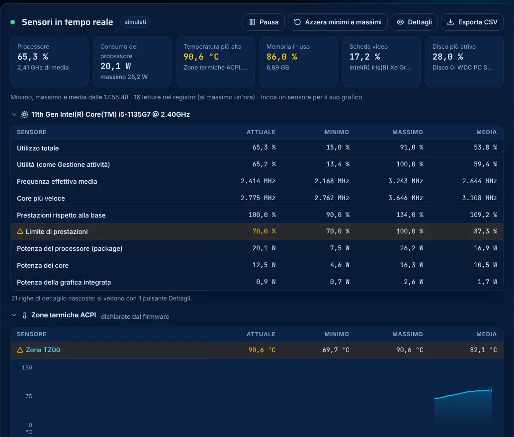 |

| Cosa occupa spazio (demo: C: quasi pieno per Windows.old, download e video) |
| --- |
| 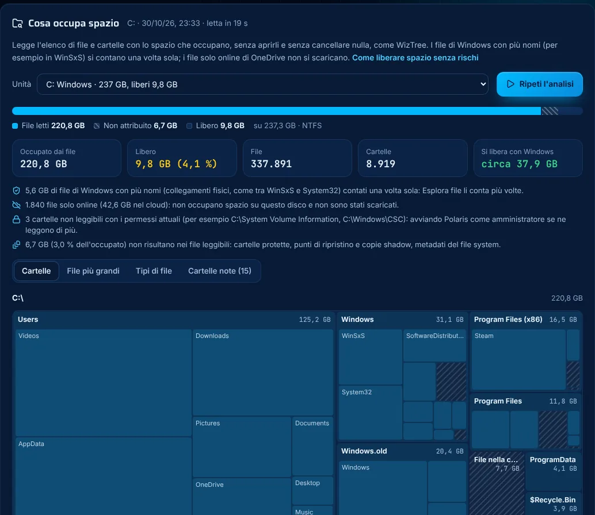 |

## Cosa misura

| Area | Misure |
| --- | --- |
| Computer | versione e supporto di Windows, RAM installata e in uso, carico del processore e processi, velocità dei core in tempo reale, salute dei dischi (stato, attributi SMART, registro NVMe, usura, temperatura, errori), tipo del disco di sistema, spazio per volume, cosa occupa spazio (cartelle, file più grandi, tipi di file, cartelle note di Windows, spazio recuperabile), programmi all'avvio, riavvio e riavvii in sospeso, spegnimenti imprevisti, schermate blu e loro file (codice, parametri, driver indicato, impostazioni dei dump), errori hardware e di disco nel registro, antivirus e Microsoft Defender (protezione, firme, scansioni, minacce), ultimo aggiornamento, batteria, piano di alimentazione, driver video, scheda tecnica (processore, memoria e canali, scheda madre, firmware, Secure Boot, TPM, video) |
| Test di velocità (su richiesta) | processore con un thread e con tutti, punta e velocità mantenuta; disco con il profilo di CrystalDiskMark (SEQ1M Q8T1, SEQ1M Q1T1, RND4K Q32T1, RND4K Q1T1), in MB/s e IOPS |
| Antivirus (su richiesta) | scansione rapida o completa e aggiornamento delle firme di Microsoft Defender |
| Wi-Fi | potenza in dBm, qualità, velocità radio, banda, standard (Wi-Fi 4…7), larghezza di canale, reti sullo stesso canale, canali 2,4 GHz sovrapposti, carico dichiarato dall'access point (BSS Load), sicurezza (WPA2/WPA3 Personal ed Enterprise, TKIP, PMF, WPS), canale consigliato per 2,4 e 5 GHz |
| Mappa del Wi-Fi (su richiesta) | per ogni stanza: segnale una volta al secondo per 15 secondi (mediana, peggiore 10 %, oscillazione), cambi di access point, perdite, tempi e jitter verso il router, reti vicine sullo stesso canale; giudizio per stanza e azioni |
| Reti con più access point | AP della rete con canali, segnale, carico e roaming assistito (802.11k, 802.11v, 802.11r e Mobility Domain), AP propri sullo stesso canale, PC agganciato a un AP lontano (sticky client), stessa rete annunciata con protezioni diverse (possibile AP gemello) |
| Rete locale | indirizzo, DHCP e server DHCP (APIPA), gateway, latenza/perdite/jitter verso il router, velocità della porta Ethernet, IPv6, sottoreti molto ampie, dominio e DNS aziendali, stesso MAC per più indirizzi, MAC del router cambiato rispetto all'analisi precedente, dispositivi visti di recente |
| Internet | latenza, perdite e jitter verso Cloudflare, Google e Quad9, traceroute, MTU del percorso, navigazione HTTPS reale |
| Velocità di Internet (su richiesta, con consenso) | download e upload con Measurement Lab (ndt7), latenza a riposo e sotto carico (bufferbloat), ritrasmissioni, server usato |
| DNS | tempo di risposta del DNS in uso e confronto con i resolver pubblici |
| Router e sicurezza | servizi esposti dal *proprio* router (Telnet, FTP, SMB…), UPnP IGD e indirizzo pubblico, pannello di gestione HTTP/HTTPS, profili del firewall di Windows |
| Infrastruttura (su richiesta) | inventario della sottorete, test di segmentazione tra le zone, raggiungibilità e tempi dei servizi critici, certificati dei servizi interni (scadenza, nomi, emittente, versione di TLS, attendibilità su questo PC), autovalutazione organizzativa in sei aree |
| Monitor | un ping al secondo verso router e Internet per tutta la sessione (fino a 12 ore, anche cambiando sezione), con picchi, interruzioni e relativa ora; esportazione CSV |

## Wi-Fi stanza per stanza e velocità di Internet

- **Mappa del Wi-Fi per stanza** (sezione Wi-Fi): si scrive il nome della stanza, si resta fermi con il portatile dove si
  lavora e Polaris misura per circa 15 secondi il segnale (una lettura al secondo), i cambi di access point e un ping al router
  ogni 200 ms, poi fa una scansione delle reti. Ogni stanza ha un giudizio (segnale, oscillazioni, perdite, jitter, reti sullo
  stesso canale) e le azioni conseguenti: dove mettere un access point, separare le bande, cambiare canale, collegare via cavo
  gli access point. Soglie con fonte: -67 dBm per la voce su Wi-Fi (Cisco), -72 dBm di copertura predefinita (Juniper
  Mist), perdite sotto l'1 % e jitter sotto 30 ms (Microsoft Teams); le altre sono scelte di Polaris e lo dice. Un router che ignora i ping non rende critica la stanza. Gli access
  point della rete compaiono negli export come "AP A", "AP B"; delle reti vicine si conservano solo conteggi, canali e segnali.
  I ping vanno solo al router, se ha un indirizzo privato; nessuna impostazione della scheda viene cambiata.
- **Velocità di Internet** (sezione Internet): solo su richiesta e dopo una finestra di **consenso a ogni test**, Polaris usa il
  protocollo ndt7 di [Measurement Lab](https://www.measurementlab.net/) (M-Lab), un progetto senza scopo di lucro: latenza a
  riposo per 5 secondi, poi 10 secondi di download e 10 di upload (fino a circa 250 MB per verso) mentre continua a misurare la
  latenza, così si vede quanto cresce sotto carico (bufferbloat). M-Lab **pubblica** ogni risultato con l'indirizzo IP pubblico
  della connessione; Polaris non salva né stampa l'IP. Al massimo un test ogni 2 minuti e 10 al giorno, anche da riga di comando (il conteggio sta in un piccolo file locale con giorno, numero e ora dell'ultimo test). La velocità è sempre
  informativa: Polaris non conosce il contratto; per le contestazioni vale la misura certificata di AGCOM (Ne.Me.Sys.).

## Reti complesse e strutture sanitarie

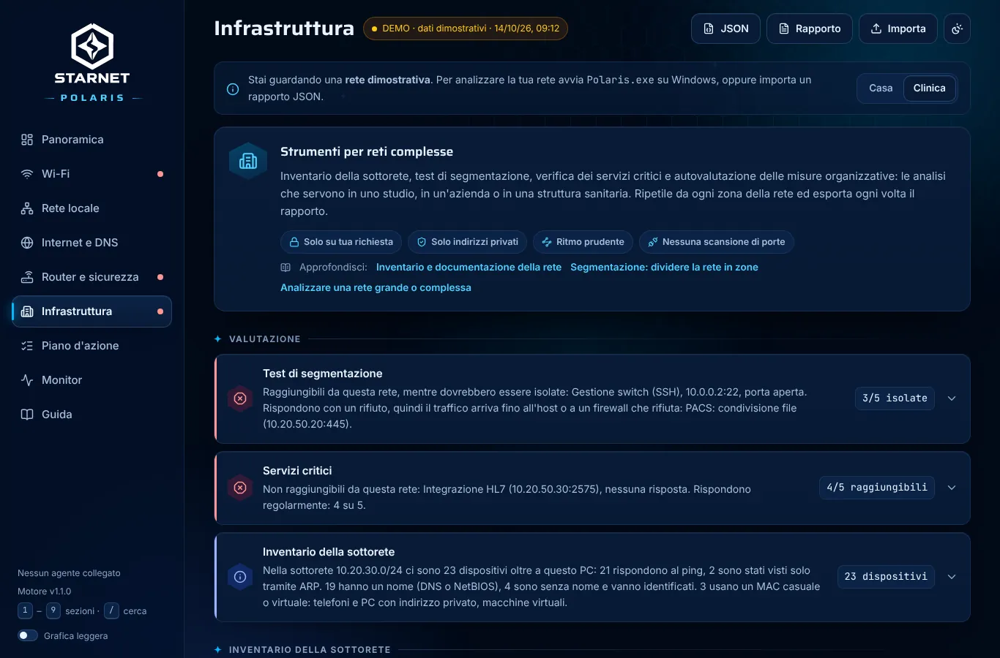

La sezione **Infrastruttura** raccoglie gli strumenti per le reti con più zone. Contattano altri dispositivi, quindi seguono
regole precise: partono **solo su richiesta**, l'inventario chiede la conferma di essere autorizzati (con l'attività concordata
con l'ingegneria clinica dove ci sono dispositivi medicali), si rivolgono **solo a indirizzi privati**, con un **ritmo prudente**
e **senza scansioni di porte**.

- **Inventario della sottorete**: un ping a ogni indirizzo (circa 30 al secondo, 8 alla volta), poi la tabella ARP, che rivela
  anche i dispositivi che ignorano il ping, e i nomi da DNS inverso e NetBIOS. Durante il ping Polaris ascolta anche gli annunci
  mDNS e SSDP (stampanti, TV, NAS e telecamere si presentano da soli), legge i ruoli NetBIOS e il TTL e ricava il produttore dal
  MAC con l'elenco pubblico IEEE incorporato: così riconosce il **tipo di ogni dispositivo**, con l'icona e il perché. Elenco
  filtrabile ed esportabile in CSV con tipo e produttore; segnala i dispositivi senza nome, i MAC casuali e la sottorete quasi
  piena. Oltre /22 si esamina solo il blocco /24 del PC.
- **Mappa della rete** (sezione Rete locale, dalla 0.13.0): le zone sono la rete del PC, le altre VLAN con il loro nome e le reti
  Wi-Fi trasmesse dagli stessi access point; i pacchetti animati mostrano da dove passa il traffico di questo PC verso Internet,
  il DNS e i servizi verificati, e si fermano dove le regole bloccano come previsto. Zoom, spostamento, filtri per tipo, ricerca,
  dettagli di ogni dispositivo ed elenco testuale accessibile.
- **Il traffico passo passo** (sotto la mappa, dalla 0.13.0): per sei azioni comuni (aprire un sito, ricevere l'indirizzo dal
  DHCP, un ping al router, il percorso verso Internet, i servizi verificati e le zone isolate, una stampa) i pacchetti che il
  protocollo prevede, con gli indirizzi e i tempi misurati dall'analisi: dispositivi disegnati a linee e pacchetti che viaggiano
  con la loro etichetta, vista a sequenza, dettagli di ogni passo e tabella dei pacchetti come in un analizzatore di rete, con i
  colori dei protocolli. I pacchetti verso una zona isolata si fermano al firewall; una risposta che arriva da una zona che
  doveva essere isolata è segnata in rosso. È una ricostruzione didattica: Polaris non registra il traffico e non invia nulla.
- **Reti e VLAN** (dalla 0.13.0): le altre reti senza doverle scrivere, ognuna con la fonte da cui risulta. Oltre alle rotte del
  PC (anche quelle ricevute dal DHCP) e ai server DNS e DHCP in altre reti: l'**ascolto degli annunci dello switch** per circa un
  minuto (LLDP, LLDP-MED, CDP, DTP, Spanning Tree e PVST+), senza trasmettere nulla, che dice switch, porta, VLAN della porta e
  della voce; le **sottoreti di Active Directory** per i PC in un dominio; la **lettura SNMP in sola lettura** di router e switch
  con le credenziali del tecnico (SNMPv3 o v2c), che restano in memoria solo per la lettura; l'**inventario di un'altra rete**
  attraverso il router. Un pulsante porta le reti scoperte nel **test di segmentazione**. Giudizi su duplex e velocità della
  porta, DTP attivo (VLAN hopping), postazioni nella VLAN 1, radice dello Spanning Tree e configurazione SNMP.
- **Test di segmentazione e servizi critici**: si indicano le destinazioni che da questa zona devono rispondere (cartella
  clinica, PACS, HL7, DNS, controller di dominio…) e quelle che devono restare isolate (dispositivi medicali, gestione degli
  apparati, telecamere, ospiti). Per ognuna una connessione TCP alla porta indicata o due ping; le destinazioni si ricordano per
  rete. Una risposta da una zona che doveva essere isolata è un problema critico.
- **Certificati dei servizi interni**: si indicano i servizi cifrati della rete locale (cartella clinica, PACS su DICOM TLS,
  NAS, pannello del router, posta con STARTTLS, LDAPS) e Polaris legge il certificato durante la negoziazione TLS, poi chiude
  senza inviare dati né credenziali. Per ognuno: scadenza e durata, nomi coperti, emittente o autofirmato, chiave e firma,
  versione di TLS (e se il servizio accetta ancora TLS 1.0/1.1), richiesta di un certificato client, impronta SHA-256 e
  attendibilità come la vede Windows su questo PC, con i soli certificati già presenti (niente download, niente controllo della
  revoca). Solo indirizzi privati, al massimo 20 servizi; un nome deve portare solo a indirizzi privati.
- **Autovalutazione**: 28 domande su segmentazione, dispositivi medicali, accessi e fornitori, backup, continuità e gestione
  degli incidenti. Le risposte restano sul PC ed entrano nel rapporto; ogni lacuna aggiunge al piano l'azione corrispondente. È
  una dichiarazione, non una verifica, e non sostituisce un audit.

Nelle reti con dominio Polaris non suggerisce di cambiare DNS sul PC (romperebbe i nomi interni) ma di potenziare il DNS interno.
Senza agente, le due reti dimostrative (*Casa* e *Clinica*) mostrano tutte le funzioni con dati e simulazioni dichiarati come tali.

| AP della rete (demo Clinica) | Esiti delle verifiche | Autovalutazione (tema chiaro) |
| --- | --- | --- |
| 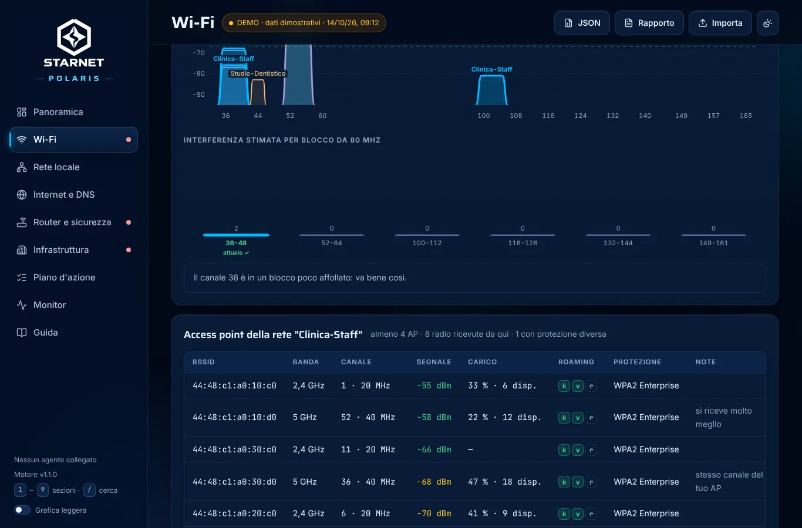 | 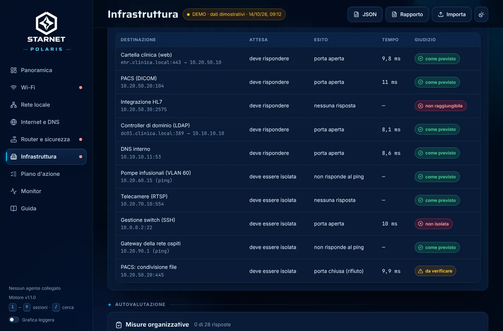 | 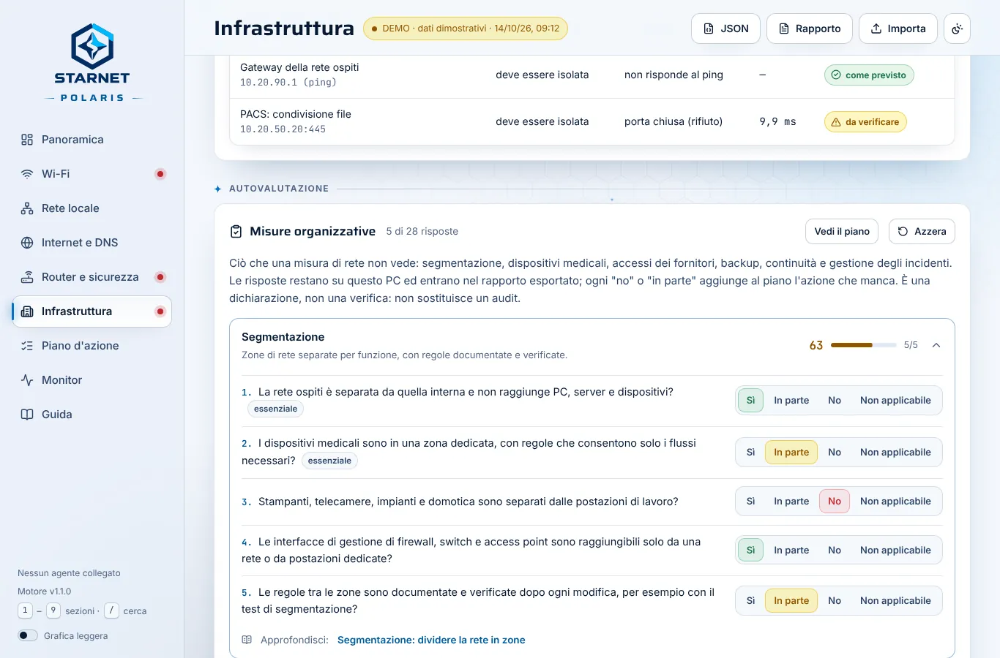 |

## Guide

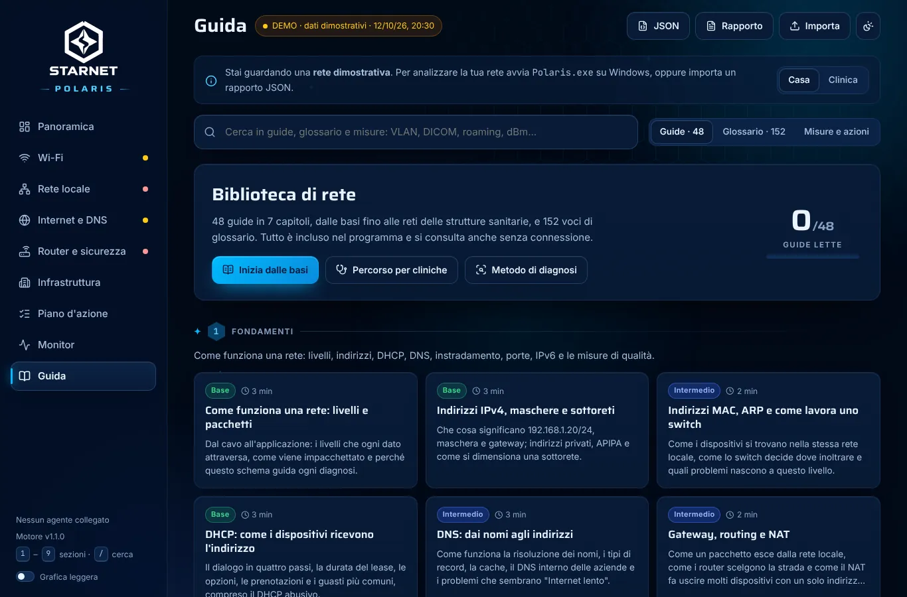

79 guide in nove capitoli (usare STARNET Polaris, il computer, fondamenti, Wi-Fi, rete cablata, servizi, sicurezza, reti
complesse e sanità, diagnosi), un glossario di 235 voci e la ricerca unificata su guide, glossario, misure e azioni. La guida
d'uso parte dai primi passi e arriva alla riga di comando e alla cassetta degli attrezzi; il capitolo sul computer spiega
componenti, scheda tecnica, sensori in tempo reale, dischi HDD e SSD, attributi SMART, cosa occupa spazio e come liberarlo, test di velocità, memoria, avvio, aggiornamenti, antivirus e
Microsoft Defender, registro eventi, file delle schermate blu, batteria e il metodo per un PC lento; quelli sulla rete anche la
misura del Wi-Fi stanza per stanza, i certificati dei servizi interni e che cosa dice (e non dice) un test di velocità. Le date di supporto di
Windows citate sono quelle note a metà 2026 e vanno verificate sul sito Microsoft. Ogni valore misurato e ogni azione del piano rimandano
alla guida che li spiega; diciassette schemi animati illustrano livelli, sottoreti, DHCP, canali, roaming, VLAN, zone di una rete
sanitaria, mappa della rete, annunci LLDP, instradamento tra VLAN, SNMP, traceroute, velocità USB, test della RAM, fasi
dell'avvio, percorso di stampa e Memtest86+ su chiavetta. **Nove videoguide** (dalla 0.13.0) uniscono scene animate e una
narrazione letta dalla voce italiana di Windows (Elsa, se installata), con sottotitoli, capitoli, velocità e trascrizione: si
usano solo le voci del PC, quindi il testo non esce dal computer, e senza voce italiana restano i sottotitoli. I riferimenti normativi citati (GDPR, NIS2, dispositivi medicali) sono una sintesi da verificare sui testi ufficiali,
non una consulenza legale.

## Piattaforme

| Piattaforma | Stato |
| --- | --- |
| **Windows 10/11** | programma portatile (`Polaris.exe`, nessuna installazione) con finestra nativa WebView2, rapporto da riga di comando e interfaccia nel browser |
| Android | progettato, da realizzare: [docs/ANDROID.md](docs/ANDROID.md) |
| ESP32 | progettato, da realizzare: [docs/ESP32.md](docs/ESP32.md) |

Tutte le piattaforme condividono lo **stesso nucleo**: interfaccia e motore di analisi in TypeScript (`core/`). Le sonde di ogni
piattaforma producono solo dati grezzi in un formato comune; l'interpretazione è sempre la stessa. Dettagli in
[docs/ARCHITETTURA.md](docs/ARCHITETTURA.md).

## Uso su Windows

Scarica `STARNET-Polaris-<versione>-windows-amd64.zip` dalla pagina [Releases](https://github.com/number959/Lanterna/releases) (con il file `.sha256` per controllare l'impronta), estrai la cartella e fai doppio clic su `Polaris.exe`. L'analisi parte da sola e dura circa 25 secondi.
Nella cartella `strumenti` ci sono CrystalDiskInfo, CrystalDiskMark e BlueScreenView: si aprono dalla cassetta degli attrezzi.

```text
polaris-cli report                  rapporto a schermo
polaris-cli report --verbose        con spiegazioni e passi per la versione di Windows del PC
polaris-cli report --out r.txt      salva il rapporto (UTF-8, si apre col Blocco note)
polaris-cli report --json           dati grezzi, riapribili nell'interfaccia con "Importa"
polaris-cli serve --open            interfaccia nel browser su http://127.0.0.1:8737
polaris-cli bench cpu               test di velocità del processore (circa 25 secondi)
polaris-cli bench disk --drive D:   test di un'unità (file temporaneo cancellato alla fine)
polaris-cli bench ram --preset standard   test della RAM con Windows acceso (quick 3 min, standard 10, long 30)
polaris-cli defender status         stato di Microsoft Defender e minacce
polaris-cli defender quick          scansione rapida (full: completa; update: firme)
polaris-cli report --html --out stato-pc.html   documento stampabile sullo stato del PC
polaris-cli tools kit               kit per i PC senza Internet in strumenti-scaricati (--all: anche Safety Scanner)
polaris-cli tools status            programmi scaricati, sul PC e nel kit
polaris-cli clock                   velocità dei core in tempo reale (--seconds N, --json)
polaris-cli sensors --seconds 600 --csv sensori.csv   sensori come HWiNFO, con registro per Excel (--all, --json)
polaris-cli space C: --top 30       cosa occupa spazio, come WizTree (anche una cartella; --json)
polaris-cli certs nas.studio.local:5001 10.0.0.5   certificati dei servizi della rete locale (--json)
polaris-cli crashes                 file delle schermate blu, come BlueScreenView (da amministratore; --json)
polaris-cli wifi-survey Soggiorno   misura il Wi-Fi in questa stanza (--secondi 10-20, --senza-scansione, --json)
polaris-cli speedtest --accetto     test di velocità di Internet con M-Lab (senza --accetto mostra il consenso; --json)
```

Su Windows 11 24H2 e successivi la lettura delle reti Wi-Fi richiede il permesso di posizione per le app desktop: Polaris lo
rileva e spiega come attivarlo. Non servono privilegi di amministratore; avviando Polaris come amministratore compaiono anche
attributi SMART, registro NVMe, temperatura, usura ed errori dei dischi (e la temperatura dei dischi SATA nel monitor dei
sensori).

## Sviluppo

Requisiti: Node.js 20+, Go 1.27+ (il file go.mod indica la versione esatta e Go la scarica da solo); per i programmi inclusi curl e unzip (o Python 3). Si compila da Linux, macOS o Windows.

```bash
cd core && npm ci && npm test        # motore di analisi (vitest)
npm run dev                          # interfaccia con i dati dimostrativi su http://localhost:5173
cd ../windows && go test ./...       # agente Windows (gira anche su Linux)
cd .. && scripts/build-windows.sh    # build/STARNET-Polaris/ e build/STARNET-Polaris-windows-amd64.zip
```

**Pubblicare una versione**: con la CI verde sul commit, Actions > Release > Run workflow con il numero di versione. Il
workflow controlla che `core/package.json` e `windows/winres/winres.json` siano alla stessa versione e che esistano le note
`docs/release/<versione>.md`, rifà test e build in un ambiente pulito, crea il tag `v<versione>` e la release con il
pacchetto e la sua impronta SHA-256 (anche come bozza, se scelto).

La build scarica gli archivi originali di CrystalDiskInfo e CrystalDiskMark dalla pagina SourceForge del produttore e di
BlueScreenView da nirsoft.net, li verifica con l'impronta SHA-256 fissata in `scripts/strumenti.sh` e li estrae senza modifiche in
`strumenti/`; gli archivi restano in `build/cache-strumenti/`. Con `STRUMENTI=no scripts/build-windows.sh` il pacchetto esce senza
programmi inclusi.

`npm run dev` usa i dati dimostrativi (la rete *Casa*; dal selettore nell'avviso si passa a *Clinica*); con `polaris-cli serve`
avviato, il server di sviluppo inoltra `/api` all'agente vero.

Fino alla versione 0.2.0 il programma si chiamava LANterna: il repository e il modulo Go conservano quel nome interno.
I master del marchio sono in `brand/`; `node scripts/brand.mjs` rigenera i tracciati usati dall'interfaccia.

## Alternative open source

Quali programmi open source o quali funzioni native possono sostituire i download (CPU-Z, HWiNFO, Process Explorer, Autoruns,
WizTree, scanner antivirus), con licenze verificate, limiti e priorità, e lo stato di ciascun programma: che cosa Polaris fa già
da sé, che cosa arriva e in quale versione, che cosa resta impossibile senza un driver o un motore antivirus:
[docs/ALTERNATIVE-OPEN-SOURCE.md](docs/ALTERNATIVE-OPEN-SOURCE.md). Il piano dei rilasci è in [docs/PIANO.md](docs/PIANO.md).

## Verifiche

Cosa è stato verificato e come, inclusa l'esecuzione dell'exe sotto Wine e su Windows reale in CI, e cosa resta da provare su un
PC con scheda Wi-Fi: [docs/VERIFICHE.md](docs/VERIFICHE.md).

## Privacy e sicurezza

- Tutto resta sul PC: nessun dato viene inviato a servizi esterni, con una sola eccezione che decidi tu, il test di velocità di
  Internet (vedi sotto).
- **Test di velocità di Internet**: parte solo dopo il consenso, chiesto a ogni test. Measurement Lab riceve e pubblica per
  sempre, in un archivio aperto, il risultato con l'indirizzo IP pubblico della connessione, data, ora e nome del programma;
  Polaris non salva né stampa l'IP e non invia altri dati del PC. Con un IP fisso (studi, aziende, strutture sanitarie) il
  risultato resta collegato a quell'indirizzo: va deciso secondo le regole interne. Informativa di M-Lab:
  https://www.measurementlab.net/privacy/.
- La **mappa del Wi-Fi** contatta solo il router (se ha un indirizzo privato); gli access point della rete compaiono negli
  export con un alias e le reti vicine solo come conteggi.
- I **file delle schermate blu** si leggono senza modificarli; dei driver si mostrano solo i nomi dei file e dai percorsi delle
  impostazioni spariscono i nomi utente.
- Il server locale ascolta solo su `127.0.0.1`, rifiuta host diversi (DNS rebinding) e richieste da altre origini.
- Il controllo dei servizi esposti riguarda **esclusivamente il gateway** della rete a cui si è collegati, senza autenticarsi.
- Inventario e verifiche partono solo su richiesta, solo verso indirizzi privati (RFC 1918 e ULA IPv6) e senza scansioni di
  porte: l'inventario contatta i dispositivi della sottorete del PC, o di un'altra sottorete privata indicata dall'utente
  attraverso il router, le verifiche solo le destinazioni indicate dall'utente. Le API locali rifiutano richieste senza
  conferma, con destinazioni non valide o pubbliche. Durante l'inventario una domanda mDNS e una ricerca SSDP restano nella
  rete del PC (indirizzi multicast locali); dei servizi annunciati si tengono solo i tipi, mai i nomi dei dispositivi.
- **Scoperta delle reti**: l'ascolto degli annunci dello switch non trasmette nulla e conserva solo le trame degli annunci;
  la lettura SNMP interroga solo l'indirizzo privato indicato, una richiesta alla volta, e solo con la conferma di essere
  autorizzati. Le credenziali SNMP non vengono salvate, non compaiono nei rapporti né nei messaggi di errore; non si leggono
  contatto e posizione degli apparati, le descrizioni delle porte e gli alias scritti dagli amministratori (possono
  contenere nomi di persone), e i numeri di serie si scartano. Il produttore dal MAC si ricava dall'elenco incorporato, senza
  collegarsi a Internet.
- Per le misure vengono contattati: il router, i resolver pubblici 1.1.1.1, 8.8.8.8 e 9.9.9.9, `www.google.com/generate_204` e
  `cp.cloudflare.com/generate_204`; solo per il test di velocità, `locate.measurementlab.net` e il server di M-Lab che indica.
- I dati del computer si leggono senza modificare nulla; i test di velocità partono solo su richiesta, quello del disco con una
  conferma esplicita, lasciando almeno 2 GB liberi e cancellando il file di prova. Nei rapporti la cartella dell'utente è
  sostituita da `%USERPROFILE%`, i numeri di serie dei dischi non vengono letti e degli eventi si conservano solo origine,
  codice, numero e data (il dettaglio solo per schermate blu, dischi e file system).
- Di Microsoft Defender si leggono stato e cronologia delle minacce con nome, gravità e stato, senza percorsi dei file né nomi
  utente; scansioni e aggiornamento delle firme partono solo su richiesta (la scansione completa con una conferma).
- La cassetta degli attrezzi apre solo voci della sua lista bianca. I programmi inclusi si avviano solo se l'eseguibile è
  quello originale: una copia modificata o sostituita viene segnalata e non parte.
- I programmi scaricati arrivano solo quando li chiedi e solo dai siti del produttore (`download.cpuid.com`,
  `downloads.sourceforge.net`, `download.sysinternals.com`, `downloads.malwarebytes.com`, `go.microsoft.com`,
  `download.eset.com`, `diskanalyzer.com`, `www.memtest.org`, `github.com` per Rufus e i loro server di distribuzione, come
  `objects.githubusercontent.com` e `release-assets.githubusercontent.com`), passando dal proxy di sistema come il browser; la
  richiesta non porta dati del PC. Partono solo con la firma digitale valida dell'editore atteso, verificata da Windows a ogni
  avvio; l'immagine di Memtest86+, che non ha firma e non viene mai aperta da Polaris, si accetta solo se l'impronta SHA-256
  coincide con quella pubblicata dal progetto. La cartella del kit è affidabile quanto il supporto su cui sta: chi può scriverci può sostituire anche Polaris.exe.
- Il documento stampabile toglie indirizzi MAC e IP pubblici anche dai testi dei giudizi.

## Licenze

I componenti di terze parti inclusi nell'eseguibile e le loro licenze sono in [THIRD_PARTY_NOTICES.md](THIRD_PARTY_NOTICES.md)
(MIT, BSD, ISC, Apache-2.0, SIL Open Font License 1.1 per i font e la licenza del loader WebView2 di Microsoft), generato da
`scripts/notices.sh` a partire da ciò che finisce davvero nel bundle. Lo stesso file elenca i programmi della cartella
`strumenti` (CrystalDiskInfo e CrystalDiskMark, licenza MIT; BlueScreenView, gratuito e ridistribuibile senza modifiche) con
archivi, impronte e i componenti che contengono, ognuno con i testi completi nella propria cartella `License`. I programmi che
Polaris scarica su richiesta non fanno parte del pacchetto e restano soggetti alle licenze dei produttori. Tra questi c'è la libreria AMD_RC2t7 di CrystalDiskInfo, con una licenza
propria: si ridistribuisce solo dentro il pacchetto del programma, senza modifiche, e chiede un accordo aggiuntivo se le sue
funzioni o i suoi risultati vengono venduti. Se Polaris venisse distribuito a pagamento, queste condizioni andrebbero verificate. La licenza di STARNET Polaris stessa non è ancora stata scelta. Il marchio STARNET (cartella `brand/`) appartiene al suo
titolare e non è coperto da quelle licenze.
