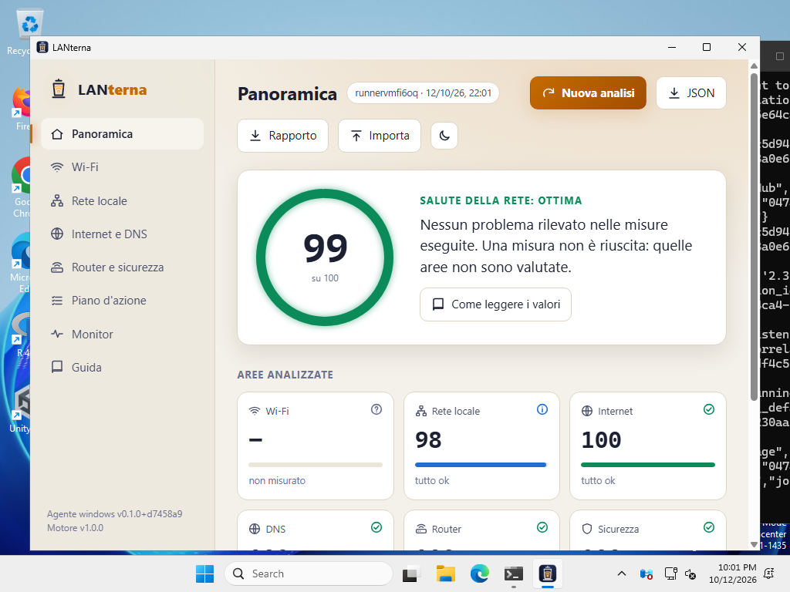

# Verifiche

Cosa è stato verificato, come, e cosa resta da provare. Data: 12 ottobre 2026, versione 0.2.0 (nuova interfaccia, sezione 4).

## 1. Test automatici

| Parte | Test | Cosa coprono |
| --- | --- | --- |
| Motore di analisi (`core/`, vitest) | 41 | conversioni frequenza/canale e spettro; soglie di ogni metrica ai bordi (es. -67/-68/-75/-76 dBm); diagnosi incrociate (latenza in casa o dell'operatore, router che ignora i ping o non risponde affatto ma inoltra il traffico, perdite misurate via TCP, traceroute con nodo lento o percorso parziale, ping bloccati ma web funzionante); sicurezza (aperta, WEP, TKIP, WPA3, PMF, WPS); piano d'azione senza duplicati e con i critici in testa; rapporto testuale; **il bundle `engine.js` gira come script ES2015 senza moduli né Intl** (come in goja) e dà lo stesso risultato |
| Decoder 802.11 (`windows/internal/ie`) | 16 | beacon costruiti **byte per byte**: RSN (WPA2, WPA3, transizione, OWE, Enterprise, valori impliciti), WPA in modalità mista con TKIP, WEP dal bit Privacy, WPS, BSS Load, Country, HT 40 MHz sopra/sotto, VHT 80/160 (codifica moderna e deprecata), HE 6 GHz con campi opzionali, EHT 320 MHz, elementi troncati |
| Strutture wlanapi (`windows/internal/wlan`) | 5 | `WLAN_BSS_LIST`, `WLAN_CONNECTION_ATTRIBUTES`, `WLAN_INTERFACE_INFO_LIST` costruite byte per byte: RSSI con segno, frequenza in kHz, velocità in unità da 500 kbit/s, offset IE relativo alla voce e fuori dal buffer, conteggi incoerenti, descrizioni UTF-16 |
| Parser netsh (`windows/internal/netsh`) | 4 | output inglese e italiano, anche con lettere accentate storpiate dalla code page CP850; messaggio di Windows 11 sul permesso di posizione |
| Sonde di rete (`windows/internal/probe`) | 12 | proxy di sistema di Windows (proxy unico o per schema, eccezioni `<local>` e con caratteri jolly); pacchetto DNS confrontato byte per byte, server DNS finto (risposta, REFUSED, SERVFAIL, timeout); router UPnP finto completo (SSDP, descrizione XML, SOAP `GetExternalIPAddress`); filtro degli URL SSDP (solo LAN privata); porte; titolo del pannello; HTTPS |
| Orchestrazione (`windows/internal/collect`) | 8 | analisi completa su piattaforma simulata; traceroute; MTU con ricerca binaria; riserva TCP quando l'ICMP non funziona; interruzione rapida se l'host non risponde; assenza di gateway; PC senza scheda Wi-Fi; scelta del metodo nel monitor |
| Server locale (`windows/internal/server`) | 4 | rifiuto di Host estranei, POST da altre origini e cross-site; CSP; tipi dei file dell'interfaccia (font `woff2`, CSS con `nosniff`); ciclo avvio, avanzamento e risultato; ping del monitor; avvii concorrenti |
| Motore in goja (`windows/internal/engine`) | 3 | il vero `engine.js` eseguito nell'interprete dell'exe: rapporto e analisi, formattazione dei numeri con la virgola |

In totale 41 test TypeScript e 52 test Go, questi ultimi eseguiti anche con il race detector.

## 2. Strutture di Windows confrontate con gli header ufficiali

Gli offset con cui l'agente legge le strutture restituite da Windows sono stati confrontati con quelli calcolati dal compilatore
sugli header ufficiali (mingw-w64 `wlanapi.h`, `iphlpapi.h`, `icmpapi.h`), con un programma C che stampa `offsetof`/`sizeof`,
eseguito sotto Wine. **Tutti coincidono**:

| Struttura | Dimensione | Campi verificati |
| --- | --- | --- |
| `WLAN_INTERFACE_INFO` | 532 | descrizione @16, stato @528; prima voce della lista @8 |
| `WLAN_CONNECTION_ATTRIBUTES` | 604 | associazione @520 (SSID +0, BSSID +40, PHY +48, qualità +56, rx +60, tx +64), sicurezza @588 (autenticazione +8, cifratura +12) |
| `WLAN_BSS_ENTRY` | 360 | BSSID @40, RSSI @56, capability @88, frequenza @92, rate set @96, offset IE @352, dimensione IE @356; prima voce @8 |
| `ICMP_ECHO_REPLY` (x64) | 40 | stato @4, RTT @8, dati @16, opzioni @24 |
| `IP_OPTION_INFORMATION` (x64) | 16 | flag @2, dati opzioni @8 |
| `MIB_IPNETROW` | 24 | MAC @8, indirizzo @16, tipo @20; prima riga @4 |

Verificati anche opcode (`current_connection` = 7, `channel_number` = 8, `rssi` = 0x10000102) e codici ICMP
(`IP_TTL_EXPIRED_TRANSIT` = 11013, `IP_REQ_TIMED_OUT` = 11010, `IP_PACKET_TOO_BIG` = 11009, `IP_FLAG_DF` = 2).

## 3. L'eseguibile Windows eseguito davvero sotto Wine 9.0

Compilato `LANterna.exe` / `lanterna-cli.exe` (Windows x64) ed eseguito sotto Wine in tre modi.

**Rapporto da riga di comando** (`lanterna-cli report`, `LANterna.exe report`): analisi completa in circa 9 s. Funzionano schede
di rete, gateway, ping al router (20/20), traceroute, DNS di sistema e pubblici, verifica HTTPS, tabella dei vicini, porte del
router e UPnP; il sistema viene riconosciuto come "Wine 9.0, emula Windows 10". Senza scheda Wi-Fi e senza PowerShell, Wi-Fi e
firewall risultano correttamente "non riusciti", con il motivo. Rapporto su file: UTF-8 con BOM e fine riga CRLF.

**Server locale + interfaccia vera in Chromium** (lo stesso motore di WebView2): l'interfaccia incorporata nell'exe avvia da sola
l'analisi, mostra le fasi reali, poi i dati misurati (non la demo); "Nuova analisi" e il monitor in tempo reale funzionano; nessun
errore in console; CSP attiva; `Host` estraneo e `POST` da altra origine rifiutati con 403.

**Finestra grafica su display virtuale** (Xvfb): sotto Wine il runtime WebView2 non esiste, quindi si è collaudata la gestione
della sua assenza: compare solo il messaggio che spiega cosa installare e apre l'interfaccia nel browser; con OK il programma
termina. Simulato anche il caso "runtime presente ma guasto": la finestra vuota viene nascosta e il messaggio resta visibile.

**Versione 0.2.0** (nuova interfaccia), stesse tre prove ripetute con l'exe ricompilato: rapporto in 14 s; con `serve`
l'interfaccia incorporata avvia l'analisi e mostra le 11 fasi reali nella nuova schermata (sotto: il firewall, non leggibile sotto
Wine, è segnato in giallo), poi la panoramica con i dati dell'exe e l'avviso "Analisi completata"; i tre font arrivano dall'exe come
`font/woff2` e risultano caricati; monitor con ping veri, seconda analisi dal pulsante, nessun errore in console con la CSP attiva;
la finestra grafica senza WebView2 mostra il messaggio, serve l'interfaccia su una porta libera e con OK termina.

### Difetti trovati grazie a Wine e corretti

1. `GetAdaptersAddresses` con `GAA_FLAG_INCLUDE_GATEWAYS` e `AF_UNSPEC` restituiva `ERROR_NOT_SUPPORTED`: ora i gateway IPv4 si
   leggono con una seconda chiamata `AF_INET`. Senza questa correzione router e DNS non sarebbero stati individuati.
2. Il monitor mostrava il 100 % di pacchetti persi verso Internet dove l'ICMP è filtrato: ora usa il metodo (ICMP o TCP) che ha
   funzionato durante l'analisi.
3. Il traceroute lanciava tutte le sonde nello stesso istante e gonfiava i tempi dei primi salti (51,8 ms contro 4 ms del ping):
   ora le sonde sono scaglionate e si tiene il minimo di due campioni.
4. Senza WebView2, go-webview2 lasciava aperta una finestra vuota dietro il messaggio: ora il runtime si verifica prima di creare
   la finestra.
5. Distruggere quella finestra provocava un `WM_QUIT` che chiudeva subito il messaggio di avviso: ora la finestra viene nascosta.
6. `GET /api/scan` prima della prima analisi rispondeva 404 (errore in console): ora risponde 204.
7. L'avanzamento da riga di comando ripeteva le stesse righe; il titolo diceva "ottima forma" anche con misure non riuscite; un
   traceroute che non raggiunge la destinazione era descritto come "regolare".

## 4. Interfaccia (versione 0.2.0)

**Librerie effettivamente usate** (licenze lette dai file dei pacchetti installati e riportate per intero in
`THIRD_PARTY_NOTICES.md`; l'elenco è ricavato dalla mappa del bundle, quindi contiene solo ciò che è davvero incluso):

| Libreria | Versione | Licenza | Contributo |
| --- | --- | --- | --- |
| Motion | 13.4.4 | MIT | animazioni: cascate d'entrata, molle, transizioni di pagina, indicatori che scivolano, linee SVG che si tracciano, numeri che si assestano |
| lucide-react | 1.48.0 | ISC (alcune icone derivano da Feather, MIT) | tutte le icone |
| @radix-ui/colors | 3.0.0 | MIT | scale dei colori di stato per i due temi |
| Fontsource: Inter, Space Grotesk, JetBrains Mono | 5.3.0 | SIL OFL 1.1 | caratteri, incorporati nell'exe |

Sono state scelte versioni pubblicate da almeno 14 giorni: Motion 13.5.1 (2 ottobre) è stata esclusa e gli `overrides` di npm
fissano i suoi pacchetti interni. Peso del bundle: JavaScript 468 kB (152 kB compressi), CSS 48 kB (12 kB), font 196 kB.

Tutte le prove in Chromium 141 (lo stesso motore di WebView2), sulla build di produzione:

| Verifica | Come | Esito |
| --- | --- | --- |
| Aspetto | 8 sezioni × tema scuro e chiaro × 1366×900 e 390×844, animazioni attive, screenshot esaminati dopo l'assestamento | nessuno scorrimento orizzontale, nessun elemento rimasto invisibile o fuori dal riquadro, nessun errore in console |
| Animazioni | fotogrammi catturati durante l'analisi (agente simulato con avanzamento passo per passo), l'ingresso della panoramica e il cambio tema | sonde che si accendono in ordine, numeri e anello che si assestano, sezioni in cascata, cerchio del nuovo tema che si apre dal pulsante |
| Accessibilità | axe-core 4.11.4, regole WCAG 2.1 A/AA e buone pratiche, 32 combinazioni (8 sezioni × 2 temi × desktop e mobile) con una scheda aperta | 0 violazioni dopo le correzioni sotto |
| Tastiera | Tab dall'inizio, Invio e Spazio, frecce e Home nel selettore della banda, scorciatoie | "Vai al contenuto" per primo; ordine logico; schede, caselle e interruttori con stato ARIA aggiornato; `2` apre il Wi-Fi, `/` la guida con il cursore nella ricerca; le scorciatoie non scattano mentre si scrive |
| Movimento ridotto | `document.getAnimations()` dopo l'entrata | nessuna animazione in corso su panoramica e monitor; durante l'analisi solo brevi transizioni quando una fase termina |
| Grafica leggera | fotogrammi rallentati ad arte (30 ms di lavoro per fotogramma) | si attiva da sola circa 4,5 s dopo il caricamento con l'etichetta "automatica"; su una pagina fluida resta spenta; la scelta manuale vince sulla misura ed è ricordata; il cambio tema diventa immediato |
| Fluidità | tempi tra fotogrammi in Chromium **senza GPU** (rendering software: il caso peggiore, come macchine virtuali e desktop remoto) | 60 fps mediani da fermi, nel cambio pagina, nel cambio banda e nel monitor; fra 30 e 60 fps, secondo l'esecuzione, all'apertura di una scheda (animazione dell'altezza) e all'ingresso della panoramica; circa 30 fps nella rivelazione circolare del tema |
| Esportazioni e import | pulsanti JSON, Rapporto e Importa | file scaricati con il nome atteso e avviso di conferma; il JSON esportato si reimporta ("File importato"); un JSON qualsiasi viene rifiutato con un avviso |

Difetti trovati con queste prove e corretti prima della consegna:

1. I bagliori di sfondo con `filter: blur(70px)` portavano Chromium senza GPU a 12-15 fps: ora sono gradienti radiali già sfumati,
   mossi solo con `transform` (60 fps).
2. Le icone e il logo dentro la schermata di analisi ereditavano `width: 100%` dalla regola del disegno principale e diventavano enormi.
3. In SVG la `y` di Motion è una traslazione, non l'attributo: le etichette dello spettro finivano al doppio dell'altezza. Il badge
   dei nodi perdeva la posizione, perché la scala animata sostituiva l'attributo `transform`.
4. L'azione evidenziata nel piano restava invisibile (un `animate` proprio interrompeva le varianti ereditate): ora è una classe CSS.
5. Una regola `.ring-num span` rimpiccioliva il numero del punteggio.
6. I numeri delle liste nei pannelli che si aprono in altezza venivano tagliati dall'overflow nascosto.
7. Su mobile le etichette della barra in basso si sovrapponevano: ora sono voci di pari larghezza con nomi brevi, mentre il nome
   completo resta per i lettori di schermo. La barra superiore scorre via con la pagina.
8. Le fasce colorate del misuratore del segnale non coincidevano con le soglie del motore (-75/-67 dBm) e le etichette erano
   equidistanti invece che in scala.
9. Nel tema chiaro i colori di stato Radix (passo 11) sulle superfici color carta arrivavano a 4,1-4,3:1: scuriti del 10 % circa,
   ora sono almeno 4,5:1. Anche la tavolozza delle reti nello spettro ha una variante per il tema chiaro.
10. Tabelle scorrevoli non raggiungibili da tastiera e un livello di titolo saltato nelle schede espandibili (axe-core).
11. Le etichette dello spettro attraversate dalle curve: ora hanno una targhetta del colore di fondo, larga quanto il testo misurato.
12. Un errore introdotto durante il lavoro (hook React chiamato in modo condizionale nel logo) mandava in errore l'avvio di
    un'analisi con il movimento ridotto: trovato dalla relativa prova.

## 5. Cosa non è stato possibile verificare qui

| Parte | Perché | Come è stata coperta | Da provare su un PC |
| --- | --- | --- | --- |
| Lettura delle reti Wi-Fi da una scheda vera | Wine non ha schede Wi-Fi | decoder IE e strutture wlanapi collaudati byte per byte; offset confrontati con gli header ufficiali | sezione Wi-Fi: reti, dBm, larghezze, sicurezza della propria rete |
| Finestra WebView2 su un PC | Wine non ha il runtime | Chromium (stesso motore) e **finestra vera su Windows Server 2025 in CI**, con cattura dello schermo (sotto) | nitidezza con ridimensionamento al 125-150 % e su più monitor |
| Fluidità con una GPU vera | il container e la CI non hanno GPU | misure in rendering software (caso peggiore) e grafica leggera automatica | animazioni a 60 fps anche aprendo le schede; con desktop remoto deve attivarsi la grafica leggera |
| Permesso di posizione (Windows 11 24H2+) | serve Windows 11 con scheda Wi-Fi | messaggio di Windows riconosciuto nei test; errore `ACCESS_DENIED` tradotto in istruzioni | con posizione disattivata deve comparire la spiegazione, attivandola le reti |
| UPnP e porte di un router reale | nessun router domestico nel container | router UPnP simulato nei test | modello del router, porte aperte, IP pubblico |

## 6. Collaudo su Windows reale (CI)

Il workflow `.github/workflows/ci.yml` esegue tutti i test, compila lo zip (artefatto `LANterna-windows-amd64`) e lo collauda su
una macchina `windows-latest` di GitHub (Windows Server 2025, build 26100, scheda di rete virtuale Hyper-V, nessuna scheda Wi-Fi).

**Prima esecuzione** (commit `5baa2c6`), tutti i passi verdi:

- `version`: rilevato WebView2 153.0.4234.48;
- rapporto: schede lette con `GetAdaptersAddresses` (Ethernet 3, 10.1.0.163/20, gateway 10.1.0.1), DNS di sistema 51 ms contro
  Quad9 8,5 ms, HTTPS in 73 ms, **firewall letto via PowerShell** (tre profili attivi, in uso "Pubblica"), analisi in 9,9 s;
- server locale: `204` prima dell'analisi, analisi completa via API con avanzamento, interfaccia servita con CSP;
- **finestra grafica con WebView2 vero**: processo attivo, titolo "LANterna", 6 processi `msedgewebview2`; la cattura dello schermo
  mostra l'interfaccia con i dati reali della macchina e l'icona di LANterna nella barra delle applicazioni.

Difetti trovati su Windows reale e corretti:

1. Il gateway di Azure non risponde né ai ping né a TCP e LANterna lo dichiarava "router non risponde: rete interrotta" (critico)
   mentre Internet funzionava attraverso di lui. Ora: se il traffico verso Internet passa, il router è vivo per definizione e la
   voce diventa informativa, con la spiegazione.
2. "Anche verso il router ci sono perdite" veniva dedotto da un router che non risponde affatto: il confronto ora si fa solo se il
   router risponde. Le perdite misurate con connessioni TCP (ping bloccati) restano al massimo "da migliorare", con la spiegazione
   del limite; i tentativi TCP sono distanziati di 500 ms.
3. La scheda di rete di una macchina virtuale ("Microsoft Hyper-V Network Adapter") era classificata come virtuale: ora sono
   virtuali solo gli switch ("Hyper-V Virtual Ethernet Adapter", "vEthernet").
4. Windows Server 2025 veniva descritto come "Windows 11" (stessa build): ora si distingue con `ProductType`.
5. La finestra chiedeva 1320×880 pixel anche su uno schermo 1024×768 e, centrata da go-webview2 con aritmetica senza segno, usciva
   a sinistra. Ora la dimensione segue la scala DPI del sistema ed è limitata al 94 % dell'area di lavoro.

**Seconda esecuzione** (commit `d7458a9`), tutti i passi verdi, correzioni confermate: sistema descritto come "Windows Server 2025
(build 26100)"; scheda "Ethernet 3" classificata come cavo (100 Gbit/s); con i tentativi TCP distanziati, 8 risposte su 8 da tutti e
tre i server pubblici (le "perdite" della prima esecuzione dipendevano dai tentativi troppo ravvicinati); router silenzioso ma
funzionante descritto come informazione; punteggio 99/100. La finestra ora sta interamente nello schermo:

