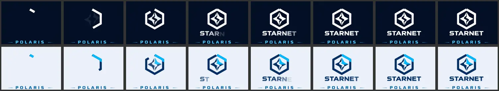
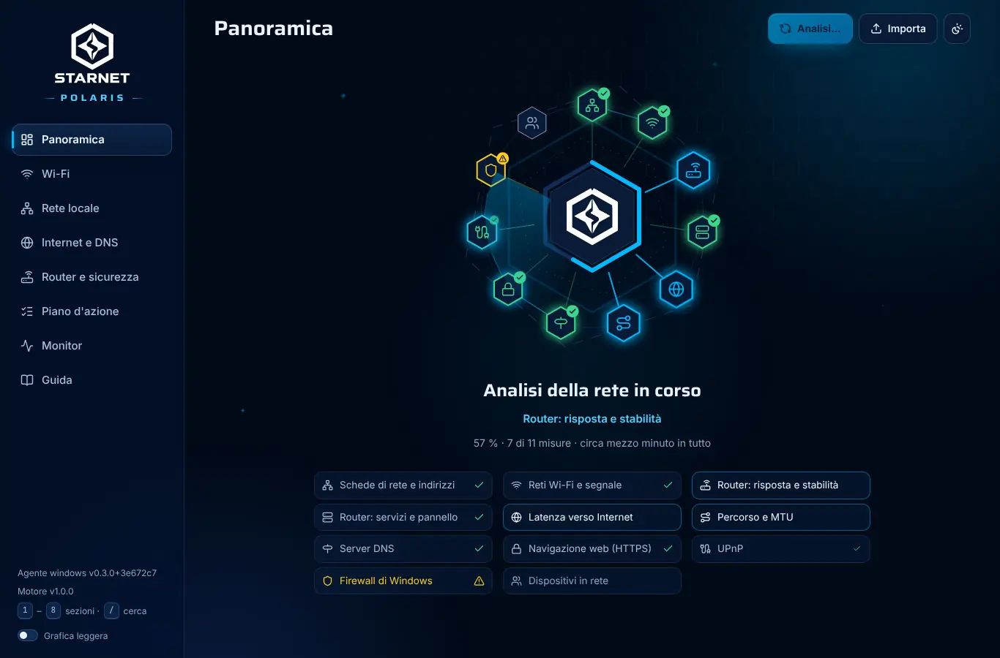
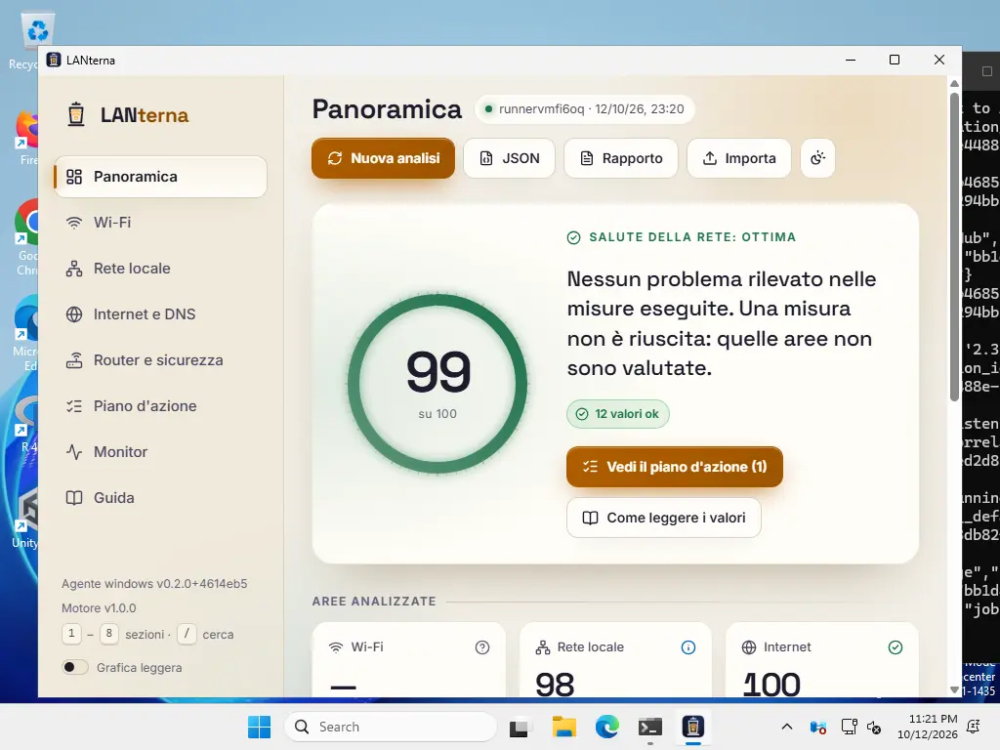
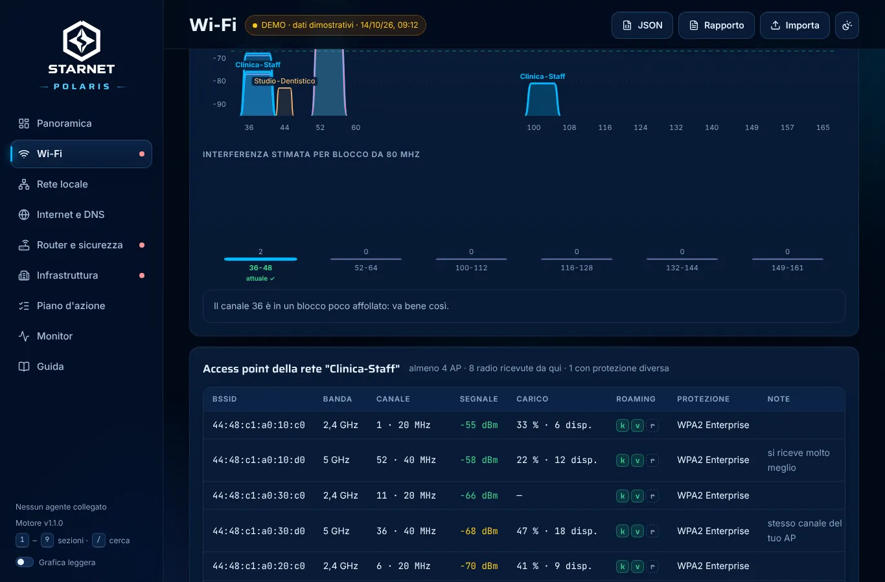
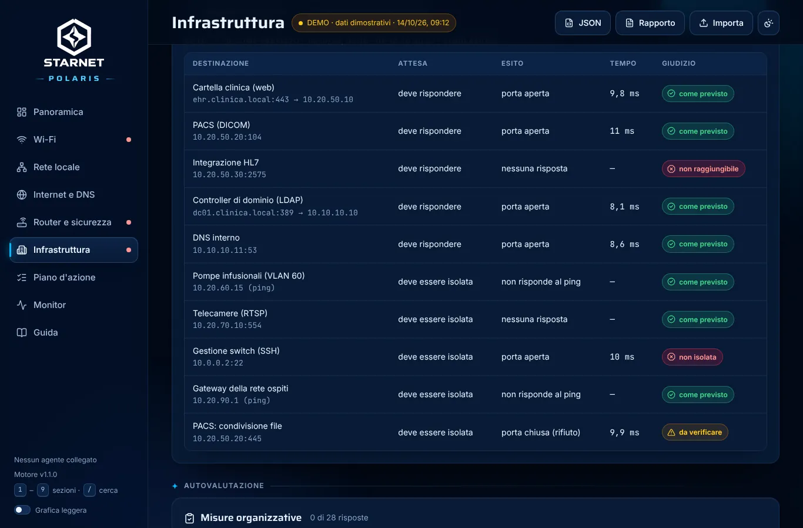
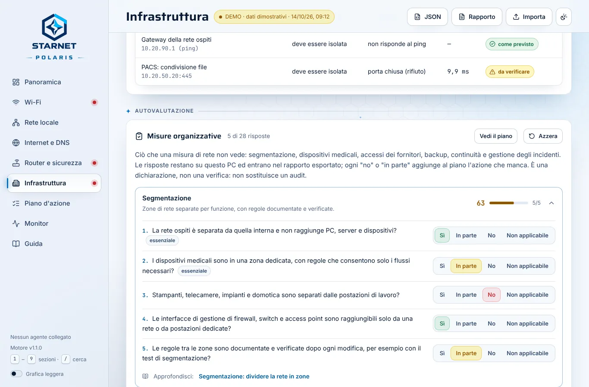

# Verifiche

Cosa è stato verificato, come, e cosa resta da provare. Versione attuale: 0.6.0 (19 ottobre 2026), con SMART completo, profilo di
CrystalDiskMark, scheda tecnica, Microsoft Defender, cassetta degli attrezzi e CrystalDiskInfo e CrystalDiskMark inclusi nel
pacchetto (sezione 10). Fino alla versione 0.2.0 il programma si chiamava LANterna:
le sezioni che descrivono prove precedenti riportano i nomi di allora.

## 1. Test automatici

| Parte | Test | Cosa coprono |
| --- | --- | --- |
| Motore di analisi (`core/`, vitest) | 41 | conversioni frequenza/canale e spettro; soglie di ogni metrica ai bordi (es. -67/-68/-75/-76 dBm); diagnosi incrociate (latenza in casa o dell'operatore, router che ignora i ping o non risponde affatto ma inoltra il traffico, perdite misurate via TCP, traceroute con nodo lento o percorso parziale, ping bloccati ma web funzionante); sicurezza (aperta, WEP, TKIP, WPA3, PMF, WPS); piano d'azione senza duplicati e con i critici in testa; rapporto testuale; **il bundle `engine.js` gira come script ES2015 senza moduli né Intl** (come in goja) e dà lo stesso risultato |
| Reti complesse (`core/test/complex.test.ts`) | 21 | AP della rete (un router dual band non conta due volte), AP propri sullo stesso canale con la soglia di -80 dBm, sticky client e giudizio sul segnale che punta all'AP scelto, roaming (802.1X senza 802.11r, funzioni diverse tra AP, Mobility Domain diversi), AP gemello aperto e varianti della stessa protezione, reti delle stesse radio escluse dai vicini e dal consiglio dei canali; dominio e suffisso DNS (anche suffissi domestici e DNS pubblici), server DHCP, sottorete ampia, MAC condivisi; inventario, segmentazione, servizi critici, autovalutazione con le azioni nel piano; rete dimostrativa Clinica; rapporto con i dettagli entro 90 colonne |
| Guide (`core/test/guides.test.ts`) | 17 | identificativi e capitoli, collegamenti interni, misure e azioni citate esistenti, **ogni misura spiegata in almeno una guida**, markup chiuso, tabelle coerenti, glossario senza doppioni, argomenti sanitari presenti, ricerca |
| Decoder 802.11 (`windows/internal/ie`) | 20 | beacon costruiti **byte per byte**: RSN (WPA2, WPA3, transizione, OWE, Enterprise, valori impliciti), WPA in modalità mista con TKIP, WEP dal bit Privacy, WPS, BSS Load, Country, HT 40 MHz sopra/sotto, VHT 80/160 (codifica moderna e deprecata), HE 6 GHz con campi opzionali, EHT 320 MHz, elementi troncati; roaming da Mobility Domain, RM Enabled Capabilities ed Extended Capabilities (anche troncato) e 802.11r dedotto dagli AKM FT |
| Strutture wlanapi (`windows/internal/wlan`) | 6 | `WLAN_BSS_LIST`, `WLAN_CONNECTION_ATTRIBUTES`, `WLAN_INTERFACE_INFO_LIST` costruite byte per byte: RSSI con segno, frequenza in kHz, velocità in unità da 500 kbit/s, offset IE relativo alla voce e fuori dal buffer, conteggi incoerenti, descrizioni UTF-16 |
| Parser netsh (`windows/internal/netsh`) | 4 | output inglese e italiano, anche con lettere accentate storpiate dalla code page CP850; messaggio di Windows 11 sul permesso di posizione |
| Sonde di rete (`windows/internal/probe`) | 12 | proxy di sistema di Windows (proxy unico o per schema, eccezioni `<local>` e con caratteri jolly); pacchetto DNS confrontato byte per byte, server DNS finto (risposta, REFUSED, SERVFAIL, timeout); router UPnP finto completo (SSDP, descrizione XML, SOAP `GetExternalIPAddress`); filtro degli URL SSDP (solo LAN privata); porte; titolo del pannello; HTTPS |
| Orchestrazione (`windows/internal/collect`) | 8 | analisi completa su piattaforma simulata; traceroute; MTU con ricerca binaria; riserva TCP quando l'ICMP non funziona; interruzione rapida se l'host non risponde; assenza di gateway; PC senza scheda Wi-Fi; scelta del metodo nel monitor |
| Server locale (`windows/internal/server`) | 7 | rifiuto di Host estranei, POST da altre origini e cross-site; CSP; tipi dei file dell'interfaccia (font `woff2`, favicon `ico`, CSS con `nosniff`); ciclo avvio, avanzamento e risultato; ping del monitor; avvii concorrenti; inventario (conferma obbligatoria, solo JSON, rete non adatta, già in corso, non disponibile) e verifiche |
| Infrastruttura (`windows/internal/infra`) | 9 | sottorete da esaminare (/22 intera, ripiego sul /24, reti pubbliche e /31 rifiutate), reti private e MAC casuali, inventario con limite di concorrenza, dispositivi visti solo tramite ARP e nomi, interruzione, verifiche (porta aperta, chiusa o filtrata, ping, nomi risolti preferendo IPv4, destinazioni pubbliche rifiutate), validazione, richiesta e risposta NetBIOS byte per byte |
| Motore in goja (`windows/internal/engine`) | 3 | il vero `engine.js` eseguito nell'interprete dell'exe: rapporto e analisi, formattazione dei numeri con la virgola |

In totale 79 test TypeScript e 69 test Go, questi ultimi eseguiti anche con il race detector. Il conteggio del motore di analisi
(41) comprende i test di tutte le versioni precedenti.

## 2. Strutture di Windows confrontate con gli header ufficiali

Gli offset con cui l'agente legge le strutture restituite da Windows sono stati confrontati con quelli calcolati dal compilatore
sugli header ufficiali (mingw-w64 `wlanapi.h`, `iphlpapi.h`, `icmpapi.h`), con un programma C che stampa `offsetof`/`sizeof`,
eseguito sotto Wine. **Tutti coincidono**:

| Struttura | Dimensione | Campi verificati |
| --- | --- | --- |
| `WLAN_INTERFACE_INFO` | 532 | descrizione @16, stato @528; prima voce della lista @8 |
| `WLAN_CONNECTION_ATTRIBUTES` | 604 | associazione @520 (SSID +0, BSSID +40, PHY +48, qualità +56, rx +60, tx +64), sicurezza @588 (autenticazione +8, cifratura +12) |
| `WLAN_BSS_ENTRY` | 360 | BSSID @40, RSSI @56, capability @88, frequenza @92, rate set @96, offset IE @352, dimensione IE @356; prima voce @8 |
| `ICMP_ECHO_REPLY` (x64) | 40 | stato @4, RTT @8, dati @16, opzioni @24 |
| `IP_OPTION_INFORMATION` (x64) | 16 | flag @2, dati opzioni @8 |
| `MIB_IPNETROW` | 24 | MAC @8, indirizzo @16, tipo @20; prima riga @4 |

Verificati anche opcode (`current_connection` = 7, `channel_number` = 8, `rssi` = 0x10000102) e codici ICMP
(`IP_TTL_EXPIRED_TRANSIT` = 11013, `IP_REQ_TIMED_OUT` = 11010, `IP_PACKET_TOO_BIG` = 11009, `IP_FLAG_DF` = 2).

## 3. L'eseguibile Windows eseguito davvero sotto Wine 9.0

Compilato `LANterna.exe` / `lanterna-cli.exe` (Windows x64) ed eseguito sotto Wine in tre modi.

**Rapporto da riga di comando** (`lanterna-cli report`, `LANterna.exe report`): analisi completa in circa 9 s. Funzionano schede
di rete, gateway, ping al router (20/20), traceroute, DNS di sistema e pubblici, verifica HTTPS, tabella dei vicini, porte del
router e UPnP; il sistema viene riconosciuto come "Wine 9.0, emula Windows 10". Senza scheda Wi-Fi e senza PowerShell, Wi-Fi e
firewall risultano correttamente "non riusciti", con il motivo. Rapporto su file: UTF-8 con BOM e fine riga CRLF.

**Server locale + interfaccia vera in Chromium** (lo stesso motore di WebView2): l'interfaccia incorporata nell'exe avvia da sola
l'analisi, mostra le fasi reali, poi i dati misurati (non la demo); "Nuova analisi" e il monitor in tempo reale funzionano; nessun
errore in console; CSP attiva; `Host` estraneo e `POST` da altra origine rifiutati con 403.

**Finestra grafica su display virtuale** (Xvfb): sotto Wine il runtime WebView2 non esiste, quindi si è collaudata la gestione
della sua assenza: compare solo il messaggio che spiega cosa installare e apre l'interfaccia nel browser; con OK il programma
termina. Simulato anche il caso "runtime presente ma guasto": la finestra vuota viene nascosta e il messaggio resta visibile.

**Versione 0.2.0** (nuova interfaccia), stesse tre prove ripetute con l'exe ricompilato: rapporto in 14 s; con `serve`
l'interfaccia incorporata avvia l'analisi e mostra le 11 fasi reali nella nuova schermata (sotto: il firewall, non leggibile sotto
Wine, è segnato in giallo), poi la panoramica con i dati dell'exe e l'avviso "Analisi completata"; i tre font arrivano dall'exe come
`font/woff2` e risultano caricati; monitor con ping veri, seconda analisi dal pulsante, nessun errore in console con la CSP attiva;
la finestra grafica senza WebView2 mostra il messaggio, serve l'interfaccia su una porta libera e con OK termina.

La schermata di analisi di allora è stata sostituita da quella della versione 0.3.0 (sezione 7).

### Difetti trovati grazie a Wine e corretti

1. `GetAdaptersAddresses` con `GAA_FLAG_INCLUDE_GATEWAYS` e `AF_UNSPEC` restituiva `ERROR_NOT_SUPPORTED`: ora i gateway IPv4 si
   leggono con una seconda chiamata `AF_INET`. Senza questa correzione router e DNS non sarebbero stati individuati.
2. Il monitor mostrava il 100 % di pacchetti persi verso Internet dove l'ICMP è filtrato: ora usa il metodo (ICMP o TCP) che ha
   funzionato durante l'analisi.
3. Il traceroute lanciava tutte le sonde nello stesso istante e gonfiava i tempi dei primi salti (51,8 ms contro 4 ms del ping):
   ora le sonde sono scaglionate e si tiene il minimo di due campioni.
4. Senza WebView2, go-webview2 lasciava aperta una finestra vuota dietro il messaggio: ora il runtime si verifica prima di creare
   la finestra.
5. Distruggere quella finestra provocava un `WM_QUIT` che chiudeva subito il messaggio di avviso: ora la finestra viene nascosta.
6. `GET /api/scan` prima della prima analisi rispondeva 404 (errore in console): ora risponde 204.
7. L'avanzamento da riga di comando ripeteva le stesse righe; il titolo diceva "ottima forma" anche con misure non riuscite; un
   traceroute che non raggiunge la destinazione era descritto come "regolare".

## 4. Interfaccia (versione 0.2.0)

**Librerie effettivamente usate** (licenze lette dai file dei pacchetti installati e riportate per intero in
`THIRD_PARTY_NOTICES.md`; l'elenco è ricavato dalla mappa del bundle, quindi contiene solo ciò che è davvero incluso):

| Libreria | Versione | Licenza | Contributo |
| --- | --- | --- | --- |
| Motion | 13.4.4 | MIT | animazioni: cascate d'entrata, molle, transizioni di pagina, indicatori che scivolano, linee SVG che si tracciano, numeri che si assestano |
| lucide-react | 1.48.0 | ISC (alcune icone derivano da Feather, MIT) | tutte le icone |
| @radix-ui/colors | 3.0.0 | MIT | scale dei colori di stato per i due temi |
| Fontsource: Inter, Space Grotesk, JetBrains Mono | 5.3.0 | SIL OFL 1.1 | caratteri, incorporati nell'exe |

Sono state scelte versioni pubblicate da almeno 14 giorni: Motion 13.5.1 (2 ottobre) è stata esclusa e gli `overrides` di npm
fissano i suoi pacchetti interni. Peso del bundle: JavaScript 468 kB (152 kB compressi), CSS 48 kB (12 kB), font 196 kB.

Tutte le prove in Chromium 141 (lo stesso motore di WebView2), sulla build di produzione:

| Verifica | Come | Esito |
| --- | --- | --- |
| Aspetto | 8 sezioni × tema scuro e chiaro × 1366×900 e 390×844, animazioni attive, screenshot esaminati dopo l'assestamento | nessuno scorrimento orizzontale, nessun elemento rimasto invisibile o fuori dal riquadro, nessun errore in console |
| Animazioni | fotogrammi catturati durante l'analisi (agente simulato con avanzamento passo per passo), l'ingresso della panoramica e il cambio tema | sonde che si accendono in ordine, numeri e anello che si assestano, sezioni in cascata, cerchio del nuovo tema che si apre dal pulsante |
| Accessibilità | axe-core 4.11.4, regole WCAG 2.1 A/AA e buone pratiche, 32 combinazioni (8 sezioni × 2 temi × desktop e mobile) con una scheda aperta | 0 violazioni dopo le correzioni sotto |
| Tastiera | Tab dall'inizio, Invio e Spazio, frecce e Home nel selettore della banda, scorciatoie | "Vai al contenuto" per primo; ordine logico; schede, caselle e interruttori con stato ARIA aggiornato; `2` apre il Wi-Fi, `/` la guida con il cursore nella ricerca; le scorciatoie non scattano mentre si scrive |
| Movimento ridotto | `document.getAnimations()` dopo l'entrata | nessuna animazione in corso su panoramica e monitor; durante l'analisi solo brevi transizioni quando una fase termina |
| Grafica leggera | fotogrammi rallentati ad arte (30 ms di lavoro per fotogramma) | si attiva da sola circa 4,5 s dopo il caricamento con l'etichetta "automatica"; su una pagina fluida resta spenta; la scelta manuale vince sulla misura ed è ricordata; il cambio tema diventa immediato |
| Fluidità | tempi tra fotogrammi in Chromium **senza GPU** (rendering software: il caso peggiore, come macchine virtuali e desktop remoto) | 60 fps mediani da fermi, nel cambio pagina, nel cambio banda e nel monitor; fra 30 e 60 fps, secondo l'esecuzione, all'apertura di una scheda (animazione dell'altezza) e all'ingresso della panoramica; circa 30 fps nella rivelazione circolare del tema |
| Esportazioni e import | pulsanti JSON, Rapporto e Importa | file scaricati con il nome atteso e avviso di conferma; il JSON esportato si reimporta ("File importato"); un JSON qualsiasi viene rifiutato con un avviso |

Difetti trovati con queste prove e corretti prima della consegna:

1. I bagliori di sfondo con `filter: blur(70px)` portavano Chromium senza GPU a 12-15 fps: ora sono gradienti radiali già sfumati,
   mossi solo con `transform` (60 fps).
2. Le icone e il logo dentro la schermata di analisi ereditavano `width: 100%` dalla regola del disegno principale e diventavano enormi.
3. In SVG la `y` di Motion è una traslazione, non l'attributo: le etichette dello spettro finivano al doppio dell'altezza. Il badge
   dei nodi perdeva la posizione, perché la scala animata sostituiva l'attributo `transform`.
4. L'azione evidenziata nel piano restava invisibile (un `animate` proprio interrompeva le varianti ereditate): ora è una classe CSS.
5. Una regola `.ring-num span` rimpiccioliva il numero del punteggio.
6. I numeri delle liste nei pannelli che si aprono in altezza venivano tagliati dall'overflow nascosto.
7. Su mobile le etichette della barra in basso si sovrapponevano: ora sono voci di pari larghezza con nomi brevi, mentre il nome
   completo resta per i lettori di schermo. La barra superiore scorre via con la pagina.
8. Le fasce colorate del misuratore del segnale non coincidevano con le soglie del motore (-75/-67 dBm) e le etichette erano
   equidistanti invece che in scala.
9. Nel tema chiaro i colori di stato Radix (passo 11) sulle superfici color carta arrivavano a 4,1-4,3:1: scuriti del 10 % circa,
   ora sono almeno 4,5:1. Anche la tavolozza delle reti nello spettro ha una variante per il tema chiaro.
10. Tabelle scorrevoli non raggiungibili da tastiera e un livello di titolo saltato nelle schede espandibili (axe-core).
11. Le etichette dello spettro attraversate dalle curve: ora hanno una targhetta del colore di fondo, larga quanto il testo misurato.
12. Un errore introdotto durante il lavoro (hook React chiamato in modo condizionale nel logo) mandava in errore l'avvio di
    un'analisi con il movimento ridotto: trovato dalla relativa prova.

## 5. Cosa non è stato possibile verificare qui

| Parte | Perché | Come è stata coperta | Da provare su un PC |
| --- | --- | --- | --- |
| Lettura delle reti Wi-Fi da una scheda vera | Wine non ha schede Wi-Fi | decoder IE e strutture wlanapi collaudati byte per byte; offset confrontati con gli header ufficiali | sezione Wi-Fi: reti, dBm, larghezze, sicurezza della propria rete |
| Finestra WebView2 su un PC | Wine non ha il runtime | Chromium (stesso motore) e **finestra vera su Windows Server 2025 in CI**, con cattura dello schermo (sotto) | nitidezza con ridimensionamento al 125-150 % e su più monitor |
| Fluidità con una GPU vera | il container e la CI non hanno GPU | misure in rendering software (caso peggiore) e grafica leggera automatica | animazioni a 60 fps anche aprendo le schede; con desktop remoto deve attivarsi la grafica leggera |
| Permesso di posizione (Windows 11 24H2+) | serve Windows 11 con scheda Wi-Fi | messaggio di Windows riconosciuto nei test; errore `ACCESS_DENIED` tradotto in istruzioni | con posizione disattivata deve comparire la spiegazione, attivandola le reti |
| UPnP e porte di un router reale | nessun router domestico nel container | router UPnP simulato nei test | modello del router, porte aperte, IP pubblico |
| Inventario di una rete privata vera | la rete del container è 192.0.2.0/24, che non è privata; la rete della CI non va scansionata | primitive simulate nei test (ritmo, concorrenza, ARP, nomi); sotto Wine verificato il rifiuto della rete non privata; in CI il rifiuto senza conferma | tempi su una /24, dispositivi visti solo tramite ARP, nomi NetBIOS di PC e stampanti |
| Roaming 802.11k/v/r da AP veri | nessuna scheda Wi-Fi | elementi costruiti byte per byte secondo lo standard | funzioni e Mobility Domain degli AP di una rete aziendale; segnalazione dello sticky client camminando |
| Verifiche verso una rete segmentata | nessuna VLAN né firewall interni qui | esiti simulati nei test; sotto Wine verifiche vere (indirizzo pubblico rifiutato, ping senza risposta) | distinzione tra porta chiusa e filtrata attraverso un firewall reale |

## 6. Collaudo su Windows reale (CI)

Il workflow `.github/workflows/ci.yml` esegue tutti i test, compila lo zip (artefatto `LANterna-windows-amd64`) e lo collauda su
una macchina `windows-latest` di GitHub (Windows Server 2025, build 26100, scheda di rete virtuale Hyper-V, nessuna scheda Wi-Fi).

**Prima esecuzione** (commit `5baa2c6`), tutti i passi verdi:

- `version`: rilevato WebView2 153.0.4234.48;
- rapporto: schede lette con `GetAdaptersAddresses` (Ethernet 3, 10.1.0.163/20, gateway 10.1.0.1), DNS di sistema 51 ms contro
  Quad9 8,5 ms, HTTPS in 73 ms, **firewall letto via PowerShell** (tre profili attivi, in uso "Pubblica"), analisi in 9,9 s;
- server locale: `204` prima dell'analisi, analisi completa via API con avanzamento, interfaccia servita con CSP;
- **finestra grafica con WebView2 vero**: processo attivo, titolo "LANterna", 6 processi `msedgewebview2`; la cattura dello schermo
  mostra l'interfaccia con i dati reali della macchina e l'icona di LANterna nella barra delle applicazioni.

Difetti trovati su Windows reale e corretti:

1. Il gateway di Azure non risponde né ai ping né a TCP e LANterna lo dichiarava "router non risponde: rete interrotta" (critico)
   mentre Internet funzionava attraverso di lui. Ora: se il traffico verso Internet passa, il router è vivo per definizione e la
   voce diventa informativa, con la spiegazione.
2. "Anche verso il router ci sono perdite" veniva dedotto da un router che non risponde affatto: il confronto ora si fa solo se il
   router risponde. Le perdite misurate con connessioni TCP (ping bloccati) restano al massimo "da migliorare", con la spiegazione
   del limite; i tentativi TCP sono distanziati di 500 ms.
3. La scheda di rete di una macchina virtuale ("Microsoft Hyper-V Network Adapter") era classificata come virtuale: ora sono
   virtuali solo gli switch ("Hyper-V Virtual Ethernet Adapter", "vEthernet").
4. Windows Server 2025 veniva descritto come "Windows 11" (stessa build): ora si distingue con `ProductType`.
5. La finestra chiedeva 1320×880 pixel anche su uno schermo 1024×768 e, centrata da go-webview2 con aritmetica senza segno, usciva
   a sinistra. Ora la dimensione segue la scala DPI del sistema ed è limitata al 94 % dell'area di lavoro.

**Seconda esecuzione** (commit `d7458a9`), tutti i passi verdi, correzioni confermate: sistema descritto come "Windows Server 2025
(build 26100)"; scheda "Ethernet 3" classificata come cavo (100 Gbit/s); con i tentativi TCP distanziati, 8 risposte su 8 da tutti e
tre i server pubblici (le "perdite" della prima esecuzione dipendevano dai tentativi troppo ravvicinati); router silenzioso ma
funzionante descritto come informazione; punteggio 99/100; la finestra sta interamente nello schermo.

**Terza esecuzione** (commit `4614eb5`, versione 0.2.0 con la nuova interfaccia), tutti i passi verdi: analisi in 9,5 s su
"Windows Server 2025 (build 26100)"; via API tutte le 11 fasi, con la sola "Router: risposta e stabilità" in errore (il gateway di
Azure non risponde né ai ping né a TCP, ed è descritto come informazione); 8 risposte su 8 da ciascuno dei tre server pubblici,
misurate via TCP; finestra WebView2 attiva con titolo "LANterna" e 6 processi `msedgewebview2`. La cattura mostra la nuova
interfaccia nel tema chiaro (quello impostato in Windows su quella macchina), con i font incorporati, il punteggio 99/100 e la
disposizione a tre colonne di una finestra larga circa 950 pixel. La grafica leggera non è scattata, quindi anche su quella
macchina virtuale la mediana dei tempi tra i fotogrammi è rimasta sotto 26 ms.

La cattura di questa esecuzione è stata sostituita da quella della versione 0.3.0 (sezione 7).

## 7. Versione 0.3.0: marchio STARNET e nome STARNET Polaris

**Marchio.** I master del pacchetto STARNET 22 sono copiati in `brand/` senza modifiche: le impronte SHA-256 coincidono con il
`MANIFEST.json` del pacchetto. I tracciati usati dall'interfaccia sono generati da `scripts/brand.mjs`, che verifica anche la
struttura del master (ritagli delle parti ciano, sette lettere). Regole della guida applicate e controllate sulle catture: logo
bianco sui fondi scuri, a colori sui chiari, solo il simbolo negli spazi piccoli, nessuna ombra né deformazione. L'animazione
d'entrata è stata controllata fotogramma per fotogramma nei due temi: la cornice si rivela in senso orario dal vertice alto (nel
tema chiaro compare per primo proprio il tratto ciano), le metà della stella si incastrano, le lettere arrivano in sequenza e
l'ultimo fotogramma è il logo originale.

**Nome ed eseguibili.** `Polaris.exe` (finestra) e `polaris-cli.exe` (console); cartella dei dati di WebView2
`%LOCALAPPDATA%\STARNET Polaris`. Nelle risorse dell'exe ci sono nome, descrizione, `CompanyName` STARNET e versione 0.3.0.
L'icona è il simbolo a colori su piastra bianca, renderizzato dal vettoriale a 9 dimensioni (16-256 px): leggibile sulla barra
delle applicazioni chiara e su quella scura.

**Carattere.** Saira 5.3.0 (OFL 1.1, pubblicato il 19 luglio 2026) sostituisce Space Grotesk per i titoli, con l'asse della larghezza
al 108-125 % per avvicinarsi alla scritta STARNET. Il confronto è stato fatto a schermo con Michroma, Exo 2 e Chakra Petch.
Nell'interfaccia servita dall'exe sotto Wine i titoli risultano in "Saira Variable" al 112 % e i file dei caratteri arrivano
come `font/woff2` e risultano caricati.

**Colori.** Contrasti calcolati prima di applicarli. Nel tema scuro testo e accenti stanno fra 5,4:1 e 17,7:1. Nel tema chiaro
le azioni sono in blu profondo con testo bianco (13,5:1) e i colori di stato sono scuriti quanto basta per restare almeno a
4,5:1 anche sulle superfici tinte. Il blu e il ciano restano al marchio: le informazioni usano l'indaco.

**Stessa batteria della sezione 4**, sulla build finale:

| Verifica | Esito |
| --- | --- |
| Aspetto (8 sezioni × 2 temi × desktop e mobile) | nessuno scorrimento orizzontale, nessun elemento invisibile o fuori dal riquadro, nessun errore in console |
| axe-core 4.11.4, WCAG 2.1 A/AA (32 combinazioni) | 0 violazioni |
| Tastiera | invariata: "Vai al contenuto", ordine logico, frecce e Home nel selettore, Invio e Spazio, scorciatoie `1`…`8` e `/` |
| Movimento ridotto | nessuna animazione in corso dopo l'entrata (anche le stelle dello sfondo si fermano) |
| Grafica leggera | automatica dopo 4,6 s con fotogrammi lenti; scelta manuale ricordata; cambio tema senza transizione |
| Esportazioni e import | file scaricati, JSON reimportato, file estraneo rifiutato con il nuovo nome nel messaggio |
| Fluidità senza GPU | 60 fps mediani da fermi, nei cambi pagina, nell'apertura delle schede, nel cambio banda e nel monitor; circa 30 fps nella rivelazione circolare del tema |

Revisione visiva: due difetti trovati e corretti. Nel grafico della latenza verso Internet Cloudflare e Quad9 avevano quasi lo
stesso viola, e su mobile il marchio spariva insieme alla barra laterale (ora il simbolo resta nella barra superiore).

**Exe sotto Wine nei tre modi**:
- **rapporto**: 14,5 s, intestazione "STARNET Polaris - rapporto di diagnostica di rete";
- **server**:
  - analisi in 14,8 s con le 11 fasi, nella nuova schermata (sotto);
  - favicon servito come `image/x-icon`;
  - monitor con ping veri e seconda analisi dal pulsante;
  - nessun errore in console;
- **finestra senza WebView2**: messaggio con il nuovo nome, interfaccia su una porta libera, chiusura con OK.

**Windows reale (CI, commit `b725f9e`)**, tutti i passi verdi:
- rapporto, server con le API e finestra WebView2 attiva con titolo "STARNET Polaris";
- nella cattura si vedono la nuova icona nella barra del titolo e in quella delle applicazioni, il logo a colori nel tema chiaro
  impostato su quella macchina e il punteggio 99/100 nell'esagono;
- la finestra alta 720 pixel ha mostrato che in fondo alla barra laterale l'interruttore "Grafica leggera" restava fuori vista:
  ora la barra scorre e sugli schermi bassi il logo è più compatto.

## 8. Versione 0.4.0: guide di rete, reti complesse e strutture sanitarie

**Cosa è nuovo.** La biblioteca di 48 guide con glossario e centro guide (commit `c0c2fb1`); il motore 1.1.0 con le analisi delle
reti con più access point e delle reti aziendali e la categoria Infrastruttura; nell'agente il pacchetto `infra` (inventario e
verifiche su richiesta), la lettura del roaming dai beacon, di dominio, suffisso DNS e server DHCP; nell'interfaccia la sezione
Infrastruttura, gli AP della rete nella sezione Wi-Fi, il monitor di sessione e la rete dimostrativa Clinica (commit `c6d0887`).

**Interfaccia**, prove in Chromium 141 sulla build di produzione, con entrambe le reti dimostrative:

| Verifica | Esito |
| --- | --- |
| Aspetto (9 sezioni × 2 temi × desktop e mobile, reti Casa e Clinica) | nessuno scorrimento orizzontale, nessun elemento invisibile o fuori dal riquadro, nessun errore in console |
| axe-core 4.11.4, WCAG 2.1 A/AA e buone pratiche (36 combinazioni per rete, con una scheda aperta e una risposta data) | 0 violazioni dopo la correzione sotto |
| Percorso interattivo (25 controlli) | tasto `6`; pulsante dell'inventario disattivo finché non si conferma l'autorizzazione; barra di avanzamento; filtro; CSV con intestazione e BOM; esempi delle destinazioni; campi vuoti segnalati; indirizzo pubblico "non verificato"; risposte da tastiera con le frecce; giudizio e azione nel piano; JSON esportato con inventario, verifiche e autovalutazione; risposte conservate dopo il ricaricamento; monitor che continua cambiando sezione, con il pallino nella navigazione e il CSV; AP della rete nella demo Clinica |
| Barra in basso su telefono | nove voci con le etichette a 390 px; sotto 370 px solo le icone (il nome resta per i lettori di schermo); nessuno sbordo a 360 e 320 px |
| Fluidità senza GPU | 60 fps mediani entrando in Infrastruttura, aprendo un'area dell'autovalutazione, rispondendo, durante l'inventario simulato, aggiungendo una destinazione, nel monitor e nella tabella degli AP; p95 di 33 ms solo all'ingresso del monitor |

**Exe 0.4.0 sotto Wine 9.0, nei tre modi:**
- **rapporto**: analisi in 14,1 s;
- **server**, nuove API con l'agente vero:
  - `415` senza corpo JSON, `400` senza conferma, `422` sulla rete del container ("192.0.2.2 non è un indirizzo privato");
  - `403` con `Origin` o `Host` estranei, `400` con una destinazione vuota;
  - verifiche in 1,8 s: indirizzo pubblico e `localhost` non verificati, ping senza risposta "isolato come previsto";
- **interfaccia servita dall'exe** (Chromium):
  - il rifiuto della rete non privata compare come avviso;
  - le verifiche danno gli esiti veri e i giudizi;
  - il monitor misura con ping veri, senza l'avviso della demo;
  - in console resta solo la riga del browser sulla risposta `422`, attesa;
- **finestra senza WebView2**: messaggio con l'indirizzo dell'interfaccia su una porta libera, chiusura con OK.

**Windows reale (CI).** I commit `c6d0887` e `859c820` hanno superato test, build e collaudo su Windows reale (Windows Server 2025,
build 26100). Al collaudo si è aggiunto un controllo prudente delle nuove API, senza scansionare la rete della CI:
- l'agente legge il suffisso DNS della connessione (`…gx.internal.cloudapp.net`), il server DHCP (168.63.129.16, quello della
  piattaforma Azure) e un dominio vuoto, come atteso per una macchina fuori dominio;
- l'inventario senza conferma è rifiutato con `400`;
- la verifica verso il gateway, un ping con `IcmpSendEcho`, dà "nessuna risposta": il gateway di Azure ignora i ping (sezione 6);
- la finestra WebView2 è attiva con il titolo "STARNET Polaris" e 6 processi `msedgewebview2`.

Il rapporto di quella macchina ha mostrato un difetto, corretto nella versione consegnata: la sottorete /20 della rete cloud
portava nel piano "Correggi la separazione tra le zone", un'azione pensata per le eccezioni del test di segmentazione. Ora le
sottoreti ampie rimandano a un'azione propria ("Dividi la rete in zone separate"), con un giudizio condizionale: è una rete
piatta solo se ospita insieme PC, ospiti e dispositivi.

**Difetti trovati e corretti durante il lavoro:**
1. Un router dual band rischiava di contare come due AP: il conteggio ora è per banda.
2. Le reti ospiti e dispositivi trasmesse dallo stesso AP risultavano "reti vicine" sul proprio canale e falsavano il consiglio
   dei canali.
3. Una radio estranea con il nome della rete entrava nel conteggio degli AP e nelle coppie sullo stesso canale.
4. Con più AP i canali da 40 MHz, scelta corretta, erano segnalati come limite di velocità.
5. Con lo sticky client il giudizio sul segnale suggeriva di avvicinarsi al router invece di correggere il roaming.
6. Una rete WPA2-Enterprise era descritta come protetta "da una password lunga".
7. La tabella ARP scartava gli indirizzi che finiscono in .255, validi nelle sottoreti /22 e /23.
8. Lo stato salvato nel browser non seguiva il cambio di chiave: passando da una rete dimostrativa all'altra restavano le
   risposte della prima.
9. Un elenco vuoto delle destinazioni aveva il ruolo di elenco senza voci (axe-core).
10. Testi: "1 sono stati visti", parentesi doppie nelle destinazioni, puntini seguiti dal punto.

**Avvertenze.** Le guide e le domande dell'autovalutazione sono state scritte senza consultare le fonti primarie durante questo
lavoro: articoli, termini di notifica e riferimenti normativi (GDPR, NIS2, dispositivi medicali) sono una sintesi da verificare sui
testi ufficiali e non costituiscono consulenza legale. Inventario, verifiche e lettura del roaming sono collaudati con dati simulati
e sotto Wine, non ancora su una rete aziendale vera (sezione 5).

| AP della rete | Esiti delle verifiche | Autovalutazione |
| --- | --- | --- |
|  |  |  |

## 9. Versione 0.5.0: il computer, test di velocità e guida all'uso

**Cosa è nuovo.** Nell'agente i pacchetti `pcinfo` (dati del computer: API native più un unico script PowerShell con uscita JSON)
e `bench` (test di velocità di processore e dischi), due nuove fasi dell'analisi ("Computer: sistema, dischi ed eventi" e
"Computer: carico e processi"), le API `/api/bench` e il comando `polaris-cli bench`. Nel motore 1.2.0 la categoria Computer con
21 metriche e 20 azioni, il calendario di supporto di Windows e il punteggio di PC e rete insieme. Nell'interfaccia la sezione
Computer (10 sezioni, tasti `1`…`0`), l'invito alla guida d'uso e la Guida come icona in alto su telefono. Nella biblioteca due
capitoli nuovi, "Usare STARNET Polaris" (6 guide) e "Il computer" (10 guide), e 33 voci di glossario.

**Test automatici.**

| Insieme | Esito |
| --- | --- |
| Motore e guide (vitest) | 141 test superati, 62 dei quali sul computer: supporto di Windows per versione, edizione e data (12 casi), soglie di RAM, carico, dischi, temperature, usura, spazio, avvio, eventi, antivirus, aggiornamenti, batteria, alimentazione, driver video e test di velocità; demo, rapporto testuale, urgenza del disco nel titolo e nel piano |
| Agente (Go, anche con `-race`) | 92 test superati: interpretazione dell'uscita di PowerShell (con BOM e righe di avviso), tipo di disco, salute, eventi, valori di avvio, pulizia dei percorsi, nomi di Windows, piani di alimentazione, raggruppamento dei processi, test del processore e del disco (con interruzione e file cancellato), spazio insufficiente, API dei test e loro esclusione reciproca con l'analisi |
| Motore in goja | rapporto con dati del computer: date in italiano ("dall'11 novembre 2025", "l'8 ottobre 2026"), codice di arresto spiegato, disco guasto come prima azione |
| `GOOS=windows go vet` | nessun problema |

**Interfaccia**, Chromium 141 sulla build di produzione:
- axe-core, WCAG 2.1 A/AA e buone pratiche, 10 sezioni × 2 temi × desktop e telefono, reti Casa e Clinica: 0 violazioni dopo le
  correzioni sotto;
- test di velocità simulati: avanzamento con fase e velocità, grafico secondo per secondo, risultati, giudizi nella
  valutazione, cronologia;
- barra in basso su telefono con nove voci e la Guida nella barra in alto;
- fluidità senza GPU: 60 fps mediani entrando nella sezione Computer, da fermi, aprendo una scheda e durante i test simulati
  (p95 di 33 ms solo durante il test del processore, quando il grafico si aggiorna).

**Exe 0.5.0 sotto Wine 9.0:**
- **rapporto**: tutte le fasi, compresa quella del computer, con sistema (Wine si presenta come Windows 10 Pro), processore,
  memoria, volumi, alimentazione e processi letti dalle API native; PowerShell in Wine non risponde e la nota lo dice;
- **test da riga di comando**: processore e disco `C:` completati, nessun file `polaris-test-*` rimasto (i valori del disco
  sotto Wine non sono indicativi: Wine passa comunque dalla cache del sistema ospite);
- **API**: `400` senza conferma, `400` con un'unità non valida, `422` con un'unità inesistente, `202` per il processore, `409`
  per un'analisi durante il test, avanzamento, `DELETE` con "test interrotto";
- **interfaccia servita dall'exe**: analisi, sezione Computer con la nota su PowerShell, test del processore (25 s reali) e del
  disco con i risultati e i giudizi, interruzione, JSON esportato con i test, test conservati dopo una nuova analisi, nessun
  errore della pagina.

**Difetti trovati e corretti durante il lavoro:**
1. Il registro eventi a livello informativo contiene Ntfs 98 "volume integro" a ogni avvio: ora si leggono solo i livelli
   critico, errore e avviso.
2. Kernel-Power 41 ed EventLog 6008 dello stesso spegnimento venivano sommati.
3. Senza privilegi alcune versioni di Windows restituiscono i contatori di affidabilità vuoti invece di un errore: non contano
   più come dati SMART presenti (e la nota sull'amministratore compare).
4. Un elenco antivirus vuoto e un Centro sicurezza illeggibile erano indistinguibili: ora `[]` e `null`.
5. I valori PowerShell interi (velocità di rotazione `0xFFFFFFFF`, stato dell'antivirus) potevano traboccare: letti come `long`.
6. Il taglio del dettaglio degli eventi poteva spezzare un carattere accentato.
7. La classe `.gauge` del nuovo indicatore dei dischi coincideva con quella dell'esagono del punteggio.
8. Titoli con i due punti doppi ("Spazio libero su D::"), "Errori di lettura corretti" per un contatore che li comprende tutti,
   "quasi libero" anche con il processore al 43 %.
9. axe-core: un `span` dentro un elenco di definizioni; la cascata di 29 azioni del piano durava quasi due secondi (ora ogni
   elenco lungo compare entro 0,6 s).
10. Un'unità inesistente veniva accettata dall'API e falliva solo dopo: ora è rifiutata subito con `422`.

**Windows reale (CI, commit `17e1c5b`)**, tutti i passi verdi su Windows Server 2025 Datacenter 24H2 (build 26100.33438),
AMD EPYC 7763 con 4 thread e 16 GB, eseguito come amministratore:
- **dati del computer** letti davvero, compresi quelli che passano da PowerShell: sistema, edizione e build; core e thread;
  memoria; due dischi virtuali Hyper-V (bus SAS, tipo non dichiarato, integri) collegati ai volumi `C:` e `D:`; registro eventi
  letto, senza eventi rilevanti negli ultimi 30 giorni; tre programmi all'avvio; 81 processi `svchost.exe` raggruppati in una
  riga; piano "High performance"; ultimo aggiornamento del 5/9/2026; nessun riavvio in sospeso;
- l'antivirus arriva dalla riserva `Get-MpComputerStatus`, perché su Windows Server il Centro sicurezza non esiste: Microsoft
  Defender con la protezione in tempo reale disattivata, come sulle macchine della CI. Il giudizio critico e la prima azione del
  piano ("Attiva la protezione antivirus") sono corretti per quella macchina;
- i dischi virtuali non forniscono contatori di affidabilità nemmeno da amministratore: compare la spiegazione invece dei
  valori, e la scheda video Hyper-V è esclusa dal giudizio sui driver;
- **test da riga di comando**: processore 16,1 MB/s con un thread e 50 con quattro; disco `C:` in versione breve con 825 MB/s in
  lettura sequenziale e 3.697 IOPS in lettura casuale 4K, scritture limitate dalla piattaforma; nessun file di prova rimasto;
- **API**: analisi con le 13 fasi, `400` e `422` per le richieste del disco senza conferma o con unità inesistente, test del
  processore completato in 24 s con 20 campioni stabili (finale al 101 % della punta);
- **finestra WebView2** attiva con il titolo "STARNET Polaris" e 6 processi `msedgewebview2`: nella cattura il punteggio di PC e
  rete, il pallino rosso su Computer, il link "Come si usa" e l'invito alla guida.

**Avvertenze.** Le date di supporto di Windows (Windows 11 per versione ed edizione, Windows 10 ed ESU), i codici di arresto e le
soglie indicative dei test sono stati scritti senza consultare le fonti durante questo lavoro: vanno verificati sul sito
Microsoft e sono riportati come tali nelle guide. Dischi, eventi, antivirus e aggiornamenti dipendono da PowerShell, che sotto
Wine non è disponibile: su Windows reale li ha verificati la CI, ma su una macchina virtuale, quindi senza contatori SMART né
batteria. Su un PC fisico con dischi veri, batteria ed eventi reali restano da provare. La temperatura del processore non viene
letta.

## 10. Versione 0.6.0: SMART, CrystalDiskMark, scheda tecnica, Defender e programmi inclusi

**Cosa è nuovo.**
- **Agente.** In `pcinfo`:
  - SMART letto direttamente dal disco (attributi ATA con soglie, registro di salute NVMe);
  - scheda tecnica da API native e dallo script.
- **Nuovi pacchetti dell'agente.**
  - `defender`: stato, minacce, scansioni con `MpCmdRun`, API `/api/defender`, comando `polaris-cli defender`;
  - `tools`: cassetta degli attrezzi, API `/api/tools` e `/api/open`.
- **Test del disco.** Usa il profilo di CrystalDiskMark con I/O sovrapposto.
- **Motore 1.2.0.** Sette metriche nuove (canali e velocità della memoria, Secure Boot, TPM, requisiti di Windows 11, minacce,
  protezione di Defender) e quattro azioni.
- **Interfaccia.** Tabella SMART e registro NVMe, griglia di CrystalDiskMark, schede Scheda tecnica, Antivirus e Cassetta degli
  attrezzi.
- **Guide.** 66 guide e 188 voci di glossario.
- **Pacchetto.** Contiene CrystalDiskInfo 9.9.2 e CrystalDiskMark 9.0.3 nella cartella `strumenti`.

**Test automatici.**

| Insieme | Esito |
| --- | --- |
| Motore, guide e catalogo (vitest) | 166 test superati, 84 dei quali sul computer: regole di stato SMART (attributo guasto alla soglia, attributi di attenzione 05, C5, C6, BB, bit di avviso NVMe), errori non correggibili non contati due volte, profilo del disco, memoria e canali, Secure Boot, TPM, Windows 11, minacce e protezione di Defender; il catalogo della cassetta, compresi i programmi inclusi |
| Agente (Go, anche con `-race`) | 116 test superati, tra cui: ATA pass-through e attributi costruiti byte per byte, registro NVMe; profondità di coda reale e interruzione del test del disco; topologia del processore e cache; interpretazione di stato e minacce di Defender ed esclusione reciproca con i test; lista bianca degli strumenti, rilevamento dei programmi installati, programmi inclusi (copia integra, alterata, mancante, architettura senza eseguibile), precedenza della copia verificata; API con codici `404`, `400`, `422` e `409` |
| Coerenza tra le parti | un test dell'agente confronta catalogo, siti e versioni incluse con `core/src/tools.ts`, `scripts/strumenti.sh` e `scripts/notices.sh` |
| Motore in goja | rapporto con SMART, scheda tecnica e Defender |
| `GOOS=windows go vet`, `gofmt`, `tsc` | nessun problema |

**Programmi inclusi: provenienza e integrità.**
- **Fonte.** Il sito ufficiale crystalmark.info rimanda alla pagina SourceForge del produttore.
- **Versioni.** Pubblicate da almeno 14 giorni: CrystalDiskInfo 9.9.2 del 25/07/2026 (la 9.9.3 aveva 8 giorni) e
  CrystalDiskMark 9.0.3 del 23/05/2026.
- **Download.** Il primo tentativo è stato rifiutato da un mirror di SourceForge (risposta `403`, non dal proxy dell'ambiente).
  Il secondo, servito da un altro mirror, è riuscito.
- **Dimensione e MD5.** Coincidono con quelli pubblicati da SourceForge per gli stessi file (8.533.389 byte, MD5
  `f27564837d3a4c77813bc69769bacf5c`; 3.725.706 byte, MD5 `b93d7c56381d0d765a3fc8238da611f0`). L'impronta SHA-256 degli
  archivi è fissata in `scripts/strumenti.sh`.
- **Estrazione.** Dopo l'estrazione i 642 + 242 file sono identici byte per byte a quelli degli archivi, senza file in più.
- **Firma digitale.**
  - Gli eseguibili contengono una firma Authenticode EV emessa da GlobalSign a CrystalMark Inc.: il soggetto è stato letto con
    OpenSSL.
  - Su Windows reale `Get-AuthenticodeSignature` la dà **Valid**.
- **Licenze lette** nell'archivio:
  - MIT per i due programmi e per PolyHook 2.0, win32-darkmode, menubar theme, NVMeInterpreter, SlotSpeedGetter, MailKit,
    MimeKit e DiskSpd;
  - BSD per opus-tools;
  - GCC Runtime Library Exception per libgcc;
  - licenza propria per la libreria AMD_RC2t7, le cui impronte coincidono con quelle dichiarate nel suo file.
- **CPU-Z.** La pagina ufficiale lo dichiara solo "freeware" e non ne concede la ridistribuzione: resta un collegamento.

**Interfaccia**, Chromium 141 sulla build di produzione:
- **axe-core** (WCAG 2.1 A/AA e buone pratiche): 0 violazioni.
  - 10 sezioni × 2 temi × desktop e telefono, reti Casa e Clinica.
  - Sezione Computer con un agente simulato (API intercettate) che riporta una copia inclusa, una alterata e un programma
    installato, in 4 combinazioni di tema e schermo.
- **A 390 px** nessuno scorrimento orizzontale; la tabella SMART diventa un elenco.
- **Immagini aggiornate:** dischi con SMART, test di velocità, scheda tecnica, Antivirus e programmi inclusi.

**Exe 0.6.0 sotto Wine 9.0:**
- **Prove precedenti di questa versione:**
  - test del disco con I/O sovrapposto completato, file di prova cancellato;
  - scheda tecnica letta dalle API native;
  - API di Defender e degli strumenti con i codici attesi.
- **Programmi inclusi**, su una copia del pacchetto. Nessun programma è stato avviato sotto Wine.
  - `/api/tools` riconosce CrystalDiskInfo 9.9.2 e CrystalDiskMark 9.0.3, senza percorsi.
  - Dopo l'aggiunta di un byte a `DiskMark64.exe` la copia risulta alterata e `/api/open` risponde `422` con il messaggio.
  - CPU-Z non installato: `422`. Un percorso al posto dell'identificativo: `404`.
- **Interfaccia servita dall'exe:**
  - badge "Incluso in Polaris" e pulsanti Apri;
  - avviso sulla copia alterata, poi scomparso dopo il ripristino del file;
  - scorciatoie nelle schede Dischi e Test di velocità;
  - nessun errore della pagina, anche a 390 px.

**Difetti trovati e corretti durante il lavoro:**
1. La tabella SMART era troppo larga sui telefoni ed ereditava le maiuscole delle intestazioni: ora compatta e, sugli schermi
   stretti, a elenco.
2. Gli errori non correggibili comparivano due volte, dai contatori di Windows e dagli attributi 187/198.
3. Una regola CSS per il telefono era scritta prima di quella generale e non aveva effetto.
4. L'avanzamento dell'inventario di rete poteva fermarsi a 5 su 6: due goroutine riferivano in ordine inverso.
5. Le dimensioni da 10 TB in su avevano troppi decimali.
6. Nel collaudo in CI `@($null).Count` vale 1 in PowerShell e falsava il numero di attributi SMART stampato.

**Windows reale (CI).** Run 39180459370 sul commit `1eceb50`: tutti i passi verdi su Windows Server 2025 Datacenter 24H2 (build
26100.33438), eseguito come amministratore. Verdi anche i run dei commit precedenti: SMART, profilo di CrystalDiskMark, scheda
tecnica, Defender, cassetta degli attrezzi.
- **Scheda tecnica.**
  - Macchina virtuale Hyper-V, firmware UEFI, Secure Boot disattivato, nessun TPM.
  - Processore AMD famiglia 25 modello 1, con cache L1/L2/L3 e istruzioni fino ad AVX2.
  - Due moduli di memoria virtuali senza velocità dichiarata.
- **SMART.** I dischi virtuali non forniscono attributi: è il comportamento atteso, e compare la spiegazione.
- **Test del disco breve.**

  | Profilo | Lettura MB/s | Scrittura MB/s |
  | --- | --- | --- |
  | SEQ1M Q8T1 | 527,4 | 178,2 |
  | SEQ1M Q1T1 | 406,3 | 176,1 |
  | RND4K Q32T1 | 21,3 (5.208 IOPS) | 2,5 (609 IOPS) |
  | RND4K Q1T1 | 19,4 (4.728 IOPS) | 2,7 (653 IOPS) |

  Nessun file di prova rimasto.
- **Microsoft Defender.**
  - Modalità normale, protezione in tempo reale e da manomissioni disattivate sul runner.
  - Firme 1.461.96.0 di giornata, cronologia vuota.
  - Via API: azione non valida `400`; scansione rapida avviata, test di velocità rifiutato durante la scansione, interruzione
    riuscita.
  - Da riga di comando: scansione rapida completata in 41 s, nessuna nuova minaccia.
- **Programmi inclusi.**
  - Firma **Valid** di CN=CrystalMark Inc. per i due eseguibili.
  - `/api/tools` con le versioni 9.9.2 e 9.0.3.
  - `/api/open` ha avviato `DiskMark64.exe` e `DiskInfo64.exe` dalle loro cartelle (poi chiusi).
  - Con un byte aggiunto a `DiskMark64.exe` la copia è segnalata come alterata, `/api/open` risponde `422` e il programma non
    parte.
- **Finestra WebView2.** Titolo "STARNET Polaris", 6 processi `msedgewebview2`.

**Avvertenze.**
- **Dischi fisici.** SMART e registro NVMe sono verificati con strutture costruite byte per byte e sui dischi virtuali della CI,
  che non hanno attributi: su un PC fisico con dischi SATA e NVMe veri restano da provare.
- **Scheda tecnica.** Core P ed E, moduli di memoria reali e TPM vanno provati su hardware vero.
- **Minacce di Defender.** Le minacce della cronologia sono verificate solo con i test: il runner non ne aveva.
- **Permessi di amministratore.** In CI i programmi inclusi sono partiti senza richiesta, perché il runner è già amministratore.
  Su un PC normale CrystalDiskInfo chiede i permessi; il messaggio per una richiesta annullata è verificato solo con i test.
- **Licenze.** Le condizioni sono riportate come lette nei testi originali. Non sono una consulenza legale: in particolare la
  clausola sulla vendita della libreria AMD_RC2t7 va verificata se Polaris venisse distribuito a pagamento.
