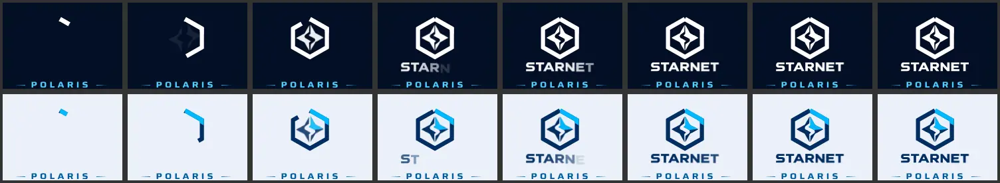
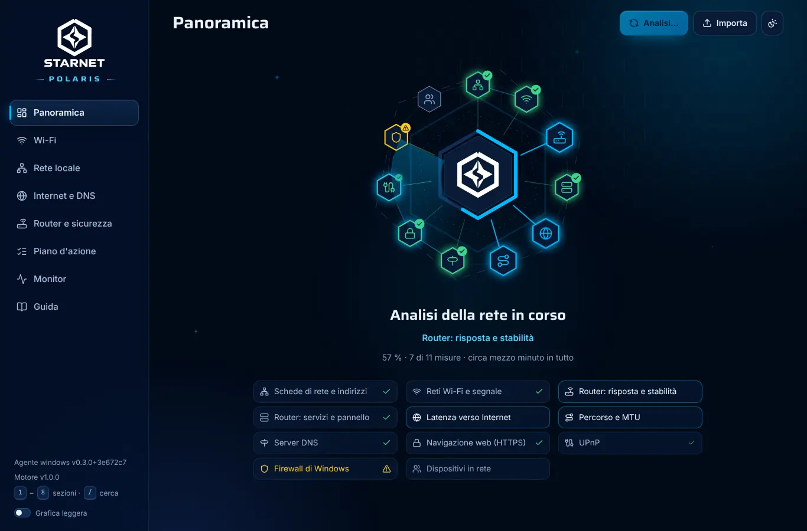
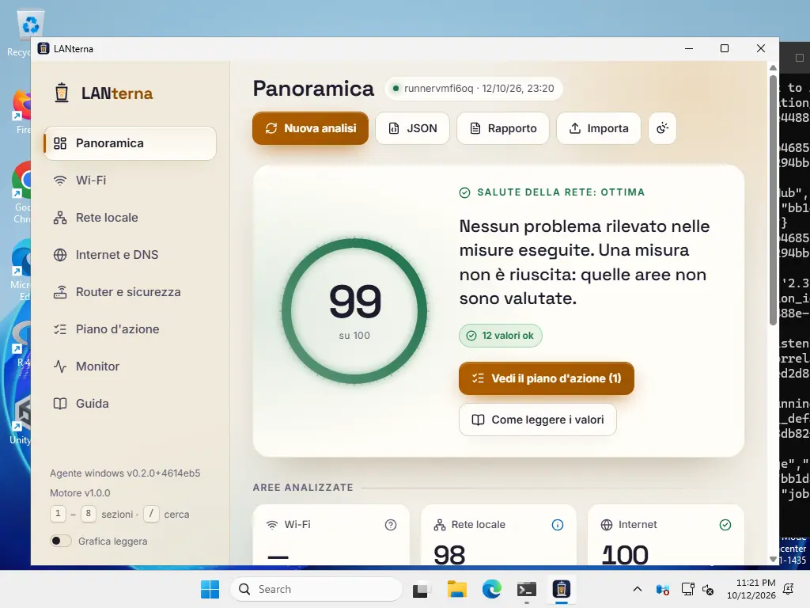
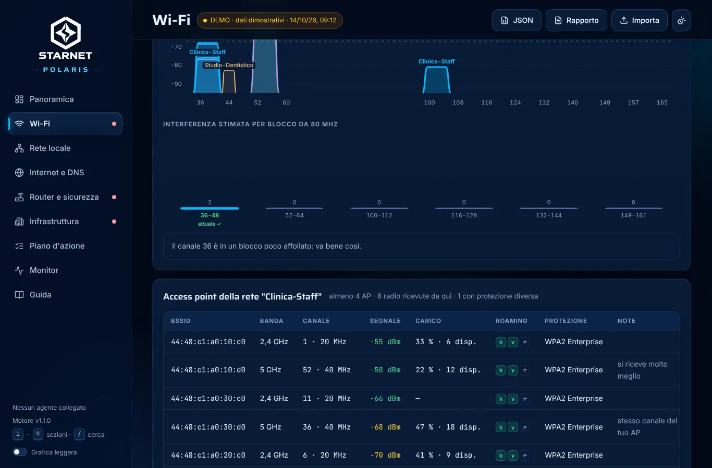
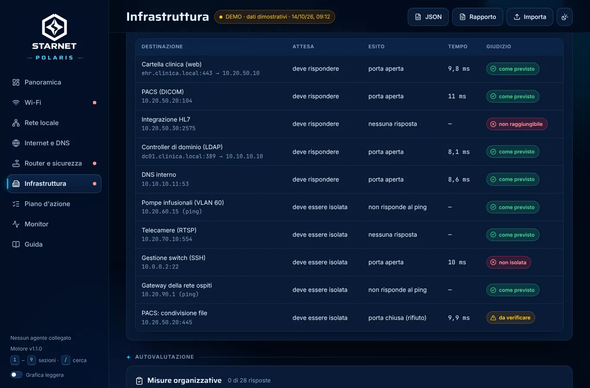
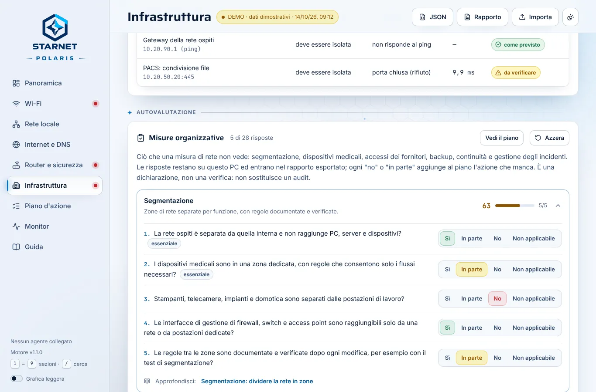

# Verifiche

Cosa è stato verificato, come, e cosa resta da provare. Versione attuale: 0.12.0 (9 novembre 2026), il computer seconda
parte: dispositivi e driver, avvio e affidabilità, aggiornamenti e controlli di Windows, protezione dei dati e degli accessi,
stampanti, test della RAM con Windows acceso, albero USB e programmi nuovi della cassetta (sezione 16); la sezione 15 descrive
la 0.11.0, con i passi guidati nel piano d'azione e i programmi utili dentro le azioni; la sezione 14 la 0.10.0 (schermate blu come
BlueScreenView, mappa del Wi-Fi per stanza, test di velocità di Internet, certificati dei servizi interni), le sezioni dalla 10
alla 13 le versioni dalla 0.6.0 alla 0.9.0. Fino alla versione 0.2.0 il programma si chiamava LANterna:
le sezioni che descrivono prove precedenti riportano i nomi di allora.

## 1. Test automatici

| Parte | Test | Cosa coprono |
| --- | --- | --- |
| Motore di analisi (`core/`, vitest) | 41 | conversioni frequenza/canale e spettro; soglie di ogni metrica ai bordi (es. -67/-68/-75/-76 dBm); diagnosi incrociate (latenza in casa o dell'operatore, router che ignora i ping o non risponde affatto ma inoltra il traffico, perdite misurate via TCP, traceroute con nodo lento o percorso parziale, ping bloccati ma web funzionante); sicurezza (aperta, WEP, TKIP, WPA3, PMF, WPS); piano d'azione senza duplicati e con i critici in testa; rapporto testuale; **il bundle `engine.js` gira come script ES2015 senza moduli né Intl** (come in goja) e dà lo stesso risultato |
| Reti complesse (`core/test/complex.test.ts`) | 21 | AP della rete (un router dual band non conta due volte), AP propri sullo stesso canale con la soglia di -80 dBm, sticky client e giudizio sul segnale che punta all'AP scelto, roaming (802.1X senza 802.11r, funzioni diverse tra AP, Mobility Domain diversi), AP gemello aperto e varianti della stessa protezione, reti delle stesse radio escluse dai vicini e dal consiglio dei canali; dominio e suffisso DNS (anche suffissi domestici e DNS pubblici), server DHCP, sottorete ampia, MAC condivisi; inventario, segmentazione, servizi critici, autovalutazione con le azioni nel piano; rete dimostrativa Clinica; rapporto con i dettagli entro 90 colonne |
| Guide (`core/test/guides.test.ts`) | 17 | identificativi e capitoli, collegamenti interni, misure e azioni citate esistenti, **ogni misura spiegata in almeno una guida**, markup chiuso, tabelle coerenti, glossario senza doppioni, argomenti sanitari presenti, ricerca |
| Decoder 802.11 (`windows/internal/ie`) | 20 | beacon costruiti **byte per byte**: RSN (WPA2, WPA3, transizione, OWE, Enterprise, valori impliciti), WPA in modalità mista con TKIP, WEP dal bit Privacy, WPS, BSS Load, Country, HT 40 MHz sopra/sotto, VHT 80/160 (codifica moderna e deprecata), HE 6 GHz con campi opzionali, EHT 320 MHz, elementi troncati; roaming da Mobility Domain, RM Enabled Capabilities ed Extended Capabilities (anche troncato) e 802.11r dedotto dagli AKM FT |
| Strutture wlanapi (`windows/internal/wlan`) | 6 | `WLAN_BSS_LIST`, `WLAN_CONNECTION_ATTRIBUTES`, `WLAN_INTERFACE_INFO_LIST` costruite byte per byte: RSSI con segno, frequenza in kHz, velocità in unità da 500 kbit/s, offset IE relativo alla voce e fuori dal buffer, conteggi incoerenti, descrizioni UTF-16 |
| Parser netsh (`windows/internal/netsh`) | 4 | output inglese e italiano, anche con lettere accentate storpiate dalla code page CP850; messaggio di Windows 11 sul permesso di posizione |
| Sonde di rete (`windows/internal/probe`) | 12 | proxy di sistema di Windows (proxy unico o per schema, eccezioni `<local>` e con caratteri jolly); pacchetto DNS confrontato byte per byte, server DNS finto (risposta, REFUSED, SERVFAIL, timeout); router UPnP finto completo (SSDP, descrizione XML, SOAP `GetExternalIPAddress`); filtro degli URL SSDP (solo LAN privata); porte; titolo del pannello; HTTPS |
| Orchestrazione (`windows/internal/collect`) | 8 | analisi completa su piattaforma simulata; traceroute; MTU con ricerca binaria; riserva TCP quando l'ICMP non funziona; interruzione rapida se l'host non risponde; assenza di gateway; PC senza scheda Wi-Fi; scelta del metodo nel monitor |
| Server locale (`windows/internal/server`) | 7 | rifiuto di Host estranei, POST da altre origini e cross-site; CSP; tipi dei file dell'interfaccia (font `woff2`, favicon `ico`, CSS con `nosniff`); ciclo avvio, avanzamento e risultato; ping del monitor; avvii concorrenti; inventario (conferma obbligatoria, solo JSON, rete non adatta, già in corso, non disponibile) e verifiche |
| Infrastruttura (`windows/internal/infra`) | 9 | sottorete da esaminare (/22 intera, ripiego sul /24, reti pubbliche e /31 rifiutate), reti private e MAC casuali, inventario con limite di concorrenza, dispositivi visti solo tramite ARP e nomi, interruzione, verifiche (porta aperta, chiusa o filtrata, ping, nomi risolti preferendo IPv4, destinazioni pubbliche rifiutate), validazione, richiesta e risposta NetBIOS byte per byte |
| Motore in goja (`windows/internal/engine`) | 3 | il vero `engine.js` eseguito nell'interprete dell'exe: rapporto e analisi, formattazione dei numeri con la virgola |

In totale 79 test TypeScript e 69 test Go, questi ultimi eseguiti anche con il race detector. Il conteggio del motore di analisi
(41) comprende i test di tutte le versioni precedenti.

## 2. Strutture di Windows confrontate con gli header ufficiali

Gli offset con cui l'agente legge le strutture restituite da Windows sono stati confrontati con quelli calcolati dal compilatore
sugli header ufficiali (mingw-w64 `wlanapi.h`, `iphlpapi.h`, `icmpapi.h`), con un programma C che stampa `offsetof`/`sizeof`,
eseguito sotto Wine. **Tutti coincidono**:

| Struttura | Dimensione | Campi verificati |
| --- | --- | --- |
| `WLAN_INTERFACE_INFO` | 532 | descrizione @16, stato @528; prima voce della lista @8 |
| `WLAN_CONNECTION_ATTRIBUTES` | 604 | associazione @520 (SSID +0, BSSID +40, PHY +48, qualità +56, rx +60, tx +64), sicurezza @588 (autenticazione +8, cifratura +12) |
| `WLAN_BSS_ENTRY` | 360 | BSSID @40, RSSI @56, capability @88, frequenza @92, rate set @96, offset IE @352, dimensione IE @356; prima voce @8 |
| `ICMP_ECHO_REPLY` (x64) | 40 | stato @4, RTT @8, dati @16, opzioni @24 |
| `IP_OPTION_INFORMATION` (x64) | 16 | flag @2, dati opzioni @8 |
| `MIB_IPNETROW` | 24 | MAC @8, indirizzo @16, tipo @20; prima riga @4 |

Verificati anche opcode (`current_connection` = 7, `channel_number` = 8, `rssi` = 0x10000102) e codici ICMP
(`IP_TTL_EXPIRED_TRANSIT` = 11013, `IP_REQ_TIMED_OUT` = 11010, `IP_PACKET_TOO_BIG` = 11009, `IP_FLAG_DF` = 2).

## 3. L'eseguibile Windows eseguito davvero sotto Wine 9.0

Compilato `LANterna.exe` / `lanterna-cli.exe` (Windows x64) ed eseguito sotto Wine in tre modi.

**Rapporto da riga di comando** (`lanterna-cli report`, `LANterna.exe report`): analisi completa in circa 9 s. Funzionano schede
di rete, gateway, ping al router (20/20), traceroute, DNS di sistema e pubblici, verifica HTTPS, tabella dei vicini, porte del
router e UPnP; il sistema viene riconosciuto come "Wine 9.0, emula Windows 10". Senza scheda Wi-Fi e senza PowerShell, Wi-Fi e
firewall risultano correttamente "non riusciti", con il motivo. Rapporto su file: UTF-8 con BOM e fine riga CRLF.

**Server locale + interfaccia vera in Chromium** (lo stesso motore di WebView2): l'interfaccia incorporata nell'exe avvia da sola
l'analisi, mostra le fasi reali, poi i dati misurati (non la demo); "Nuova analisi" e il monitor in tempo reale funzionano; nessun
errore in console; CSP attiva; `Host` estraneo e `POST` da altra origine rifiutati con 403.

**Finestra grafica su display virtuale** (Xvfb): sotto Wine il runtime WebView2 non esiste, quindi si è collaudata la gestione
della sua assenza: compare solo il messaggio che spiega cosa installare e apre l'interfaccia nel browser; con OK il programma
termina. Simulato anche il caso "runtime presente ma guasto": la finestra vuota viene nascosta e il messaggio resta visibile.

**Versione 0.2.0** (nuova interfaccia), stesse tre prove ripetute con l'exe ricompilato: rapporto in 14 s; con `serve`
l'interfaccia incorporata avvia l'analisi e mostra le 11 fasi reali nella nuova schermata (sotto: il firewall, non leggibile sotto
Wine, è segnato in giallo), poi la panoramica con i dati dell'exe e l'avviso "Analisi completata"; i tre font arrivano dall'exe come
`font/woff2` e risultano caricati; monitor con ping veri, seconda analisi dal pulsante, nessun errore in console con la CSP attiva;
la finestra grafica senza WebView2 mostra il messaggio, serve l'interfaccia su una porta libera e con OK termina.

La schermata di analisi di allora è stata sostituita da quella della versione 0.3.0 (sezione 7).

### Difetti trovati grazie a Wine e corretti

1. `GetAdaptersAddresses` con `GAA_FLAG_INCLUDE_GATEWAYS` e `AF_UNSPEC` restituiva `ERROR_NOT_SUPPORTED`: ora i gateway IPv4 si
   leggono con una seconda chiamata `AF_INET`. Senza questa correzione router e DNS non sarebbero stati individuati.
2. Il monitor mostrava il 100 % di pacchetti persi verso Internet dove l'ICMP è filtrato: ora usa il metodo (ICMP o TCP) che ha
   funzionato durante l'analisi.
3. Il traceroute lanciava tutte le sonde nello stesso istante e gonfiava i tempi dei primi salti (51,8 ms contro 4 ms del ping):
   ora le sonde sono scaglionate e si tiene il minimo di due campioni.
4. Senza WebView2, go-webview2 lasciava aperta una finestra vuota dietro il messaggio: ora il runtime si verifica prima di creare
   la finestra.
5. Distruggere quella finestra provocava un `WM_QUIT` che chiudeva subito il messaggio di avviso: ora la finestra viene nascosta.
6. `GET /api/scan` prima della prima analisi rispondeva 404 (errore in console): ora risponde 204.
7. L'avanzamento da riga di comando ripeteva le stesse righe; il titolo diceva "ottima forma" anche con misure non riuscite; un
   traceroute che non raggiunge la destinazione era descritto come "regolare".

## 4. Interfaccia (versione 0.2.0)

**Librerie effettivamente usate** (licenze lette dai file dei pacchetti installati e riportate per intero in
`THIRD_PARTY_NOTICES.md`; l'elenco è ricavato dalla mappa del bundle, quindi contiene solo ciò che è davvero incluso):

| Libreria | Versione | Licenza | Contributo |
| --- | --- | --- | --- |
| Motion | 13.4.4 | MIT | animazioni: cascate d'entrata, molle, transizioni di pagina, indicatori che scivolano, linee SVG che si tracciano, numeri che si assestano |
| lucide-react | 1.48.0 | ISC (alcune icone derivano da Feather, MIT) | tutte le icone |
| @radix-ui/colors | 3.0.0 | MIT | scale dei colori di stato per i due temi |
| Fontsource: Inter, Space Grotesk, JetBrains Mono | 5.3.0 | SIL OFL 1.1 | caratteri, incorporati nell'exe |

Sono state scelte versioni pubblicate da almeno 14 giorni: Motion 13.5.1 (2 ottobre) è stata esclusa e gli `overrides` di npm
fissano i suoi pacchetti interni. Peso del bundle: JavaScript 468 kB (152 kB compressi), CSS 48 kB (12 kB), font 196 kB.

Tutte le prove in Chromium 141 (lo stesso motore di WebView2), sulla build di produzione:

| Verifica | Come | Esito |
| --- | --- | --- |
| Aspetto | 8 sezioni × tema scuro e chiaro × 1366×900 e 390×844, animazioni attive, screenshot esaminati dopo l'assestamento | nessuno scorrimento orizzontale, nessun elemento rimasto invisibile o fuori dal riquadro, nessun errore in console |
| Animazioni | fotogrammi catturati durante l'analisi (agente simulato con avanzamento passo per passo), l'ingresso della panoramica e il cambio tema | sonde che si accendono in ordine, numeri e anello che si assestano, sezioni in cascata, cerchio del nuovo tema che si apre dal pulsante |
| Accessibilità | axe-core 4.11.4, regole WCAG 2.1 A/AA e buone pratiche, 32 combinazioni (8 sezioni × 2 temi × desktop e mobile) con una scheda aperta | 0 violazioni dopo le correzioni sotto |
| Tastiera | Tab dall'inizio, Invio e Spazio, frecce e Home nel selettore della banda, scorciatoie | "Vai al contenuto" per primo; ordine logico; schede, caselle e interruttori con stato ARIA aggiornato; `2` apre il Wi-Fi, `/` la guida con il cursore nella ricerca; le scorciatoie non scattano mentre si scrive |
| Movimento ridotto | `document.getAnimations()` dopo l'entrata | nessuna animazione in corso su panoramica e monitor; durante l'analisi solo brevi transizioni quando una fase termina |
| Grafica leggera | fotogrammi rallentati ad arte (30 ms di lavoro per fotogramma) | si attiva da sola circa 4,5 s dopo il caricamento con l'etichetta "automatica"; su una pagina fluida resta spenta; la scelta manuale vince sulla misura ed è ricordata; il cambio tema diventa immediato |
| Fluidità | tempi tra fotogrammi in Chromium **senza GPU** (rendering software: il caso peggiore, come macchine virtuali e desktop remoto) | 60 fps mediani da fermi, nel cambio pagina, nel cambio banda e nel monitor; fra 30 e 60 fps, secondo l'esecuzione, all'apertura di una scheda (animazione dell'altezza) e all'ingresso della panoramica; circa 30 fps nella rivelazione circolare del tema |
| Esportazioni e import | pulsanti JSON, Rapporto e Importa | file scaricati con il nome atteso e avviso di conferma; il JSON esportato si reimporta ("File importato"); un JSON qualsiasi viene rifiutato con un avviso |

Difetti trovati con queste prove e corretti prima della consegna:

1. I bagliori di sfondo con `filter: blur(70px)` portavano Chromium senza GPU a 12-15 fps: ora sono gradienti radiali già sfumati,
   mossi solo con `transform` (60 fps).
2. Le icone e il logo dentro la schermata di analisi ereditavano `width: 100%` dalla regola del disegno principale e diventavano enormi.
3. In SVG la `y` di Motion è una traslazione, non l'attributo: le etichette dello spettro finivano al doppio dell'altezza. Il badge
   dei nodi perdeva la posizione, perché la scala animata sostituiva l'attributo `transform`.
4. L'azione evidenziata nel piano restava invisibile (un `animate` proprio interrompeva le varianti ereditate): ora è una classe CSS.
5. Una regola `.ring-num span` rimpiccioliva il numero del punteggio.
6. I numeri delle liste nei pannelli che si aprono in altezza venivano tagliati dall'overflow nascosto.
7. Su mobile le etichette della barra in basso si sovrapponevano: ora sono voci di pari larghezza con nomi brevi, mentre il nome
   completo resta per i lettori di schermo. La barra superiore scorre via con la pagina.
8. Le fasce colorate del misuratore del segnale non coincidevano con le soglie del motore (-75/-67 dBm) e le etichette erano
   equidistanti invece che in scala.
9. Nel tema chiaro i colori di stato Radix (passo 11) sulle superfici color carta arrivavano a 4,1-4,3:1: scuriti del 10 % circa,
   ora sono almeno 4,5:1. Anche la tavolozza delle reti nello spettro ha una variante per il tema chiaro.
10. Tabelle scorrevoli non raggiungibili da tastiera e un livello di titolo saltato nelle schede espandibili (axe-core).
11. Le etichette dello spettro attraversate dalle curve: ora hanno una targhetta del colore di fondo, larga quanto il testo misurato.
12. Un errore introdotto durante il lavoro (hook React chiamato in modo condizionale nel logo) mandava in errore l'avvio di
    un'analisi con il movimento ridotto: trovato dalla relativa prova.

## 5. Cosa non è stato possibile verificare qui

| Parte | Perché | Come è stata coperta | Da provare su un PC |
| --- | --- | --- | --- |
| Lettura delle reti Wi-Fi da una scheda vera | Wine non ha schede Wi-Fi | decoder IE e strutture wlanapi collaudati byte per byte; offset confrontati con gli header ufficiali | sezione Wi-Fi: reti, dBm, larghezze, sicurezza della propria rete |
| Finestra WebView2 su un PC | Wine non ha il runtime | Chromium (stesso motore) e **finestra vera su Windows Server 2025 in CI**, con cattura dello schermo (sotto) | nitidezza con ridimensionamento al 125-150 % e su più monitor |
| Fluidità con una GPU vera | il container e la CI non hanno GPU | misure in rendering software (caso peggiore) e grafica leggera automatica | animazioni a 60 fps anche aprendo le schede; con desktop remoto deve attivarsi la grafica leggera |
| Permesso di posizione (Windows 11 24H2+) | serve Windows 11 con scheda Wi-Fi | messaggio di Windows riconosciuto nei test; errore `ACCESS_DENIED` tradotto in istruzioni | con posizione disattivata deve comparire la spiegazione, attivandola le reti |
| UPnP e porte di un router reale | nessun router domestico nel container | router UPnP simulato nei test | modello del router, porte aperte, IP pubblico |
| Inventario di una rete privata vera | la rete del container è 192.0.2.0/24, che non è privata; la rete della CI non va scansionata | primitive simulate nei test (ritmo, concorrenza, ARP, nomi); sotto Wine verificato il rifiuto della rete non privata; in CI il rifiuto senza conferma | tempi su una /24, dispositivi visti solo tramite ARP, nomi NetBIOS di PC e stampanti |
| Roaming 802.11k/v/r da AP veri | nessuna scheda Wi-Fi | elementi costruiti byte per byte secondo lo standard | funzioni e Mobility Domain degli AP di una rete aziendale; segnalazione dello sticky client camminando |
| Verifiche verso una rete segmentata | nessuna VLAN né firewall interni qui | esiti simulati nei test; sotto Wine verifiche vere (indirizzo pubblico rifiutato, ping senza risposta) | distinzione tra porta chiusa e filtrata attraverso un firewall reale |

## 6. Collaudo su Windows reale (CI)

Il workflow `.github/workflows/ci.yml` esegue tutti i test, compila lo zip (artefatto `LANterna-windows-amd64`) e lo collauda su
una macchina `windows-latest` di GitHub (Windows Server 2025, build 26100, scheda di rete virtuale Hyper-V, nessuna scheda Wi-Fi).

**Prima esecuzione** (commit `5baa2c6`), tutti i passi verdi:

- `version`: rilevato WebView2 153.0.4234.48;
- rapporto: schede lette con `GetAdaptersAddresses` (Ethernet 3, 10.1.0.163/20, gateway 10.1.0.1), DNS di sistema 51 ms contro
  Quad9 8,5 ms, HTTPS in 73 ms, **firewall letto via PowerShell** (tre profili attivi, in uso "Pubblica"), analisi in 9,9 s;
- server locale: `204` prima dell'analisi, analisi completa via API con avanzamento, interfaccia servita con CSP;
- **finestra grafica con WebView2 vero**: processo attivo, titolo "LANterna", 6 processi `msedgewebview2`; la cattura dello schermo
  mostra l'interfaccia con i dati reali della macchina e l'icona di LANterna nella barra delle applicazioni.

Difetti trovati su Windows reale e corretti:

1. Il gateway di Azure non risponde né ai ping né a TCP e LANterna lo dichiarava "router non risponde: rete interrotta" (critico)
   mentre Internet funzionava attraverso di lui. Ora: se il traffico verso Internet passa, il router è vivo per definizione e la
   voce diventa informativa, con la spiegazione.
2. "Anche verso il router ci sono perdite" veniva dedotto da un router che non risponde affatto: il confronto ora si fa solo se il
   router risponde. Le perdite misurate con connessioni TCP (ping bloccati) restano al massimo "da migliorare", con la spiegazione
   del limite; i tentativi TCP sono distanziati di 500 ms.
3. La scheda di rete di una macchina virtuale ("Microsoft Hyper-V Network Adapter") era classificata come virtuale: ora sono
   virtuali solo gli switch ("Hyper-V Virtual Ethernet Adapter", "vEthernet").
4. Windows Server 2025 veniva descritto come "Windows 11" (stessa build): ora si distingue con `ProductType`.
5. La finestra chiedeva 1320×880 pixel anche su uno schermo 1024×768 e, centrata da go-webview2 con aritmetica senza segno, usciva
   a sinistra. Ora la dimensione segue la scala DPI del sistema ed è limitata al 94 % dell'area di lavoro.

**Seconda esecuzione** (commit `d7458a9`), tutti i passi verdi, correzioni confermate: sistema descritto come "Windows Server 2025
(build 26100)"; scheda "Ethernet 3" classificata come cavo (100 Gbit/s); con i tentativi TCP distanziati, 8 risposte su 8 da tutti e
tre i server pubblici (le "perdite" della prima esecuzione dipendevano dai tentativi troppo ravvicinati); router silenzioso ma
funzionante descritto come informazione; punteggio 99/100; la finestra sta interamente nello schermo.

**Terza esecuzione** (commit `4614eb5`, versione 0.2.0 con la nuova interfaccia), tutti i passi verdi: analisi in 9,5 s su
"Windows Server 2025 (build 26100)"; via API tutte le 11 fasi, con la sola "Router: risposta e stabilità" in errore (il gateway di
Azure non risponde né ai ping né a TCP, ed è descritto come informazione); 8 risposte su 8 da ciascuno dei tre server pubblici,
misurate via TCP; finestra WebView2 attiva con titolo "LANterna" e 6 processi `msedgewebview2`. La cattura mostra la nuova
interfaccia nel tema chiaro (quello impostato in Windows su quella macchina), con i font incorporati, il punteggio 99/100 e la
disposizione a tre colonne di una finestra larga circa 950 pixel. La grafica leggera non è scattata, quindi anche su quella
macchina virtuale la mediana dei tempi tra i fotogrammi è rimasta sotto 26 ms.

La cattura di questa esecuzione è stata sostituita da quella della versione 0.3.0 (sezione 7).

## 7. Versione 0.3.0: marchio STARNET e nome STARNET Polaris

**Marchio.** I master del pacchetto STARNET 22 sono copiati in `brand/` senza modifiche: le impronte SHA-256 coincidono con il
`MANIFEST.json` del pacchetto. I tracciati usati dall'interfaccia sono generati da `scripts/brand.mjs`, che verifica anche la
struttura del master (ritagli delle parti ciano, sette lettere). Regole della guida applicate e controllate sulle catture: logo
bianco sui fondi scuri, a colori sui chiari, solo il simbolo negli spazi piccoli, nessuna ombra né deformazione. L'animazione
d'entrata è stata controllata fotogramma per fotogramma nei due temi: la cornice si rivela in senso orario dal vertice alto (nel
tema chiaro compare per primo proprio il tratto ciano), le metà della stella si incastrano, le lettere arrivano in sequenza e
l'ultimo fotogramma è il logo originale.

**Nome ed eseguibili.** `Polaris.exe` (finestra) e `polaris-cli.exe` (console); cartella dei dati di WebView2
`%LOCALAPPDATA%\STARNET Polaris`. Nelle risorse dell'exe ci sono nome, descrizione, `CompanyName` STARNET e versione 0.3.0.
L'icona è il simbolo a colori su piastra bianca, renderizzato dal vettoriale a 9 dimensioni (16-256 px): leggibile sulla barra
delle applicazioni chiara e su quella scura.

**Carattere.** Saira 5.3.0 (OFL 1.1, pubblicato il 19 luglio 2026) sostituisce Space Grotesk per i titoli, con l'asse della larghezza
al 108-125 % per avvicinarsi alla scritta STARNET. Il confronto è stato fatto a schermo con Michroma, Exo 2 e Chakra Petch.
Nell'interfaccia servita dall'exe sotto Wine i titoli risultano in "Saira Variable" al 112 % e i file dei caratteri arrivano
come `font/woff2` e risultano caricati.

**Colori.** Contrasti calcolati prima di applicarli. Nel tema scuro testo e accenti stanno fra 5,4:1 e 17,7:1. Nel tema chiaro
le azioni sono in blu profondo con testo bianco (13,5:1) e i colori di stato sono scuriti quanto basta per restare almeno a
4,5:1 anche sulle superfici tinte. Il blu e il ciano restano al marchio: le informazioni usano l'indaco.

**Stessa batteria della sezione 4**, sulla build finale:

| Verifica | Esito |
| --- | --- |
| Aspetto (8 sezioni × 2 temi × desktop e mobile) | nessuno scorrimento orizzontale, nessun elemento invisibile o fuori dal riquadro, nessun errore in console |
| axe-core 4.11.4, WCAG 2.1 A/AA (32 combinazioni) | 0 violazioni |
| Tastiera | invariata: "Vai al contenuto", ordine logico, frecce e Home nel selettore, Invio e Spazio, scorciatoie `1`…`8` e `/` |
| Movimento ridotto | nessuna animazione in corso dopo l'entrata (anche le stelle dello sfondo si fermano) |
| Grafica leggera | automatica dopo 4,6 s con fotogrammi lenti; scelta manuale ricordata; cambio tema senza transizione |
| Esportazioni e import | file scaricati, JSON reimportato, file estraneo rifiutato con il nuovo nome nel messaggio |
| Fluidità senza GPU | 60 fps mediani da fermi, nei cambi pagina, nell'apertura delle schede, nel cambio banda e nel monitor; circa 30 fps nella rivelazione circolare del tema |

Revisione visiva: due difetti trovati e corretti. Nel grafico della latenza verso Internet Cloudflare e Quad9 avevano quasi lo
stesso viola, e su mobile il marchio spariva insieme alla barra laterale (ora il simbolo resta nella barra superiore).

**Exe sotto Wine nei tre modi**:
- **rapporto**: 14,5 s, intestazione "STARNET Polaris - rapporto di diagnostica di rete";
- **server**:
  - analisi in 14,8 s con le 11 fasi, nella nuova schermata (sotto);
  - favicon servito come `image/x-icon`;
  - monitor con ping veri e seconda analisi dal pulsante;
  - nessun errore in console;
- **finestra senza WebView2**: messaggio con il nuovo nome, interfaccia su una porta libera, chiusura con OK.

**Windows reale (CI, commit `b725f9e`)**, tutti i passi verdi:
- rapporto, server con le API e finestra WebView2 attiva con titolo "STARNET Polaris";
- nella cattura si vedono la nuova icona nella barra del titolo e in quella delle applicazioni, il logo a colori nel tema chiaro
  impostato su quella macchina e il punteggio 99/100 nell'esagono;
- la finestra alta 720 pixel ha mostrato che in fondo alla barra laterale l'interruttore "Grafica leggera" restava fuori vista:
  ora la barra scorre e sugli schermi bassi il logo è più compatto.

## 8. Versione 0.4.0: guide di rete, reti complesse e strutture sanitarie

**Cosa è nuovo.** La biblioteca di 48 guide con glossario e centro guide (commit `c0c2fb1`); il motore 1.1.0 con le analisi delle
reti con più access point e delle reti aziendali e la categoria Infrastruttura; nell'agente il pacchetto `infra` (inventario e
verifiche su richiesta), la lettura del roaming dai beacon, di dominio, suffisso DNS e server DHCP; nell'interfaccia la sezione
Infrastruttura, gli AP della rete nella sezione Wi-Fi, il monitor di sessione e la rete dimostrativa Clinica (commit `c6d0887`).

**Interfaccia**, prove in Chromium 141 sulla build di produzione, con entrambe le reti dimostrative:

| Verifica | Esito |
| --- | --- |
| Aspetto (9 sezioni × 2 temi × desktop e mobile, reti Casa e Clinica) | nessuno scorrimento orizzontale, nessun elemento invisibile o fuori dal riquadro, nessun errore in console |
| axe-core 4.11.4, WCAG 2.1 A/AA e buone pratiche (36 combinazioni per rete, con una scheda aperta e una risposta data) | 0 violazioni dopo la correzione sotto |
| Percorso interattivo (25 controlli) | tasto `6`; pulsante dell'inventario disattivo finché non si conferma l'autorizzazione; barra di avanzamento; filtro; CSV con intestazione e BOM; esempi delle destinazioni; campi vuoti segnalati; indirizzo pubblico "non verificato"; risposte da tastiera con le frecce; giudizio e azione nel piano; JSON esportato con inventario, verifiche e autovalutazione; risposte conservate dopo il ricaricamento; monitor che continua cambiando sezione, con il pallino nella navigazione e il CSV; AP della rete nella demo Clinica |
| Barra in basso su telefono | nove voci con le etichette a 390 px; sotto 370 px solo le icone (il nome resta per i lettori di schermo); nessuno sbordo a 360 e 320 px |
| Fluidità senza GPU | 60 fps mediani entrando in Infrastruttura, aprendo un'area dell'autovalutazione, rispondendo, durante l'inventario simulato, aggiungendo una destinazione, nel monitor e nella tabella degli AP; p95 di 33 ms solo all'ingresso del monitor |

**Exe 0.4.0 sotto Wine 9.0, nei tre modi:**
- **rapporto**: analisi in 14,1 s;
- **server**, nuove API con l'agente vero:
  - `415` senza corpo JSON, `400` senza conferma, `422` sulla rete del container ("192.0.2.2 non è un indirizzo privato");
  - `403` con `Origin` o `Host` estranei, `400` con una destinazione vuota;
  - verifiche in 1,8 s: indirizzo pubblico e `localhost` non verificati, ping senza risposta "isolato come previsto";
- **interfaccia servita dall'exe** (Chromium):
  - il rifiuto della rete non privata compare come avviso;
  - le verifiche danno gli esiti veri e i giudizi;
  - il monitor misura con ping veri, senza l'avviso della demo;
  - in console resta solo la riga del browser sulla risposta `422`, attesa;
- **finestra senza WebView2**: messaggio con l'indirizzo dell'interfaccia su una porta libera, chiusura con OK.

**Windows reale (CI).** I commit `c6d0887` e `859c820` hanno superato test, build e collaudo su Windows reale (Windows Server 2025,
build 26100). Al collaudo si è aggiunto un controllo prudente delle nuove API, senza scansionare la rete della CI:
- l'agente legge il suffisso DNS della connessione (`…gx.internal.cloudapp.net`), il server DHCP (168.63.129.16, quello della
  piattaforma Azure) e un dominio vuoto, come atteso per una macchina fuori dominio;
- l'inventario senza conferma è rifiutato con `400`;
- la verifica verso il gateway, un ping con `IcmpSendEcho`, dà "nessuna risposta": il gateway di Azure ignora i ping (sezione 6);
- la finestra WebView2 è attiva con il titolo "STARNET Polaris" e 6 processi `msedgewebview2`.

Il rapporto di quella macchina ha mostrato un difetto, corretto nella versione consegnata: la sottorete /20 della rete cloud
portava nel piano "Correggi la separazione tra le zone", un'azione pensata per le eccezioni del test di segmentazione. Ora le
sottoreti ampie rimandano a un'azione propria ("Dividi la rete in zone separate"), con un giudizio condizionale: è una rete
piatta solo se ospita insieme PC, ospiti e dispositivi.

**Difetti trovati e corretti durante il lavoro:**
1. Un router dual band rischiava di contare come due AP: il conteggio ora è per banda.
2. Le reti ospiti e dispositivi trasmesse dallo stesso AP risultavano "reti vicine" sul proprio canale e falsavano il consiglio
   dei canali.
3. Una radio estranea con il nome della rete entrava nel conteggio degli AP e nelle coppie sullo stesso canale.
4. Con più AP i canali da 40 MHz, scelta corretta, erano segnalati come limite di velocità.
5. Con lo sticky client il giudizio sul segnale suggeriva di avvicinarsi al router invece di correggere il roaming.
6. Una rete WPA2-Enterprise era descritta come protetta "da una password lunga".
7. La tabella ARP scartava gli indirizzi che finiscono in .255, validi nelle sottoreti /22 e /23.
8. Lo stato salvato nel browser non seguiva il cambio di chiave: passando da una rete dimostrativa all'altra restavano le
   risposte della prima.
9. Un elenco vuoto delle destinazioni aveva il ruolo di elenco senza voci (axe-core).
10. Testi: "1 sono stati visti", parentesi doppie nelle destinazioni, puntini seguiti dal punto.

**Avvertenze.** Le guide e le domande dell'autovalutazione sono state scritte senza consultare le fonti primarie durante questo
lavoro: articoli, termini di notifica e riferimenti normativi (GDPR, NIS2, dispositivi medicali) sono una sintesi da verificare sui
testi ufficiali e non costituiscono consulenza legale. Inventario, verifiche e lettura del roaming sono collaudati con dati simulati
e sotto Wine, non ancora su una rete aziendale vera (sezione 5).

| AP della rete | Esiti delle verifiche | Autovalutazione |
| --- | --- | --- |
|  |  |  |

## 9. Versione 0.5.0: il computer, test di velocità e guida all'uso

**Cosa è nuovo.** Nell'agente i pacchetti `pcinfo` (dati del computer: API native più un unico script PowerShell con uscita JSON)
e `bench` (test di velocità di processore e dischi), due nuove fasi dell'analisi ("Computer: sistema, dischi ed eventi" e
"Computer: carico e processi"), le API `/api/bench` e il comando `polaris-cli bench`. Nel motore 1.2.0 la categoria Computer con
21 metriche e 20 azioni, il calendario di supporto di Windows e il punteggio di PC e rete insieme. Nell'interfaccia la sezione
Computer (10 sezioni, tasti `1`…`0`), l'invito alla guida d'uso e la Guida come icona in alto su telefono. Nella biblioteca due
capitoli nuovi, "Usare STARNET Polaris" (6 guide) e "Il computer" (10 guide), e 33 voci di glossario.

**Test automatici.**

| Insieme | Esito |
| --- | --- |
| Motore e guide (vitest) | 141 test superati, 62 dei quali sul computer: supporto di Windows per versione, edizione e data (12 casi), soglie di RAM, carico, dischi, temperature, usura, spazio, avvio, eventi, antivirus, aggiornamenti, batteria, alimentazione, driver video e test di velocità; demo, rapporto testuale, urgenza del disco nel titolo e nel piano |
| Agente (Go, anche con `-race`) | 92 test superati: interpretazione dell'uscita di PowerShell (con BOM e righe di avviso), tipo di disco, salute, eventi, valori di avvio, pulizia dei percorsi, nomi di Windows, piani di alimentazione, raggruppamento dei processi, test del processore e del disco (con interruzione e file cancellato), spazio insufficiente, API dei test e loro esclusione reciproca con l'analisi |
| Motore in goja | rapporto con dati del computer: date in italiano ("dall'11 novembre 2025", "l'8 ottobre 2026"), codice di arresto spiegato, disco guasto come prima azione |
| `GOOS=windows go vet` | nessun problema |

**Interfaccia**, Chromium 141 sulla build di produzione:
- axe-core, WCAG 2.1 A/AA e buone pratiche, 10 sezioni × 2 temi × desktop e telefono, reti Casa e Clinica: 0 violazioni dopo le
  correzioni sotto;
- test di velocità simulati: avanzamento con fase e velocità, grafico secondo per secondo, risultati, giudizi nella
  valutazione, cronologia;
- barra in basso su telefono con nove voci e la Guida nella barra in alto;
- fluidità senza GPU: 60 fps mediani entrando nella sezione Computer, da fermi, aprendo una scheda e durante i test simulati
  (p95 di 33 ms solo durante il test del processore, quando il grafico si aggiorna).

**Exe 0.5.0 sotto Wine 9.0:**
- **rapporto**: tutte le fasi, compresa quella del computer, con sistema (Wine si presenta come Windows 10 Pro), processore,
  memoria, volumi, alimentazione e processi letti dalle API native; PowerShell in Wine non risponde e la nota lo dice;
- **test da riga di comando**: processore e disco `C:` completati, nessun file `polaris-test-*` rimasto (i valori del disco
  sotto Wine non sono indicativi: Wine passa comunque dalla cache del sistema ospite);
- **API**: `400` senza conferma, `400` con un'unità non valida, `422` con un'unità inesistente, `202` per il processore, `409`
  per un'analisi durante il test, avanzamento, `DELETE` con "test interrotto";
- **interfaccia servita dall'exe**: analisi, sezione Computer con la nota su PowerShell, test del processore (25 s reali) e del
  disco con i risultati e i giudizi, interruzione, JSON esportato con i test, test conservati dopo una nuova analisi, nessun
  errore della pagina.

**Difetti trovati e corretti durante il lavoro:**
1. Il registro eventi a livello informativo contiene Ntfs 98 "volume integro" a ogni avvio: ora si leggono solo i livelli
   critico, errore e avviso.
2. Kernel-Power 41 ed EventLog 6008 dello stesso spegnimento venivano sommati.
3. Senza privilegi alcune versioni di Windows restituiscono i contatori di affidabilità vuoti invece di un errore: non contano
   più come dati SMART presenti (e la nota sull'amministratore compare).
4. Un elenco antivirus vuoto e un Centro sicurezza illeggibile erano indistinguibili: ora `[]` e `null`.
5. I valori PowerShell interi (velocità di rotazione `0xFFFFFFFF`, stato dell'antivirus) potevano traboccare: letti come `long`.
6. Il taglio del dettaglio degli eventi poteva spezzare un carattere accentato.
7. La classe `.gauge` del nuovo indicatore dei dischi coincideva con quella dell'esagono del punteggio.
8. Titoli con i due punti doppi ("Spazio libero su D::"), "Errori di lettura corretti" per un contatore che li comprende tutti,
   "quasi libero" anche con il processore al 43 %.
9. axe-core: un `span` dentro un elenco di definizioni; la cascata di 29 azioni del piano durava quasi due secondi (ora ogni
   elenco lungo compare entro 0,6 s).
10. Un'unità inesistente veniva accettata dall'API e falliva solo dopo: ora è rifiutata subito con `422`.

**Windows reale (CI, commit `17e1c5b`)**, tutti i passi verdi su Windows Server 2025 Datacenter 24H2 (build 26100.33438),
AMD EPYC 7763 con 4 thread e 16 GB, eseguito come amministratore:
- **dati del computer** letti davvero, compresi quelli che passano da PowerShell: sistema, edizione e build; core e thread;
  memoria; due dischi virtuali Hyper-V (bus SAS, tipo non dichiarato, integri) collegati ai volumi `C:` e `D:`; registro eventi
  letto, senza eventi rilevanti negli ultimi 30 giorni; tre programmi all'avvio; 81 processi `svchost.exe` raggruppati in una
  riga; piano "High performance"; ultimo aggiornamento del 5/9/2026; nessun riavvio in sospeso;
- l'antivirus arriva dalla riserva `Get-MpComputerStatus`, perché su Windows Server il Centro sicurezza non esiste: Microsoft
  Defender con la protezione in tempo reale disattivata, come sulle macchine della CI. Il giudizio critico e la prima azione del
  piano ("Attiva la protezione antivirus") sono corretti per quella macchina;
- i dischi virtuali non forniscono contatori di affidabilità nemmeno da amministratore: compare la spiegazione invece dei
  valori, e la scheda video Hyper-V è esclusa dal giudizio sui driver;
- **test da riga di comando**: processore 16,1 MB/s con un thread e 50 con quattro; disco `C:` in versione breve con 825 MB/s in
  lettura sequenziale e 3.697 IOPS in lettura casuale 4K, scritture limitate dalla piattaforma; nessun file di prova rimasto;
- **API**: analisi con le 13 fasi, `400` e `422` per le richieste del disco senza conferma o con unità inesistente, test del
  processore completato in 24 s con 20 campioni stabili (finale al 101 % della punta);
- **finestra WebView2** attiva con il titolo "STARNET Polaris" e 6 processi `msedgewebview2`: nella cattura il punteggio di PC e
  rete, il pallino rosso su Computer, il link "Come si usa" e l'invito alla guida.

**Avvertenze.** Le date di supporto di Windows (Windows 11 per versione ed edizione, Windows 10 ed ESU), i codici di arresto e le
soglie indicative dei test sono stati scritti senza consultare le fonti durante questo lavoro: vanno verificati sul sito
Microsoft e sono riportati come tali nelle guide. Dischi, eventi, antivirus e aggiornamenti dipendono da PowerShell, che sotto
Wine non è disponibile: su Windows reale li ha verificati la CI, ma su una macchina virtuale, quindi senza contatori SMART né
batteria. Su un PC fisico con dischi veri, batteria ed eventi reali restano da provare. La temperatura del processore non viene
letta.

## 10. Versione 0.6.0: SMART, CrystalDiskMark, scheda tecnica, Defender e programmi inclusi

**Cosa è nuovo.**
- **Agente.** In `pcinfo`:
  - SMART letto direttamente dal disco (attributi ATA con soglie, registro di salute NVMe);
  - scheda tecnica da API native e dallo script.
- **Nuovi pacchetti dell'agente.**
  - `defender`: stato, minacce, scansioni con `MpCmdRun`, API `/api/defender`, comando `polaris-cli defender`;
  - `tools`: cassetta degli attrezzi, API `/api/tools` e `/api/open`.
- **Test del disco.** Usa il profilo di CrystalDiskMark con I/O sovrapposto.
- **Motore 1.2.0.** Sette metriche nuove (canali e velocità della memoria, Secure Boot, TPM, requisiti di Windows 11, minacce,
  protezione di Defender) e quattro azioni.
- **Interfaccia.** Tabella SMART e registro NVMe, griglia di CrystalDiskMark, schede Scheda tecnica, Antivirus e Cassetta degli
  attrezzi.
- **Guide.** 66 guide e 188 voci di glossario.
- **Pacchetto.** Contiene CrystalDiskInfo 9.9.2 e CrystalDiskMark 9.0.3 nella cartella `strumenti`.

**Test automatici.**

| Insieme | Esito |
| --- | --- |
| Motore, guide e catalogo (vitest) | 166 test superati, 84 dei quali sul computer: regole di stato SMART (attributo guasto alla soglia, attributi di attenzione 05, C5, C6, BB, bit di avviso NVMe), errori non correggibili non contati due volte, profilo del disco, memoria e canali, Secure Boot, TPM, Windows 11, minacce e protezione di Defender; il catalogo della cassetta, compresi i programmi inclusi |
| Agente (Go, anche con `-race`) | 116 test superati, tra cui: ATA pass-through e attributi costruiti byte per byte, registro NVMe; profondità di coda reale e interruzione del test del disco; topologia del processore e cache; interpretazione di stato e minacce di Defender ed esclusione reciproca con i test; lista bianca degli strumenti, rilevamento dei programmi installati, programmi inclusi (copia integra, alterata, mancante, architettura senza eseguibile), precedenza della copia verificata; API con codici `404`, `400`, `422` e `409` |
| Coerenza tra le parti | un test dell'agente confronta catalogo, siti e versioni incluse con `core/src/tools.ts`, `scripts/strumenti.sh` e `scripts/notices.sh` |
| Motore in goja | rapporto con SMART, scheda tecnica e Defender |
| `GOOS=windows go vet`, `gofmt`, `tsc` | nessun problema |

**Programmi inclusi: provenienza e integrità.**
- **Fonte.** Il sito ufficiale crystalmark.info rimanda alla pagina SourceForge del produttore.
- **Versioni.** Pubblicate da almeno 14 giorni: CrystalDiskInfo 9.9.2 del 25/07/2026 (la 9.9.3 aveva 8 giorni) e
  CrystalDiskMark 9.0.3 del 23/05/2026.
- **Download.** Il primo tentativo è stato rifiutato da un mirror di SourceForge (risposta `403`, non dal proxy dell'ambiente).
  Il secondo, servito da un altro mirror, è riuscito.
- **Dimensione e MD5.** Coincidono con quelli pubblicati da SourceForge per gli stessi file (8.533.389 byte, MD5
  `f27564837d3a4c77813bc69769bacf5c`; 3.725.706 byte, MD5 `b93d7c56381d0d765a3fc8238da611f0`). L'impronta SHA-256 degli
  archivi è fissata in `scripts/strumenti.sh`.
- **Estrazione.** Dopo l'estrazione i 642 + 242 file sono identici byte per byte a quelli degli archivi, senza file in più.
- **Firma digitale.**
  - Gli eseguibili contengono una firma Authenticode EV emessa da GlobalSign a CrystalMark Inc.: il soggetto è stato letto con
    OpenSSL.
  - Su Windows reale `Get-AuthenticodeSignature` la dà **Valid**.
- **Licenze lette** nell'archivio:
  - MIT per i due programmi e per PolyHook 2.0, win32-darkmode, menubar theme, NVMeInterpreter, SlotSpeedGetter, MailKit,
    MimeKit e DiskSpd;
  - BSD per opus-tools;
  - GCC Runtime Library Exception per libgcc;
  - licenza propria per la libreria AMD_RC2t7, le cui impronte coincidono con quelle dichiarate nel suo file.
- **CPU-Z.** La pagina ufficiale lo dichiara solo "freeware" e non ne concede la ridistribuzione: resta un collegamento.

**Interfaccia**, Chromium 141 sulla build di produzione:
- **axe-core** (WCAG 2.1 A/AA e buone pratiche): 0 violazioni.
  - 10 sezioni × 2 temi × desktop e telefono, reti Casa e Clinica.
  - Sezione Computer con un agente simulato (API intercettate) che riporta una copia inclusa, una alterata e un programma
    installato, in 4 combinazioni di tema e schermo.
- **A 390 px** nessuno scorrimento orizzontale; la tabella SMART diventa un elenco.
- **Immagini aggiornate:** dischi con SMART, test di velocità, scheda tecnica, Antivirus e programmi inclusi.

**Exe 0.6.0 sotto Wine 9.0:**
- **Prove precedenti di questa versione:**
  - test del disco con I/O sovrapposto completato, file di prova cancellato;
  - scheda tecnica letta dalle API native;
  - API di Defender e degli strumenti con i codici attesi.
- **Programmi inclusi**, su una copia del pacchetto. Nessun programma è stato avviato sotto Wine.
  - `/api/tools` riconosce CrystalDiskInfo 9.9.2 e CrystalDiskMark 9.0.3, senza percorsi.
  - Dopo l'aggiunta di un byte a `DiskMark64.exe` la copia risulta alterata e `/api/open` risponde `422` con il messaggio.
  - CPU-Z non installato: `422`. Un percorso al posto dell'identificativo: `404`.
- **Interfaccia servita dall'exe:**
  - badge "Incluso in Polaris" e pulsanti Apri;
  - avviso sulla copia alterata, poi scomparso dopo il ripristino del file;
  - scorciatoie nelle schede Dischi e Test di velocità;
  - nessun errore della pagina, anche a 390 px.

**Difetti trovati e corretti durante il lavoro:**
1. La tabella SMART era troppo larga sui telefoni ed ereditava le maiuscole delle intestazioni: ora compatta e, sugli schermi
   stretti, a elenco.
2. Gli errori non correggibili comparivano due volte, dai contatori di Windows e dagli attributi 187/198.
3. Una regola CSS per il telefono era scritta prima di quella generale e non aveva effetto.
4. L'avanzamento dell'inventario di rete poteva fermarsi a 5 su 6: due goroutine riferivano in ordine inverso.
5. Le dimensioni da 10 TB in su avevano troppi decimali.
6. Nel collaudo in CI `@($null).Count` vale 1 in PowerShell e falsava il numero di attributi SMART stampato.

**Windows reale (CI).** Run 39180459370 sul commit `1eceb50`: tutti i passi verdi su Windows Server 2025 Datacenter 24H2 (build
26100.33438), eseguito come amministratore. Verdi anche i run dei commit precedenti: SMART, profilo di CrystalDiskMark, scheda
tecnica, Defender, cassetta degli attrezzi.
- **Scheda tecnica.**
  - Macchina virtuale Hyper-V, firmware UEFI, Secure Boot disattivato, nessun TPM.
  - Processore AMD famiglia 25 modello 1, con cache L1/L2/L3 e istruzioni fino ad AVX2.
  - Due moduli di memoria virtuali senza velocità dichiarata.
- **SMART.** I dischi virtuali non forniscono attributi: è il comportamento atteso, e compare la spiegazione.
- **Test del disco breve.**

  | Profilo | Lettura MB/s | Scrittura MB/s |
  | --- | --- | --- |
  | SEQ1M Q8T1 | 527,4 | 178,2 |
  | SEQ1M Q1T1 | 406,3 | 176,1 |
  | RND4K Q32T1 | 21,3 (5.208 IOPS) | 2,5 (609 IOPS) |
  | RND4K Q1T1 | 19,4 (4.728 IOPS) | 2,7 (653 IOPS) |

  Nessun file di prova rimasto.
- **Microsoft Defender.**
  - Modalità normale, protezione in tempo reale e da manomissioni disattivate sul runner.
  - Firme 1.461.96.0 di giornata, cronologia vuota.
  - Via API: azione non valida `400`; scansione rapida avviata, test di velocità rifiutato durante la scansione, interruzione
    riuscita.
  - Da riga di comando: scansione rapida completata in 41 s, nessuna nuova minaccia.
- **Programmi inclusi.**
  - Firma **Valid** di CN=CrystalMark Inc. per i due eseguibili.
  - `/api/tools` con le versioni 9.9.2 e 9.0.3.
  - `/api/open` ha avviato `DiskMark64.exe` e `DiskInfo64.exe` dalle loro cartelle (poi chiusi).
  - Con un byte aggiunto a `DiskMark64.exe` la copia è segnalata come alterata, `/api/open` risponde `422` e il programma non
    parte.
- **Finestra WebView2.** Titolo "STARNET Polaris", 6 processi `msedgewebview2`.

**Avvertenze.**
- **Dischi fisici.** SMART e registro NVMe sono verificati con strutture costruite byte per byte e sui dischi virtuali della CI,
  che non hanno attributi: su un PC fisico con dischi SATA e NVMe veri restano da provare.
- **Scheda tecnica.** Core P ed E, moduli di memoria reali e TPM vanno provati su hardware vero.
- **Minacce di Defender.** Le minacce della cronologia sono verificate solo con i test: il runner non ne aveva.
- **Permessi di amministratore.** In CI i programmi inclusi sono partiti senza richiesta, perché il runner è già amministratore.
  Su un PC normale CrystalDiskInfo chiede i permessi; il messaggio per una richiesta annullata è verificato solo con i test.
- **Licenze.** Le condizioni sono riportate come lette nei testi originali. Non sono una consulenza legale: in particolare la
  clausola sulla vendita della libreria AMD_RC2t7 va verificata se Polaris venisse distribuito a pagamento.

## 11. Versione 0.7.0: programmi scaricati, kit senza Internet, documento, animazioni, suoni e velocità dei core

**Cosa è nuovo.**
- **Agente.**
  - `tools.Fetcher`: versioni portable scaricate su richiesta dal sito del produttore (CPU-Z, HWiNFO, AdwCleaner, Microsoft
    Safety Scanner, ESET Online Scanner, Autoruns, Process Explorer, WizTree) e verificate con la firma Authenticode al download
    e a ogni avvio; kit per i PC senza Internet nella cartella `strumenti-scaricati` accanto a Polaris.
  - `cpuclock`: velocità dei core in tempo reale dai contatori delle prestazioni di Windows (PDH), senza driver.
  - `winps`: avvio di Windows PowerShell senza i moduli ereditati da PowerShell 7.
  - Bus nominale del processore (SMBIOS) nella scheda tecnica.
  - API `/api/tools/fetch`, `/api/tools/kit`, `/api/tools/remove`, `/api/cpu/clock`; comandi `polaris-cli report --html`,
    `tools status`, `tools kit`, `clock`.
- **Motore.** Documento stampabile sullo stato del PC (`document.ts`), HTML A4 autonomo, usato anche dall'exe tramite goja.
- **Interfaccia.** Cassetta degli attrezzi con download, conferma, avanzamento e kit; anteprima del documento con stampa, PDF e
  HTML; icone e caricamenti animati; suoni con interruttore; velocità dei core in tempo reale nella scheda tecnica.
- **Guide.** 66 guide e 192 voci di glossario (nuove: Core Speed, Turbo, BCLK, Moltiplicatore).
- **Pacchetto.** BlueScreenView 1.55 si aggiunge a CrystalDiskInfo e CrystalDiskMark nella cartella `strumenti`.

**Test automatici.**

| Insieme | Esito |
| --- | --- |
| Motore, guide, interfaccia (vitest) | 179 test superati, tra cui: documento (sezioni, caselle del piano, logo a colori, nessuna risorsa esterna, filtro di MAC e IP pubblici, stili confinati in `.pdoc`); suoni con un contesto audio finto (note, inviluppi senza clic, preferenza salvata, muti fino al primo gesto, segnali non accavallati); simulazione e storico della velocità dei core |
| Agente (Go, anche con `-race`) | 141 test superati, tra cui: download con server TLS di prova (rimandi, host ammessi, file troppo grandi, pagine web al posto del file, zip con percorsi fuori cartella, impronta, firma attesa e diversa, interruzione, nuovi tentativi); kit (copia nel kit vista da un altro profilo senza rete, precedenza della copia del PC, eliminazione, cartella non scrivibile senza percorsi nel messaggio); cache delle impronte; preparazione del kit via API (coda, pronti, non riusciti, interruzione, eliminazione di un programma in coda rifiutata); ambiente di PowerShell senza `PSModulePath` e prima riga d'errore; frequenza dei core (ordinamento numerico, riserva della nominale, valori assurdi scartati, due raccolte alla prima lettura, cache, chiusura per inattività, riapertura dopo un errore); API `/api/cpu/clock` con `200`, `501` e `503` |
| Coerenza tra le parti | un test dell'agente confronta il catalogo dei download (host, firmatario, versione fissata, scadenza) con `core/src/tools.ts` |
| Download reali (`-tags realnet`, prova manuale) | i sette programmi sotto i 100 MB scaricati dai siti veri con gli stessi rimandi, host, limiti e impronte dell'agente; fuori da Windows la firma non si può verificare e la prova lo dichiara |
| `go vet` (Linux, Windows amd64 e arm64), `gofmt`, `tsc` | nessun problema; `vet` per Windows a 32 bit segnala costanti fuori misura in `pcinfo`, codice precedente: il pacchetto è solo a 64 bit |

**Licenze e provenienza.**
- **BlueScreenView 1.55** (NirSoft): gratuito e ridistribuibile senza modifiche, come dice la sua licenza; archivio con impronta
  SHA-256 fissata in `scripts/strumenti.sh`, testo della licenza in `THIRD_PARTY_NOTICES.md`.
- **Programmi scaricati.** Non sono nel pacchetto: CPU-Z non concede la ridistribuzione, gli altri hanno licenze proprie. Siti,
  firmatari e versioni sono stati verificati il 19/10/2026; il catalogo è in `windows/internal/tools/portable.go`.
- **Alternative open source** con licenze lette il 25/10/2026: [ALTERNATIVE-OPEN-SOURCE.md](ALTERNATIVE-OPEN-SOURCE.md).

**Interfaccia**, Chromium 141 sulla build di produzione, axe-core (WCAG 2.1 A/AA e buone pratiche):
- cassetta con un agente simulato: download in corso, conferma, copie pronte, scadute e alterate; 4 combinazioni di tema e
  schermo;
- documento aperto, in tema scuro e chiaro, desktop e telefono;
- kit: pronto, scelta dei programmi, preparazione in corso con un programma non riuscito, esito; barra con i suoni spenti;
- velocità dei core: demo in tema scuro, chiaro e a 390 px; agente simulato; errore con Riprova;
- audit completo sulla build finale: 10 sezioni × 2 temi × desktop e telefono, reti Casa e Clinica: **0 violazioni**;
- **Comportamento verificato con gli stessi script**: richiesta del kit senza Safety Scanner e senza un programma tolto dalla
  scelta; messaggio finale di avviso con il suo suono; un tocco cambiando sezione, due note aprendo il documento, nessun suono a
  interruttore spento, conferma alla riaccensione; una lettura al secondo della velocità dei core, nessuna lettura in pausa, con
  un'altra scheda aperta o dopo un errore, ripresa con Riprova.

**Windows reale (CI).** Windows Server 2025 Datacenter 24H2 (build 26100.33650) su una macchina virtuale Hyper-V con processore
AMD EPYC 7763 (2 core, 4 thread), eseguito come amministratore. Tutti i passi verdi anche nel run finale 40182647278.
- **Programmi scaricati** (run 40088230616, commit `777f96f`): Autoruns 14.3 (3 MB) con firma di Microsoft Corporation e CPU-Z
  3.01 (5,2 MB) con firma di CPUID scaricati e verificati; Autoruns64 avviato da Polaris; dopo un byte aggiunto
  all'eseguibile la copia risulta alterata, `/api/open` risponde `422`, il programma non parte e la copia si elimina.
- **Kit senza Internet** (run 40144127327, commit `bc0b15c`): kit preparato con Autoruns (9 file in `strumenti-scaricati`);
  da un profilo vuoto e con la rete in uscita bloccata dal firewall per `polaris-cli.exe` e `powershell.exe` (firewall attivo
  su 3 profili) `tools status` vede Autoruns "nel kit", il download di CPU-Z fallisce ("An attempt was made to access a socket
  in a way forbidden by its access permissions") e Autoruns64 parte dal kit con la firma verificata di nuovo.
- **Velocità dei core** (run 40182647278, commit `0779b3b`): da riga di comando tre letture di 3.231, 3.180 e 3.165 MHz, il
  132-130 % della nominale di 2.445 MHz (il turbo del processore è visibile, quindi i valori oltre il 100 % non vengono
  tagliati), un valore per ciascuno dei 4 processori logici; via API 3.216 e poi 3.208 MHz con l'ora aggiornata. Il firmware
  virtuale non dichiara la frequenza del bus: la riga del bus non compare, come previsto.
- **Documento**: `report --html` produce il documento con le sezioni attese e senza indirizzi MAC.

**Exe 0.7.0 sotto Wine 9.0** (build finale):
- `polaris-cli clock` si ferma con un messaggio chiaro: Wine non ha il contatore delle prestazioni del processore (errore PDH
  `0xC0000BB9`, contatore inesistente); `/api/cpu/clock` risponde `501` con lo stesso motivo.
- `/api/tools` elenca gli otto programmi scaricabili, il kit disponibile e i tre programmi inclusi; `tools status` funziona.
- Interfaccia servita dall'exe: nella scheda Processore il riquadro della velocità dei core mostra il motivo e il pulsante
  Riprova; nessun errore della pagina.

**Difetti trovati e corretti durante il lavoro:**
1. Sul collaudo in CI la verifica della firma usciva con codice 1: Polaris avviato da PowerShell 7 ereditava un
   `PSModulePath` con i moduli di PowerShell 7 in testa e `powershell.exe` caricava il `Microsoft.PowerShell.Security` sbagliato.
   Ora `winps` avvia Windows PowerShell senza quella variabile; lo stesso sarebbe successo aprendo Polaris da un terminale
   PowerShell 7.
2. L'elenco dei programmi scaricati ricalcolava lo SHA-256 di ogni eseguibile a ogni lettura, cioè ogni 400 ms durante un
   download: con Safety Scanner (oltre 200 MB) era pesante. Ora l'impronta si ricalcola solo se cambiano dimensione o data;
   prima di ogni avvio resta la verifica della firma.
3. Durante il kit la scheda del programma in corso mostrava "Interrompi il download", che avrebbe fermato tutto il kit: ora si
   interrompe solo dal pannello del kit.
4. Anteprima del documento: intestazione di tabella vuota, area scorrevole non raggiungibile da tastiera, punti di riferimento
   annidati; corretti fino a 0 violazioni.
5. Documento: la prima pagina restava mezza vuota per una regola di interruzione di pagina troppo rigida.
6. Cassetta: due pulsanti "Scarica e apri" mentre la conferma era aperta; barra del documento che andava a capo sui telefoni.
7. Velocità dei core: l'elenco delle barre aveva `role="img"` su un `<ul>` (axe: elementi di elenco senza elenco), il pallino
   "dal vivo" finiva da solo su una riga sui telefoni e con pochi core le barre restavano schiacciate a sinistra.
8. Un test dell'API dei download poteva leggere lo stato prima dell'avanzamento (corsa rilevata con `-race`).

**Avvertenze.**
- **PC mai collegati a Internet.** La verifica della firma usa i certificati già presenti in Windows. In CI ha funzionato con la
  rete bloccata, ma le liste di revoca potevano essere già in cache e i certificati principali erano presenti. Su un PC mai
  collegato potrebbe mancare il certificato principale di un produttore: allora la firma non risulta valida e Polaris non avvia
  il programma (comportamento sicuro, da provare su un PC isolato).
- **Kit su chiavetta.** Provato su disco NTFS in CI, non su una chiavetta FAT32 o exFAT reale.
- **Firme verificate su Windows** per Autoruns e CPU-Z; per gli altri sei programmi download, host e impronte sono provati con i
  siti veri, la firma solo con i test (fuori da Windows non si può verificare).
- **Velocità dei core.** Verificata sulla macchina virtuale della CI, con il turbo visibile. Processori ibridi (core P ed E con
  nominali diverse), bus e moltiplicatore dichiarati da un firmware vero e portatili a batteria vanno provati su PC fisici.
- **Suoni.** Verificati con un contesto audio finto; l'ascolto reale dentro WebView2 resta da provare su un PC.
- **Licenze.** Le condizioni sono riportate come lette nei testi originali; non sono una consulenza legale.

## 12. Versione 0.8.0: monitor dei sensori senza driver, come HWiNFO

**Cosa è nuovo.**
- **Agente.**
  - `pdh`: lettura dei contatori delle prestazioni di Windows estratta in un pacchetto comune (anche per la velocità dei core).
    I contatori senza carattere jolly si leggono con `PdhGetFormattedCounterValue`. Sui Windows senza risorse in inglese i nomi
    degli insiemi della versione 2 si traducono con `PerfEnumerateCounterSet` e `PerfQueryCounterSetRegistrationInfo`.
  - `sensors`: processore (utilizzo, utilità, frequenze, limite di prestazioni, stati C, interrupt e DPC, consumi RAPL dove
    Windows espone Energy Meter), zone termiche ACPI, scheda video (utilizzo per motore e memoria dai contatori; temperatura,
    ventola, potenza, frequenze e tensione dal driver con D3DKMT), memoria, dischi (attività, velocità, tempo di risposta,
    temperatura da Windows o da SMART ogni 30 secondi), rete, batteria (IOCTL della classe batteria) e sistema; ciò che manca
    su un PC finisce in un elenco di note.
  - API `GET /api/sensors`; comando `polaris-cli sensors` con riepilogo (attuale, minimo, massimo, media), `--all`, `--csv`
    scritto riga per riga e `--json` stampato man mano.
- **Interfaccia.** Riquadro Computer > Sensori: riquadri di sintesi, una tabella per dispositivo con attuale, minimo, massimo e
  media, grafico di ogni sensore, righe di dettaglio, pausa, azzeramento, CSV per Excel, avvisi con suono e isteresi, demo
  simulata e dichiarata. La scorciatoia verso HWiNFO compare anche quando HWiNFO è stato scaricato da Polaris.
- **Guide.** 67 guide (nuova: "Sensori in tempo reale") e 199 voci di glossario (nuove: Limite di prestazioni, Zona termica
  ACPI, RAPL, Stati C, DPC, WDDM, HWiNFO).

**Fonti delle interfacce di Windows**, verificate il 30/10/2026 prima di scrivere il codice:
- **Scheda video (D3DKMT).** Valori di `KMTQUERYADAPTERINFOTYPE` (8, 13, 15, 25, 61, 62, 63), strutture e unità (temperatura
  in decimi di °C, potenza in decimi di punto percentuale, frequenze in Hz, tensione in mV) confermati da due copie
  indipendenti delle intestazioni Microsoft (libdxg e le intestazioni incluse in System Informer, con licenza MIT), dalle
  associazioni windows-rs e dall'intestazione di Wine compilata per x86, x64 e ARM64. La pagina di Microsoft Learn elenca i
  valori senza numeri e salta il 14: numerarla per posizione darebbe valori sbagliati.
- **Batteria.** Codici IOCTL, strutture, valori "sconosciuto" e unità confermati da intestazioni mingw-w64, ReactOS e
  windows-sys; filtro delle batterie di sistema come nell'esempio di Microsoft.
- **Temperatura dei dischi.** `StorageDeviceTemperatureProperty` = 52 e strutture verificate con asserzioni compilate sulle
  intestazioni mingw-w64 per tre architetture.
- **Contatori.** Nomi, unità e tipi dalla documentazione di Microsoft; **Energy Meter** (potenza in milliwatt) ha una sola fonte,
  codice di terze parti: va verificato su un PC che lo espone.
- **Windows senza inglese.** Il fallimento di `PdhAddEnglishCounterW` sugli insiemi della versione 2 è documentato e riprodotto
  su Windows 11 in tedesco dal progetto windows_exporter (PR 2709, ottobre 2026), che usa lo stesso rimedio.

**Test automatici.**

| Insieme | Esito |
| --- | --- |
| Motore, guide, interfaccia (vitest) | 189 test superati, tra cui: attuale, minimo, massimo e media, grafici e registro; azzeramento; soglie verso l'alto e verso il basso; avvisi una volta sola, riarmo con margine anche sul tempo di risposta, allarmi prima degli avvisi e rinvio di quelli in eccesso; pause come interruzioni e letture ripetute scartate; CSV con marca UTF-8, punto e virgola, virgola decimale e testi resi sicuri; simulazione della demo coerente con i due PC |
| Agente (Go, anche con `-race`) | 164 test superati, tra cui: costruzione dei gruppi da letture finte (processore e core, potenza RAPL, zone in kelvin e decimi, GPU con più processi e più motori dello stesso tipo, LUID, schede software escluse, memoria, istanze dei dischi, rete senza interfacce virtuali, batteria, sistema); note su ciò che manca; decodifica di batteria, telemetria GPU e temperatura dei dischi da buffer costruiti byte per byte; traduzione dei nomi dei contatori con un registro finto; registro e CSV scritto man mano; chiusura per inattività anche dopo una lettura servita dalla cache (difetto presente anche nella velocità dei core, corretto); API `/api/sensors` con `200`, `501` e `503` |
| `go vet` (Windows amd64, 386 e arm64), `gofmt`, `tsc` | nessun problema nei pacchetti nuovi; `vet` a 32 bit segnala ancora le costanti di `pcinfo`, codice precedente |

**Revisione indipendente.** Tre revisori (agente Go, interfaccia, testi e documentazione) e un secondo revisore per ogni area,
che ha ricontrollato ogni rilievo sul codice: 33 rilievi (alcuni sono lo stesso difetto visto da due aree), 29 confermati e
corretti, 4 scartati (risveglio dei dischi meccanici, già detto nella guida; differenza tra le due simulazioni della demo;
minuscole negli avvisi; descrizione di HWiNFO nel glossario). I principali: fonti che restavano
aperte dopo l'ultima lettura servita dalla cache; registro CSV scritto solo alla fine (perso se il PC si bloccava); nota
sull'amministratore mostrata anche per chiavette USB e dischi virtuali; utilizzo della GPU sommato tra motori dello stesso tipo;
livelli di attenzione e allarme indicati solo dal colore; valori troncati nella tabella tra 641 e 1279 px.

**Interfaccia**, Chromium 141 sulla build di produzione, axe-core (WCAG 2.1 A/AA e buone pratiche):
- monitor nella demo: portatile di casa in tema scuro, ambulatorio in tema chiaro, telefono a 390 px senza scorrimento
  orizzontale della pagina; dettagli, grafico, gruppi chiusi e riaperti, pausa (nessuna lettura in più), azzeramento, CSV
  scaricato e controllato, valori conservati cambiando sezione;
- agente simulato: avviso "Attenzione" con suono quando la temperatura della GPU supera la soglia, riga evidenziata con icona,
  errore `501` con il motivo e Riprova, nessuna lettura dopo l'errore;
- **0 violazioni** sul monitor in tutti gli stati e nell'audit completo delle 10 sezioni × 2 temi × desktop e telefono.

**Exe sotto Wine 9.0.** Wine non implementa `PdhGetFormattedCounterArrayW`: la prima versione si fermava con "unimplemented
function". Ora i contatori senza carattere jolly si leggono uno per uno e quelli che mancano si saltano: `polaris-cli sensors`
mostra memoria e tempo dall'avvio con le note su ciò che manca, il JSON è valido, un percorso CSV sbagliato si segnala subito e
il registro si scrive riga per riga. Con l'exe del pacchetto, l'interfaccia servita dall'agente sotto Wine mostra la sezione
Sensori con memoria e sistema, le note su ciò che manca e nessun errore della pagina; la stessa prova ha trovato una virgola
mancante ("15.7 GB utilizzabili", ora "15,7 GB").

**Windows reale (CI).** Windows Server 2025 Datacenter 24H2 (build 26100.33650) su macchine virtuali Azure con 2 core e 4
thread, eseguito come amministratore; tutte le run dalla 29 alla 34 verdi.
- **Monitor da riga di comando** (run 41106718717, commit `9a2048e`, Intel Xeon Platinum 8370C): processore con utilizzo
  5,2 %, utilità 7,4 %, frequenza effettiva media 3.321 MHz (il 119 % della base, quindi turbo visibile), limite di prestazioni
  100 % e le righe di dettaglio dei 4 processori logici; memoria (16 GB); due dischi con attività, velocità e tempo di risposta;
  due schede di rete; sistema. Note su ciò che manca coerenti con una macchina virtuale: niente Energy Meter, niente zone
  termiche, e la nota sulla scheda video assente perché nessuna scheda viene mostrata. CSV di 3 letture e 47 colonne; via API
  7 gruppi con l'ora aggiornata da una lettura all'altra.
- **Temperatura dei dischi** (run 41101981191, Intel Xeon Platinum 8573C): i due dischi NVMe virtuali di quella macchina
  riportavano 50 °C e 72 °C; i dischi "Msft Virtual Disk" delle run successive non riportano temperatura e la riga non compare.
- **Windows senza inglese, traduzione forzata** con `POLARIS_PDH_LOCALIZED=1` (run 41103576216 e 41106718717): l'insieme
  Processor Information si trova attraverso le funzioni di registrazione della versione 2 e si legge con `PdhAddCounterW`;
  frequenza 3.072 e 3.207 MHz nel monitor, 3.024 e 3.429 MHz nella velocità dei core. Gli insiemi della versione 1 (dischi,
  rete, memoria) non passano da questa strada, come previsto: con la traduzione forzata mancano, nell'uso normale si leggono con
  i nomi inglesi, che per loro esistono su ogni Windows.

**Difetti trovati e corretti durante il lavoro** (oltre ai rilievi della revisione indipendente):
1. Sotto Wine, Polaris si fermava sulla prima lettura dei contatori senza carattere jolly; ora si leggono con la funzione per
   un solo valore.
2. La nota sulla telemetria della scheda video compariva anche senza nessuna scheda mostrata (la macchina virtuale della CI
   ha solo un adattatore video senza motori di calcolo).
3. La velocità dei core della 0.7.0 poteva non funzionare su un Windows installato solo in italiano: ora usa la stessa
   traduzione dei nomi.
4. Valori troncati nella tabella con le colonne fisse; grafico della batteria in valore assoluto; demo con un avviso ogni
   minuto.

**Avvertenze: cosa resta da provare su PC fisici.**
- **Scheda video dedicata.** Temperatura, ventola, potenza, frequenze e tensione dal driver non si possono provare in CI (le
  macchine virtuali non hanno una GPU). Costanti e strutture sono verificate su più fonti e la decodifica è provata con buffer
  costruiti a mano, ma la lettura va confermata su una scheda NVIDIA o AMD recente.
- **Consumi (Energy Meter).** Nome dei canali e unità (milliwatt) hanno una sola fonte: da verificare su un portatile Intel
  recente.
- **Batteria e zone termiche.** Provate con dati costruiti a mano e nella demo, non su un portatile vero.
- **Windows solo in italiano.** La traduzione dei nomi è provata forzandola su Windows in inglese e, da windows_exporter, su
  Windows 11 in tedesco; manca la prova su un'installazione italiana senza risorse in inglese.
- **Dischi SATA e meccanici.** La temperatura SMART da amministratore e il risveglio dei dischi meccanici fermi vanno provati su
  un PC con dischi veri.
- **Ciò che richiede un driver** (temperature e tensioni di processore e scheda madre, ventole) resta escluso per scelta: per
  quei valori c'è HWiNFO.

## 13. Versione 0.9.0: "Cosa occupa spazio", l'analisi dello spazio come WizTree

**Cosa è nuovo.**
- **Agente.** Pacchetto `space`: legge l'elenco delle cartelle di un'unità con `GetFileInformationByHandleEx`
  (`FileIdBothDirectoryInfo`, 64 KB per chiamata, otto lettori in parallelo), senza aprire i file e senza cancellare nulla.
  Spazio allocato e dimensione dei dati, collegamenti fisici della cartella di Windows contati una volta, giunzioni e link
  simbolici non seguiti, file solo online di OneDrive contati a parte e mai aperti, cartelle non leggibili ed errori del disco
  distinti; albero ridotto alle 1500 cartelle più grandi, 100 file più grandi, tipi e categorie, cartelle note di Windows.
  Percorsi senza nomi utente, indirizzi e-mail e SID. API `POST/GET/DELETE /api/space` e `POST /api/space/open` (apre in
  Esplora file solo elementi dell'ultima analisi, per numero); comando `polaris-cli space [C:|cartella] [--top N] [--json]`.
- **Interfaccia.** Computer > Cosa occupa spazio: barra dell'unità, mappa a riquadri a due livelli navigabile anche da
  tastiera, tabella delle cartelle con "Apri", file più grandi con "Mostra", tipi di file, cartelle note in cinque gruppi (si
  libera con Windows, si libera dal programma, da rivedere, da impostazione, non toccare) con cosa sono e come liberarle. Demo
  simulata e dichiarata per il portatile di casa (C: quasi pieno) e per l'ambulatorio (C: e archivio D:).
- **Motore 1.3.0.** Misura "Spazio recuperabile" per unità; lo spazio libero scarso dice dove sta lo spazio; azioni nuove
  (scoprire cosa occupa spazio, rimuovere Windows.old, rivedere download e file grandi, compattare i dischi virtuali); sezione
  nel documento stampabile con totali, tipi e cartelle note, senza nomi di file o di cartelle personali.
- **Guide.** 68 guide (nuova: "Cosa occupa spazio: analisi del disco e pulizia sicura") e 208 voci di glossario (nuove:
  Spazio allocato, Collegamento fisico, File solo online, WinSxS, Windows.old, hiberfil.sys, pagefile.sys, Mappa a riquadri,
  Sensore memoria).

**Fonti delle interfacce di Windows**, verificate il 30/10/2026 prima di scrivere il codice:
- **Struttura `FILE_ID_BOTH_DIR_INFO`.** Scostamenti (0 prossima voce, 24 ultima scrittura, 40 dimensione, 48 spazio
  allocato, 56 attributi, 60 lunghezza del nome, 64 `EaSize`, 96 numero del file, 104 nome) confermati compilando `offsetof`
  sulle intestazioni mingw-w64 con gcc e clang per 386, amd64 e arm64 e confrontati con MS-FSCC; uguali sulle tre
  architetture. La copia interna di Go dichiara `ShortNameLength` a 32 bit (sposta `ShortName`, che Polaris non legge): per
  questo le voci si leggono a scostamenti fissi dal buffer e non con una struttura Go. `EaSize` contiene il tag di reparse
  quando c'è l'attributo, come in `os.ReadDir`.
- **Protocollo.** Fine con `ERROR_NO_MORE_FILES`; la prima lettura della radice di un'unità vuota risponde
  `ERROR_FILE_NOT_FOUND` (documentato in MS-FSA e gestito così anche da Go); classe senza numero del file
  (`FileFullDirectoryInfo`, nome a 68) per i file system che non accettano l'altra.
- **Collegamenti e reparse.** Tutti i nomi di un file con più collegamenti fisici hanno lo stesso numero di file; Esplora
  file somma i collegamenti di WinSxS e ne mostra una dimensione maggiore del reale (documentazione Microsoft). Bit di
  surrogato del nome `0x20000000` (giunzioni, link simbolici, punti di montaggio); attributi dei file solo online
  (`RECALL_ON_DATA_ACCESS`, `OFFLINE`) e `RtlSetProcessPlaceholderCompatibilityMode` (Windows 10 1803+) per vederli.
- **Consigli di pulizia.** Windows.old eliminata da Windows 10 giorni dopo l'aggiornamento (da 2 a 60 con DISM); file
  temporanei non modificati da più di una settimana; Ottimizzazione recapito (3 giorni, 20 % dello spazio disponibile);
  `Dism /AnalyzeComponentStore`, `/StartComponentCleanup` e `/ResetBase`; `powercfg /h /type reduced` e `/h off`; OneDrive
  "Libera spazio"; compattazione dei VHDX solo a macchina spenta. Con una sola fonte o nessuna, e quindi scritti come da
  verificare o con cautela: il percorso della cache di Ottimizzazione recapito (solo un post di Microsoft Q&A),
  `swapfile.sys` (fonte non Microsoft), `$Windows.~WS` (nessuna pagina ufficiale). "Pulizia di Windows Update" riguarda
  l'archivio dei componenti, non `SoftwareDistribution\Download`: quella cartella è tra quelle gestite da Windows.

**Test automatici.**

| Insieme | Esito |
| --- | --- |
| Motore, guide, interfaccia (vitest) | 216 test superati, tra cui: disposizione della mappa (proporzioni, nessuna sovrapposizione, dentro il rettangolo, valori nulli); formati in italiano; catalogo con un testo per ogni cartella nota dell'agente; demo coerenti (somme dell'albero, figli in ordine, nessun nome utente, tipi non più piccoli dei file elencati, spazio non attribuito sotto il 10 %, cartelle note uguali alle loro cartelle); spazio recuperabile, azioni mirate, unità non di sistema, analisi interrotte; documento senza nomi di file; funzioni pure della scheda (durate, riconoscimento del PC dell'analisi, barra dell'unità, note) |
| Agente (Go, anche con `-race`) | 176 test superati, tra cui: analisi di un file system finto con collegamenti fisici tra System32 e WinSxS, giunzione, OneDrive, cartella negata, profili e Cestino; stesso risultato con 1 e con 16 lettori; 1555 cartelle con l'albero ridotto e le somme che tornano; interruzione e avanzamento; decodifica delle voci da buffer costruiti byte per byte (anche `FileFullDirectoryInfo` e numeri di file tutti 1); privacy (profili in Windows.old e su altre unità, e-mail, SID, lettere İ e Ⱥ, nomi comuni); errori del disco, cartelle sparite e permessi distinti; backup d'immagine esclusi dai dischi virtuali; API con avvio, doppio avvio, esclusione dei test di velocità, apertura solo per numero e per analisi, interruzione e errori; testo della riga di comando |
| `go vet` (Windows amd64, 386 e arm64), `gofmt`, `tsc` | nessun problema nei pacchetti nuovi; `vet` a 32 bit segnala ancora le costanti di `pcinfo`, codice precedente |

**Revisione indipendente.** Tre revisori (agente Go, interfaccia, motore e testi) e un secondo revisore per ogni area, che ha
ricontrollato ogni rilievo sul codice, spesso con prove: 35 rilievi, 30 confermati e corretti, 5 scartati (unità scritta dopo
le opzioni nella riga di comando; una lettura dello stato non riuscita; immagini disco contate in due elenchi; avvertenza su
`docker system prune`; controllo informativo del file di paging in CI). I principali:
- **privacy**: nomi dei profili rimasti solo in Windows.old o su altre unità, indirizzi e-mail nei nomi dei file di Outlook e
  SID del Cestino mostrati in chiaro; percorsi storpiati e un blocco con lettere che cambiano lunghezza in minuscolo (İ, Ⱥ);
- **agente**: una corsa sui dati in un test che rendeva la CI instabile; ogni errore di lettura presentato come problema di
  permessi; virgolette di un nome su una chiavetta preparata ad arte passate a Esplora file;
- **interfaccia**: esito perso rimontando la scheda; risultato unito a un rapporto importato o a un'altra demo; fuoco perso
  scendendo nelle cartelle; regione letta dagli screen reader aggiornata ogni 400 ms;
- **testi**: cache dei browser e download di Windows Update presentati come liberabili con gli strumenti di Windows;
  compattazione proposta anche per un backup d'immagine di sistema; "niente da recuperare" su un'analisi interrotta; numeri
  impossibili nella demo dell'ambulatorio.

**Interfaccia**, Chromium 141 sulla build di produzione, axe-core (WCAG 2.1 A/AA e buone pratiche):
- demo del portatile e dell'ambulatorio in tema scuro e chiaro, su desktop e a 390 px: scheda vuota, analisi in corso,
  risultato con le quattro schede, fuoco su un riquadro e discesa con Invio; nessuno scorrimento orizzontale della pagina;
- agente simulato: avanzamento, risultato con "Apri" e "Mostra", apertura che invia solo unità, numero e `startedAt`, errore
  404 mostrato;
- **0 violazioni** in tutti gli stati. Le immagini hanno mostrato tre difetti, corretti: la mappa vuota dopo la discesa in una
  cartella (l'osservatore della larghezza restava sull'elemento rimosso), lo scorrimento orizzontale a 390 px (una griglia
  senza colonna minima) e i riquadri di secondo livello inutili nelle cartelle senza sottocartelle.

**Exe sotto Wine 9.0.** `polaris-cli space C:` legge 845 file e 119 cartelle in meno di un secondo; l'interfaccia servita
dall'exe esegue un'analisi vera con l'agente (unità C: e Z:), senza errori della pagina. La prova ha trovato due difetti,
corretti: il percorso delle cartelle note scritto come nella variabile d'ambiente invece che come sul disco, e il nome della
guida nella riga di comando.

**Windows reale (CI).** Windows Server 2025 (immagine windows-2025-vs2026 20261021.278.1) su una macchina virtuale Azure,
eseguito come amministratore. Run 39 (commit `db20adc`) e run 44 (commit `67c373f`, con le correzioni della revisione):
- **cartella di Windows**: 14,65 GB in 122.840 file e 41.247 cartelle, letti in 51 s la prima volta e in 2 s la seconda
  (cartelle già in memoria); 1,15 GB di collegamenti fisici contati una volta; dati per 26,3 GB contro 14,7 GB occupati, segno che lo spazio allocato delle voci tiene
  conto della compressione dei file di sistema (da confermare con un confronto file per file); 4.434 file di System32 nell'analisi di
  Windows contro i 4.474 nomi di file per .NET; anche analizzando la sola System32 Polaris ne attribuisce 4.463, perché i file con un altro
  nome che viene prima in ordine alfabetico (per esempio in `System32\DriverStore`) si contano una volta, là. Il confronto
  esatto della run 43 era quindi sbagliato come prova: ora è un controllo di buon senso (entro il 2 %) e i conteggi esatti si
  provano su cartelle dal contenuto noto;
- **unità C: intera**: 116,8 GB letti su 128 GB occupati, 1.152.556 file e 208.278 cartelle in 403 s (disco della macchina
  virtuale con operazioni al secondo limitate), 18 cartelle riservate al sistema, nessun nome utente nel JSON; cartelle note:
  cache di Windows Installer 6,4 GB, cache dei pacchetti 1,78 GB, dischi virtuali 0,86 GB (tra cui il `system.vhd` di WSL),
  WinSxS 0,69 GB al netto dei collegamenti;
- **API**: analisi di D: in background (3,2 GB in 1.343 file), apertura di un numero sconosciuto rifiutata con 404,
  interruzione di C: con il risultato parziale (100.562 file letti);
- **cartella NTFS dal contenuto noto** (run 44): esattamente 53 file, 5 cartelle e 6.483.968 byte; la giunzione non è
  seguita, il collegamento fisico fuori dalla cartella di Windows conta con entrambi i nomi, nessuna cartella negata e nessun
  errore; il nome del profilo in `Users` e l'indirizzo e-mail nel nome di un file `.ost` non compaiono nel JSON;
- **FAT32 ed exFAT** (run 44), su dischi virtuali da 100 MB creati con diskpart e montati come unità T e U: la cartella di
  prova risulta esattamente di 21 file, 1 cartella e 635.000 byte su entrambi; la radice ha 22 file come per .NET (con le
  cartelle di sistema create da Windows); nessun errore; il nome del file system è riconosciuto;
- **da amministratore** il messaggio sulle cartelle non leggibili dice che sono riservate al sistema (3 nella cartella di
  Windows, 18 sull'unità), senza il consiglio inutile di riavviare come amministratore; tutte le run dalla 44 in poi verdi.

**Difetti trovati e corretti durante il lavoro** (oltre ai rilievi della revisione):
1. "Unità C::" nella riga di comando e nell'avanzamento.
2. Mappa vuota dopo la discesa in una cartella; titoli dei gruppi in maiuscolo; scorrimento orizzontale a 390 px.
3. Percorso delle cartelle note scritto come nella variabile d'ambiente; nome della guida nella riga di comando.
4. Virgolette mancanti nel passo della CI (run 40, solo lo script di prova); confronto esatto con .NET su System32 (run
   43, premessa sbagliata, vedi sopra).

**Avvertenze: cosa resta da provare su PC fisici.**
- **OneDrive.** I file solo online si riconoscono dagli attributi e `RtlSetProcessPlaceholderCompatibilityMode` li rende
  visibili; la CI non ha OneDrive: va provato su un PC con file solo online.
- **Chiavette vere.** FAT32 ed exFAT sono provati su dischi virtuali in CI; una chiavetta USB fisica (più lenta, rimovibile
  durante la lettura) non è stata provata.
- **Velocità.** Misurata solo sulla macchina virtuale della CI e sotto Wine. WizTree, che da amministratore legge
  direttamente la tabella dei file di NTFS, resta più rapido sui dischi con milioni di file.
- **"Apri in Esplora file".** In CI non c'è un desktop interattivo: provati il rifiuto dei numeri sconosciuti e di altre
  analisi e, con un agente simulato, che l'interfaccia invii solo il numero.
- **Consigli.** Nomi di menu e voci cambiano con gli aggiornamenti di Windows; i flussi alternativi dei file non si contano;
  lo spazio dei file compressi da WOF si legge dalle voci delle cartelle senza aprire i file.

## 14. Versione 0.10.0: schermate blu come BlueScreenView, mappa del Wi-Fi, velocità di Internet e certificati

**Cosa è nuovo.**
- **Schermate blu** (Computer > File delle schermate blu, `polaris-cli crashes`, `GET /api/crashes`): l'agente legge da solo,
  in sola lettura, le impostazioni dei dump (chiave `CrashControl`), i 50 minidump più recenti e l'intestazione di
  `MEMORY.DMP`. Per ogni file data, codice con nome e significato, parametri, versione di Windows e tipo; per i minidump a 64
  bit anche driver caricati, driver scaricati, stack salvato e il driver indicato come indizio, sempre con il metodo. Il
  motore segnala driver e codici ricorrenti, le impostazioni che impediscono di salvare i file e l'accesso che richiede
  l'amministratore; il conteggio resta in "Schermate blu" (il maggiore tra eventi 1001 e minidump del periodo).
- **Mappa del Wi-Fi per stanza** (sezione Wi-Fi, `polaris-cli wifi-survey`, `POST/GET/DELETE /api/wifi/survey`): segnale una
  volta al secondo, cambi di access point e ping al router ogni 200 ms per circa 15 secondi, poi una scansione; un giudizio
  per stanza con le azioni. Corretto anche il riconoscimento della banda a 6 GHz quando il canale arriva senza la frequenza.
- **Velocità di Internet** (sezione Internet, `polaris-cli speedtest --accetto`, `POST/GET/DELETE /api/speedtest`): client
  ndt7 di Measurement Lab scritto dalla specifica, con il consenso chiesto a ogni test; latenza a riposo e sotto carico
  (bufferbloat), ritrasmissioni, server usato. Nessun IP salvato o stampato.
- **Certificati dei servizi interni** (Infrastruttura, `polaris-cli certs`, `POST/GET /api/certs`): lettura del certificato
  durante la negoziazione TLS, solo verso indirizzi privati, con l'attendibilità calcolata da Windows su questo PC.
- **Motore 1.4.0**, 72 guide (nuove: certificati dei servizi interni, file delle schermate blu, Wi-Fi stanza per stanza, test
  di velocità di Internet) e 230 voci di glossario. Nuova dipendenza: `github.com/gorilla/websocket` 1.5.3 (BSD-2-Clause, del
  14/06/2024), solo per il test di velocità.

**Fonti**, verificate prima di scrivere il codice (dal 30/10/2026):
- **Minidump.** Intestazione `DUMP_HEADER64` e sezione triage dai layout pubblici (documentazione Microsoft e fonti aperte),
  senza esaminare binari proprietari; parametri con l'indirizzo per ogni codice dalle pagine dei codici di arresto di
  learn.microsoft.com (0xA, 0xD1, 0x1E, 0x7E, 0x8E, 0x3B, 0x50 e varianti); valori confrontati con un log pubblico di
  `.dumpdebug` (Windows 7 SP1 e Windows 10 19041), per esempio la dimensione del pool di stringhe e la regione dei driver
  scaricati. Pagina "Event ID 41" di Microsoft per il codice di arresto nell'evento Kernel-Power 41.
- **Wi-Fi.** Opcode di `WlanQueryInterface` (`current_connection` 7, `channel_number` 8, `rssi` 0x10000102), `dot11_BSS_type_any`
  3 e scostamenti di `WLAN_BSS_ENTRY` (BSSID 40, RSSI 56, `ullTimestamp` 72, `ullHostTimestamp` 80, frequenza 92, dimensione
  360), `WLAN_CONNECTION_ATTRIBUTES` (associazione 520, qualità +56) **confrontati con le intestazioni mingw-w64** con
  asserzioni statiche, per amd64 (gcc) e per arm64 e 386 (clang): tutti coincidono. Qualità in dBm con la regola lineare
  documentata da Microsoft (0 = -100 dBm, 100 = -50 dBm); jitter come in RFC 5481. Soglie: -67 dBm (Cisco, voce su Wi-Fi),
  -72 dBm (Juniper Mist, copertura predefinita), perdite sotto l'1 % e jitter sotto 30 ms (Microsoft Teams); le altre sono
  dichiarate come scelte di Polaris.
- **Velocità di Internet.** Specifica ndt7 (`ndt-server` v0.25.0: durata di 10 s per verso, chiusura entro 13-15 s, messaggi
  con `TCPInfo` e `BBRInfo`), Locate v2 (token di 60 s, fino a 4 server), informativa e regole d'uso di M-Lab (pubblicazione
  dell'IP, contributo per gli usi commerciali). La libreria ufficiale `ndt7-client-go` (Apache-2.0) dalla versione 0.10 chiede
  Go 1.25.5 e una versione non rilasciata di `gorilla/websocket`: per questo un client proprio.
- **Certificati.** `crypto/tls` di Go (lettura della catena senza rifiutarla, seconda negoziazione limitata a TLS 1.0/1.1) e
  `CertGetCertificateChain` con il solo archivio locale, senza download (`CACHE_ONLY_URL_RETRIEVAL`,
  `DISABLE_AUTH_ROOT_AUTO_UPDATE`).

**Test automatici.**

| Insieme | Esito |
| --- | --- |
| Motore, guide, interfaccia (vitest) | 354 test superati (138 in più della 0.9.0), tra cui: certificati 31 (soglie di scadenza, righe non valide sul campo giusto, porta del Desktop remoto, rapporto mostrato diverso, demo coerenti); schermate blu 28 (codici e famiglie, driver e codici ricorrenti, nessun doppio conteggio con gli eventi, conteggio "non verificabile" quando i file non si leggono e Windows non annota, registro eventi non letto, scheda resa in HTML per le letture interrotte, documento e rapporto senza percorsi, motore ES2015 in `node:vm`); mappa del Wi-Fi 34 (soglie, punto peggiore della stanza, router che ignora i ping, rete diversa rifiutata, alias degli access point senza doppioni e nessun BSSID negli export, mappa importata che non sostituisce quella salvata, dBm stimati dichiarati nel documento, motore ES2015); velocità di Internet 33 (bufferbloat anche con le sonde perse, contate per verso, avvertenze, consenso uguale tra interfaccia e agente, rapporto mostrato diverso, limite giornaliero, nessun IP nel documento); nuova analisi 5 (che cosa passa dal rapporto precedente: solo dall'agente, dallo stesso PC e dalla stessa rete, compresi nome della rete Wi-Fi e MAC del router); avvio dell'analisi 3 (un rifiuto per un'altra attività si mostra invece di sembrare un'analisi finita) |
| Agente (Go, anche con `-race`) | 268 test superati (92 in più), tra cui: minidump costruiti byte per byte a 64 e 32 bit, intestazione sola, dati incoerenti e limiti, driver dal parametro e dallo stack, lettura con permessi negati e interrotta (risultato parziale), e tre giri di fuzzing del parser (da 30 a 60 s) senza errori; misura del Wi-Fi con una radio e un pinger finti (roaming, scollegamento, cambio di rete, router muto, qualità al posto dei dBm, scansione con voci vecchie scartate) e 6 GHz dal solo canale; client ndt7 contro un M-Lab finto in TLS (Locate con 204/429/407/503, più server, token scaduti, upload dai contatori TCP del server, chiusura regolare avviata dal server, chiusura con un codice d'errore, connessione caduta senza chiusura, proxy CONNECT e 407, interruzione, nessun IP, porta, UUID o token nel risultato; limiti salvati su file e condivisi tra agente e riga di comando, file rovinato, cambio di giorno; giudizio della riga di comando uguale a quello del motore su 8 casi comuni); API con validazione, limiti, `Retry-After` ed esclusioni reciproche tra analisi, test della CPU o del disco, misura del Wi-Fi e test di velocità di Internet; certificati con servizi TLS veri su localhost |
| `go vet` (Linux e Windows amd64), `gofmt`, `tsc`, build Windows amd64 e arm64 | nessun problema |

**Revisione indipendente.** Ogni funzione ha avuto un costruttore, un revisore e un correttore separati, ognuno sulla propria
copia del repository; poi una seconda revisione sul codice unito. Rilievi della prima revisione: schermate blu 8 (7 corretti,
uno era un avviso sui conflitti di unione), mappa del Wi-Fi 9 (8 corretti, uno lasciato come scelta dichiarata: come pesare il
10° percentile del segnale), velocità di Internet 9 (tutti corretti). I principali:
- **velocità di Internet**: un bufferbloat grave (coda oltre un secondo, tipica dei collegamenti ADSL e FTTC in upload) risultava
  "contenuto" perché le sonde perse sotto carico venivano scartate; ora contano come "almeno" il tempo di attesa. L'upload
  "misurato dal server" usava un campo che il server vero di M-Lab non manda: ora viene dai contatori TCP del server. Un
  risultato vecchio si univa, riaprendo la pagina, al rapporto di un'altra rete;
- **mappa del Wi-Fi**: un router che ignora i ping rendeva critica ogni stanza (100 % di perdite); la mappa di una rete si
  ritrovava nel rapporto di un'altra con lo stesso gateway 192.168.1.1 (ora conta anche il nome della rete); nessuna stima
  quando la scheda non dà i dBm;
- **schermate blu**: un codice ripetuto spariva se il più frequente era un arresto provocato di proposito; "nessuna schermata
  blu" accanto a minidump recenti quando il registro eventi era stato svuotato; "nessun driver di terze parti" quando Polaris
  salta solo kernel e HAL.
- **Seconda revisione, sul codice unito**: quattro revisori (uno per funzione, uno per i punti di contatto) hanno trovato altri
  14 difetti reali, tutti riprodotti con prove: 3 sulle schermate blu, 2 sulla mappa del Wi-Fi, 4 sul test di velocità e 5 di
  integrazione. Tutti corretti, ognuno con un test che fallisce prima della correzione; poi un verificatore indipendente per
  gruppo ha cercato di smontare le correzioni. I principali:
  - **conteggi onesti**: senza amministratore e con Windows impostato per non annotare le schermate blu, il conteggio diceva
    "nessuna" e "Polaris le conta dai minidump" senza averli letti; ora è "non verificabile". Con il registro eventi non letto,
    i minidump recenti contano lo stesso e il giudizio lo dice;
  - **sonde perse per verso**: un download pulito nascondeva un upload con il 17,5 % di sonde perse e il giudizio diceva
    "contenuta"; la riga di comando non applicava la regola. Ora valgono per ogni verso e Go e TypeScript leggono gli stessi 8
    casi di prova;
  - **nuova analisi**: il test di velocità restava attaccato a un'altra rete con lo stesso indirizzo del router (192.168.1.1);
    inventario e certificati di un rapporto importato di un altro PC passavano nel rapporto di questo; una mappa importata
    sovrascriveva quella salvata; "Nuova analisi" rifiutata durante un test diceva "Analisi completata". Ora passa al rapporto
    nuovo solo ciò che viene dall'agente, dallo stesso PC e dalla stessa rete, e il rifiuto si mostra con il messaggio
    dell'agente;
  - **limiti del test di velocità**: valevano solo in memoria e non da riga di comando; ora sono in un piccolo file (giorno,
    numero, ora dell'ultimo test) condiviso da interfaccia e riga di comando.
  Il verificatore ha trovato un errore introdotto da una correzione (una connessione caduta descritta come "chiusa dal server
  con il codice 1006"), corretto con un test che lo riproduce. La verifica indipendente delle modifiche ai testi (documento e
  guide) non è stata completata per un limite di utilizzo degli agenti: sono state rilette a mano.

**Unione dei tre rami.** Conflitti solo additivi (import, esportazioni del motore, proprietà delle viste, stili, riga di comando,
server). L'unione ha mostrato due lacune, corrette: misura del Wi-Fi e test di velocità di Internet potevano partire insieme
(il traffico del test falsa ping e perdite della misura) e i rifiuti del test della CPU o del disco parlavano di "test di
velocità", ora ambiguo.

**Interfaccia**, Chromium 141 sulla build di produzione, axe-core (WCAG 2.1 A/AA e buone pratiche):
- ogni scheda nuova, durante il lavoro: demo di casa e della clinica, tema scuro e chiaro, 1366 e 390 px, stati iniziale, in
  corso, errore e risultato; agente simulato (lettura delle schermate blu senza e con amministratore, misura del Wi-Fi con
  avanzamento e salvataggio, finestra del consenso con il fuoco intrappolato, Esc e ritorno del fuoco, nessuna richiesta senza
  consenso);
- sulla build finale, l'intera pagina delle sezioni Computer, Wi-Fi, Internet e Infrastruttura, con misura e test simulati:
  **0 violazioni** e nessuno scorrimento orizzontale. Gli unici errori della console sono i 404 voluti dell'agente assente;
- la revisione d'integrazione ha riprodotto in Chromium, con un agente finto, i tre difetti della nuova analisi; il
  verificatore ha confermato che sulla build corretta non si ripresentano.

**Exe sotto Wine 9.0.** `polaris-cli version` dice 0.10.0 con il motore 1.4.0; `crashes` dice che le impostazioni dei dump non
si leggono e che la cartella non c'è (Wine non ha la chiave `CrashControl`); `wifi-survey` esce con codice 1 e "nessuna scheda
Wi-Fi presente", rifiuta una stanza vuota e 30 secondi; `speedtest` senza `--accetto` stampa il consenso e non contatta nessuno.

**Windows reale (CI).** Windows Server 2025 su una macchina virtuale Azure, eseguito come amministratore.
- **Certificati** (run 46-48): la run 47 ha trovato un difetto vero, corretto: "localhost" su Windows si risolve prima in `::1` e
  Polaris provava solo il primo indirizzo; ora prova gli indirizzi privati del nome uno dopo l'altro, prima gli IPv4. Dalla
  run 48 il servizio di prova con un certificato autofirmato risulta letto per indirizzo e per nome, con giorni alla scadenza
  e nome giusti, `untrusted-root` per Windows e `trusted` dopo l'importazione tra le radici del computer; un indirizzo
  pubblico è rifiutato senza collegarsi. La run 45 ha mostrato che il passo "Cosa occupa spazio" può superare i 25 minuti su
  un disco molto lento (cartella di Windows in 198 s invece di 51-64): il limite è salito a 45 minuti.
- **Schermate blu** (run 52): impostazioni lette da Polaris uguali a quelle di PowerShell (`CrashDumpEnabled` 7, dump
  automatico; cartella `%SystemRoot%\Minidump`; `LogEvent` 1), cartella dei minidump assente sul runner, nessun percorso di
  profilo nel JSON, lettura presente nel rapporto completo. **Dump vero di Windows** (run 55): un'istantanea del kernel creata senza
  arresto (la funzione usata da Gestione attività per "Crea file di dump della memoria del kernel in tempo reale"), di 1157 MB,
  con codice 0x161 e parametri scelti dalla prova; Polaris la legge dalla cartella dei minidump e ritrova esattamente codice e
  quattro parametri, 64 bit x64, build 26100 (uguale a quella del sistema), 4 processori (come per .NET), tipo "kernel a
  bitmap", ora giusta, sola intestazione perché non è un minidump. `Get-StorageDiagnosticInfo -IncludeLiveDump` invece non
  riesce a crearla su quella macchina (errore 0x85309c52).
- **Mappa del Wi-Fi** (run 52): il runner non ha il servizio WLAN; la misura finisce in 0,1 s con "il servizio Configurazione
  automatica WLAN (WlanSvc) non è attivo", codice 1, senza errori interni; via API la misura parte e finisce con lo stesso
  messaggio; dati non validi rifiutati con 400.
- **Velocità di Internet** (run 52): senza `--accetto` solo il testo del consenso (1440 caratteri, con l'informativa di M-Lab);
  via API consenso mancante o non `true` rifiutato con 400, 10 test disponibili anche dopo una misura del Wi-Fi.
  L'esclusione reciproca tra misura e test è provata nei test Go. **Nessun test reale verso M-Lab in CI**: pubblicherebbe l'indirizzo del runner.
- Tutte le run dalla 48 in poi verdi: la 51 sul codice unito, la 52 con i passi nuovi, la 55 con il dump vero, la 56 con
  tutte le correzioni della seconda revisione.

**Avvertenze: cosa resta da provare su PC fisici.**
- **Schermate blu.** L'intestazione è provata su un dump vero di Windows Server 2025; la sezione dei minidump con driver e
  stack no: non esistono minidump pubblici con una licenza che ne consenta l'uso, e una schermata blu non si può provocare
  sulle macchine della CI. Quella parte si basa su file costruiti dai layout pubblici e sui valori di un log pubblico; da
  provare su un PC con schermate blu vere, anche ARM64. I permessi
  predefiniti della cartella dei minidump non sono documentati da Microsoft: che serva l'amministratore è il caso osservato
  comunemente, e Polaris lo dice così.
- **Mappa del Wi-Fi.** I runner della CI non hanno Wi-Fi: frequenza di aggiornamento del segnale, ora dell'ultimo ascolto delle
  reti, stima dalla qualità, roaming reale e ping concorrenti vanno provati su un portatile con Wi-Fi e il permesso di
  posizione (Windows 11 24H2).
- **Velocità di Internet.** Mai provato contro M-Lab vero, per scelta. Nomi e unità dei campi `TCPInfo` vengono dalla
  specifica e dal sorgente di `ndt-server`; proxy con PAC o autenticazione NTLM/Kerberos non sono gestiti (il 407 è
  spiegato); i limiti salvati su file non sono un blocco tra processi: due avvii nello stesso istante possono passare entrambi.
- **Decisioni per STARNET.** Le regole d'uso di M-Lab chiedono a chi integra il test un'informativa sulla privacy propria,
  coerente con quella di M-Lab e con una parte sul GDPR, e un contributo agli usi commerciali (hello@measurementlab.net):
  vanno decisi prima di distribuire la versione. Indicazioni generali, da verificare, non una consulenza legale.

## 15. Versione 0.11.0: passi guidati nel piano d'azione e programmi nelle azioni

**Cosa è nuovo.**
- **Passi strutturati** per le 86 azioni (`ActionStep` in `core/src/engine/types.ts`, funzioni in `steps.ts`): 365 passi, di
  cui 110 strutturati; 67 con il pulsante che apre una pagina (in 46 azioni), 44 sul router, 4 su un altro dispositivo, 8
  comandi da copiare, 29 segnati "serve l'amministratore", 14 con il percorso di Windows 10, 3 solo per Windows 10 e 6 solo per
  Windows 11; 85 azioni su 86 con "Come verificare" (manca il confronto con il contratto, dove la verifica è la misura AGCOM).
  Titoli, spiegazioni, impatto e difficoltà sono rimasti identici: confrontati con uno script sul file prima e dopo.
- **Versione di Windows del PC**: dalla build del rapporto (22000 e oltre: Windows 11), poi dal nome; Windows Server e rapporti
  senza dati del PC mostrano entrambi i percorsi. Il piano e il rapporto di testo dicono quale versione seguono e che i nomi sono
  quelli di Windows 11 24H2 o di Windows 10 22H2.
- **Interfaccia** (`ui/plansteps.tsx`): spunta per ogni passo (salvata sul PC), pulsante "Apri …" per la pagina, "Apri il pannello
  del router", comando con "Copia" e accanto come aprire il Prompt dei comandi (normale o come amministratore, la stessa strada
  su Windows 10 e 11), avvertenze, "Come verificare", "Nuova analisi" e "Programmi utili per questa azione" (22 azioni), con lo
  stato e i pulsanti della cassetta e "Vai alla sezione" quando Polaris fa già la stessa cosa.
- **Comando con il driver giusto**: nel passo che cerca il driver ricorrente delle schermate blu il comando
  (`driverquery /v /fo csv | findstr /i <file>`, in CSV perché la tabella taglia le colonne lunghe come il percorso) contiene
  già il nome del file, solo se è un semplice nome `.sys` (lettere, cifre, punto, trattino); un rapporto importato con un nome
  costruito per aggiungere altri comandi lascia il segnaposto, che il passo dice di sostituire.
- **Agente**: 26 pagine in più nella lista bianca (42 in tutto): indirizzi `ms-settings:` dalla tabella "Launch Windows
  Settings" di Microsoft Learn (versione del 2/11/2026) e programmi di Windows senza argomenti. 13 non sono ancora usate dai
  passi e servono alla 0.12.0 (dispositivi, stampanti, BitLocker, account, Desktop remoto, UAC, servizi). `router-panel` apre
  nel browser il gateway dell'ultima analisi, solo IPv4 privato o link-local, in https se il router lo offre; un indirizzo nel
  corpo della richiesta è ignorato.
- **Permesso di posizione per il Wi-Fi** (Windows 11 24H2): il messaggio dell'agente citava un'etichetta non confermata;
  ora usa solo quelle confermate e la sezione Wi-Fi ha il pulsante "Apri le impostazioni della posizione".
- **Motore 1.5.0** (cambiano passi e rapporto di testo). Nessuna dipendenza nuova.

**Etichette italiane di Windows**, verificate l'8/11/2026 da tre ricerche indipendenti: valgono solo se due fonti
indipendenti le confermano (guide italiane come Aranzulla, Navigaweb, SmartWorld, NinjaOne, HTML.it, Fastweb; pagine dei
produttori come ASUS, Dell, Lenovo, Acer, Huawei, Brother), perché le pagine italiane di Microsoft sono in parte tradotte
automaticamente ("Firewall & protezione di rete", "Scarica & installa", "Rete & Internet") e da sole non bastano.
- Etichette corrette rispetto alla bozza: "Protezione fornita dal cloud" (non "basata sul cloud"), "Avvia analisi" (non
  "Analizza ora"), "Attiva/Disattiva Windows Defender Firewall", "Modifica le impostazioni di Controllo dell'account
  utente", "Pulizia file di sistema" (non "Pulisci"), "Installazioni di Windows precedenti", "Riavvia ora e individua
  eventuali problemi", "Migliore efficienza energetica", "Ripristino della rete" (non "Reimpostazione rete"), "Annulla
  memorizzazione" (non "Rimuovi"), "Cronologia applicazioni" in Gestione attività.
- Descritte senza virgolette dopo la revisione indipendente (una sola fonte, due articoli dello stesso sito o fonti in
  disaccordo): "Rimuovi file" e la voce delle installazioni precedenti in Impostazioni, il pulsante "Disinstalla" e la pagina
  dei programmi all'avvio di Windows 10, "Ripristina driver", la sottocartella dei certificati, il nome e il valore nelle
  Informazioni di sistema, il risultato della ricerca e il pulsante "Impostazioni..." per i file di dump, la protezione in
  tempo reale e gli aggiornamenti della protezione di Defender, i servizi di localizzazione (anche "di posizione"), il
  Prompt dei comandi come voce del menu Start, gli esempi inglesi delle proprietà delle schede di rete e del rapporto sulla
  batteria. Restano tra virgolette alcune etichette che le ricerche danno per confermate con conferme sottili (per esempio una
  guida più una pagina di Microsoft coerente con essa): le schede "Avanzate" e "Risparmio energia" di Gestione dispositivi,
  "Schede di rete", "DNS preferito" e "DNS alternativo", i nomi dei profili del firewall.
- Descritte senza virgolette perché non confermate o contese: l'opzione dell'analisi offline di Defender, il nome della
  cronologia della protezione, la sezione del firewall nell'app Sicurezza di Windows, le voci dell'elenco dei file di dump,
  il gruppo dei driver negli aggiornamenti facoltativi, il collegamento di Windows 10 agli aggiornamenti facoltativi, l'albero
  del Visualizzatore eventi ("Registri di Windows" o "Log di Windows"), la voce del menu Start per il Terminale come
  amministratore (per questo i comandi passano dal Prompt dei comandi, con "Esegui come amministratore", confermato), il nome
  della pagina della posizione ("Posizione" o "Percorso") e l'interruttore per le app desktop, i nomi delle modalità e delle
  combinazioni di risparmio energia oltre a "Bilanciato" e "Prestazioni elevate", il pulsante "Riavvia ora" di Windows Update
  (un solo produttore), la pagina "Informazioni" (tre varianti), le proprietà avanzate delle schede di rete (le decide il
  driver, spesso in inglese: per esempio "Preferred Band").
- Non raggiungibili durante la ricerca (403 o 503, non aggirati): tomshw.it, hwupgrade.it, notebookcheck.it,
  community.acer.com, windowsreport.com, epicgames.com, corsair.com, avg.com, support.hp.com e altri; il limite di ricerche per
  turno è finito prima della fine di ogni gruppo, e alcune voci sono rimaste da confermare.

**Test automatici.** vitest: 373 (19 in più della 0.10.0), tra cui 19 sui passi e sulle spunte: versione dalla build e dal nome, testo per
versione, passi di una sola versione, riga del rapporto con comando e avvertenze, ogni pagina nella lista bianca, comandi su
una riga, programmi utili esistenti, pagine di una sola versione non offerte sull'altra, 16 strumenti nella cassetta,
indirizzi del router (accettati e rifiutati), driver nel comando con nomi pericolosi respinti, istruzioni per il Prompt dei
comandi, nota sui nomi (questo PC o PC analizzato), chiave e firma delle spunte, indirizzi con zeri iniziali rifiutati, messaggio
dell'agente sul permesso di posizione letto dal sorgente Go, rapporto di casa (Windows 11) e della clinica (Windows 10) senza
`[object Object]` né segnaposto, con il comando su una riga sua. Go: tutti i pacchetti, con `TestRouterURL`,
`TestRouterPanel` (501, 400 per "app", 422 senza analisi o con un gateway pubblico, 200 con il gateway dell'analisi,
indirizzo nel corpo ignorato), `TestRouterPanelForgetsOldGateway` e `TestLocationHint`, che ora gira anche nella CI su
Linux.

**Interfaccia**, Chromium 141 sulla build di produzione, axe-core (WCAG 2.1 A/AA e buone pratiche): pagina intera del piano
nella demo di casa (Windows 11, 35 azioni, 139 passi) e della clinica (Windows 10, 22 azioni, 97 passi), tema scuro e chiaro,
1366 e 390 px: **0 violazioni**, nessuno scorrimento orizzontale. Con un agente simulato: i pulsanti mandano a `/api/open`
solo `{"tool":"router-panel","target":"site"}` o l'identificativo della pagina; "Copia" mette negli appunti
`driverquery /v | findstr /i acmewlan.sys` (il driver della demo); "Vai alla sezione" porta a Computer; con il Wi-Fi bloccato
dal permesso di posizione la sezione Wi-Fi mostra il pulsante, che chiede `location-privacy`. Unici errori della console: i 404
voluti dell'agente assente.

**Exe sotto Wine 9.0.** `polaris-cli version` dice 0.11.0 con il motore 1.5.0; `report --verbose` segue Windows 10 (la
versione che Wine dichiara): DNS dal pannello classico, ripristino della rete da "Stato", passi solo per Windows 11 nascosti,
la riga sui comandi e la nota sui nomi di Windows 10 22H2.

**Revisione indipendente** (un agente separato, sui due commit della versione): nessun problema bloccante; corretti tutti i
punti, in ordine di importanza:
- le spunte dei passi di un'azione cancellavano quelle delle altre (ogni azione riscriveva l'elenco comune con la sua copia):
  ora una chiave per azione, con la firma dei passi; provato in Chromium, le spunte di due azioni restano dopo il cambio di
  sezione e dopo il ricaricamento;
- `driverquery` in formato tabella taglia il percorso, quindi il nome del driver poteva non comparire: ora in CSV;
- il percorso del DNS per chi usa il cavo indicava una voce che c'è solo per il Wi-Fi; le minacce consentite per errore si
  tolgono dal loro elenco, non dalle esclusioni;
- il test del messaggio sul permesso di posizione non girava mai (solo Windows, e la CI fa i test Go su Linux);
- comando spezzato su due righe nel rapporto di testo, indirizzi con zeri iniziali accettati per la nota del router,
  intestazione "Passi per Windows" sulle azioni tutte sul router, "la versione di questo PC" anche per la demo e i rapporti
  importati, caselle dei passi senza collegamento al testo per i lettori di schermo, avviso del browser per il certificato
  dei router in https non spiegato, attesa fissa di 2 secondi nella prova della CI;
- 13 etichette con una sola fonte o contese (elenco sopra).
La revisione non ha trovato modi per far aprire a Polaris un indirizzo arbitrario o per far finire testo estraneo in un
comando da copiare, né problemi di compatibilità ES2015 del motore.

**Windows reale (CI).** Windows Server 2025 su una macchina virtuale Azure, eseguito come amministratore. Un passo nuovo apre
via API tre pagine (Certificati del computer e Impostazioni di sistema avanzate, usate dai passi, e Controllo dell'account
utente, per la 0.12.0), prova una pagina di Impostazioni e verifica che il pannello del router sia rifiutato come programma
(400) e senza un'analisi (422).
- Run 61 (struttura dei passi) e 63 verdi; nella 63 `services`, `advanced-system` e `uac-settings` aperti con i programmi
  giusti, la pagina di Impostazioni aperta (SystemSettings), il pannello del router rifiutato con 400 e 422.
- Run 62 e 64 rosse sullo stesso punto: dopo l'apertura da Polaris, riuscita, SystemPropertiesAdvanced non risultava in
  esecuzione entro 15 secondi (nella 64 neppure al secondo tentativo). La causa non è accertata: il controllo cercava il
  processo una volta al secondo e non vede un programma che parte e si chiude subito nella sessione non interattiva del
  runner. Dalla 65 la prova registra gli avvii dei processi con l'evento `Win32_ProcessStartTrace`: fallisce solo se Polaris
  non avvia il programma e scrive nel log se il programma si chiude da solo.
- Run 65 verde: Certificati del computer (mmc), Impostazioni di sistema avanzate (SystemPropertiesAdvanced) e Controllo
  dell'account utente (UserAccountControlSettings) in esecuzione, pagina di Impostazioni aperta (SystemSettings), pannello del
  router rifiutato con 400 e 422; verdi anche tutti gli altri passi (rapporto, sensori, spazio, certificati, schermate blu,
  programmi inclusi e scaricati, kit, Defender, finestra con WebView2).
- Nella run 60 la prova dei certificati era fallita perché il servizio TLS di prova in Python non era ancora in ascolto dopo
  2 secondi: ora si aspetta che la porta risponda (commit bdb47ae).

**Pacchetto della release** (GitHub, release v0.11.0 creata come bozza il 9/11/2026 dal workflow Release, run 1, che
rifà test e build in un ambiente pulito): `STARNET-Polaris-0.11.0-windows-amd64.zip`, costruito dal commit 9498bf7 con la
versione `0.11.0`, SHA-256 `644462a15d934f1d809834707819474a47edda7fa548f0200aa0442d6ee4793b` (anche nel file `.sha256`
allegato). Il pacchetto consegnato l'8/11, costruito in locale dal commit fcc5864 (versione `0.11.0+fcc5864`), ha lo stesso
codice, perché i commit successivi cambiano solo la CI e la documentazione, ma un'impronta diversa:
`11cfdedca2e8001227f7a932ce76d50dfa534f94cba6f3113feb9fcd5c78c30f`.

**Avvertenze: cosa resta da provare.**
- **Le etichette non sono state viste su un Windows italiano vero**: il runner della CI è un Windows Server 2025 in inglese.
  Vanno ripercorse su un PC con Windows 11 24H2 e uno con Windows 10 22H2 in italiano; le fonti arrivano al 2026 ma nessuna
  copre con certezza Windows 11 25H2, dove qualche nome può essere cambiato. Il piano lo dice all'utente.
- **Pagine di Impostazioni**: gli indirizzi vengono dalla tabella ufficiale di Microsoft; in CI si aprono solo programmi
  classici, l'app Impostazioni sul runner è una prova non bloccante.
- **Pannello del router**: l'apertura del browser è provata nei test Go con un apri-pagina finto e nella CI solo nei rifiuti;
  da provare su un PC con un router vero (con https e senza).
- **Comandi**: sono comandi standard di Windows e Polaris non li esegue; `chkdsk C: /f` chiede conferma e lavora al riavvio,
  come dice il passo.

## 16. Versione 0.12.0: il computer, seconda parte

**Cosa è nuovo** (motore 1.6.0, 25 voci nuove nel catalogo, 27 azioni nuove, 5 guide nuove: 77 in tutto).
- **Dispositivi e driver** (`pcinfo/devices*.go`, `engine/devices.ts`): dispositivi presenti con SetupAPI
  (`SetupDiGetDevicePropertyW` con le chiavi di `devpkey.h`) e codice di problema solo con `DN_HAS_PROBLEM`
  (`CM_Get_DevNode_Status`); significato dei codici scritto in italiano dalle pagine `CM_PROB_*` di Microsoft Learn; driver di
  terze parti riconosciuti dal nome `oemNNN.inf`; stato dell'integrità del codice da `NtQuerySystemInformation` (classe 0x67).
  Codici hardware ridotti a produttore e modello (VEN/DEV, VID/PID), mai l'identificativo dell'istanza; nomi scelti
  dall'utente (Bluetooth, telefoni, stampanti, scanner) sostituiti dal tipo.
- **Avvio e affidabilità** (`boot*.go`, `engine/boot.ts`): eventi 100-110 e 200-203 di Diagnostics-Performance, 1000 e 1002
  del registro Applicazione (lettura con `wevtapi`, `internal/winevt`), rapporti di Segnalazione errori senza percorsi,
  `Win32_ReliabilityStabilityMetrics` e `Win32_ReliabilityRecords` per l'indice di stabilità.
- **Aggiornamenti e controlli di Windows** (`maint*.go`, `engine/maint.ts`): cronologia di Windows Update dall'oggetto COM
  dell'agente di aggiornamento, codici di errore spiegati, servizi `wuauserv`, `UsoSvc` e `BITS` letti con i soli diritti
  di lettura (`SC_MANAGER_CONNECT`, `SERVICE_QUERY_CONFIG|SERVICE_QUERY_STATUS`) e criteri; esito della Diagnostica memoria
  dagli eventi di MemoryDiagnostics-Results e -Schedule (Microsoft non ne documenta gli identificativi: l'esito con errori
  si riconosce dal livello Errore o dai codici 1102 e 1202), `FSCTL_IS_VOLUME_DIRTY`, `MSFT_Volume.HealthStatus` e controlli
  di Wininit.
- **Protezione dei dati e degli accessi** (`access*.go`, `engine/protect.ts`): `Win32_EncryptableVolume` (della chiave di
  ripristino solo le prime 8 cifre dell'identificativo, mai la password di ripristino), punti di ripristino, eventi di
  Backup e ripristino di Windows, cartelle note dentro OneDrive; account con `NetUserEnum` livello 20 e
  `NetLocalGroupGetMembers` livello 2, di cui escono solo RID e flag; accesso automatico (di `DefaultPassword` solo se
  esiste), Desktop remoto e NLA, Controllo dell'account utente, blocco dello schermo.
- **Stampanti** (`printing_windows.go`, `engine/printing.ts`): `EnumPrintersW` livello 2, `EnumJobsW` livello 1 (solo stato e
  ora dei lavori, mai titoli né utenti), stampante predefinita e servizio di stampa; la porta di una stampante che scrive su
  un file o punta a una condivisione non porta il percorso nel rapporto.
- **Test della RAM con Windows acceso** (`bench/ram*.go`, `ui/ramtest.tsx`): memoria da `VirtualAlloc`, bloccata con
  `VirtualLock` a blocchi da 64 MB dopo aver alzato il working set minimo (con 32 MB di margine), riserva di almeno 1 GB o di
  un ottavo della RAM per Windows, 1 GB al massimo nei processi a 32 bit; otto prove, fermata se la memoria libera scende
  sotto 192 MB; solo su richiesta con conferma, interrompibile.
- **Albero USB** (`pcinfo/usb*.go`, `engine/usb.ts`, `ui/usb.tsx`): controller dalle interfacce `GUID_DEVINTERFACE_USB_HOST_CONTROLLER`
  e hub radice dai figli in Configuration Manager; per ogni hub `IOCTL_USB_GET_NODE_INFORMATION`, `..._HUB_INFORMATION_EX`,
  `..._NODE_CONNECTION_INFORMATION_EX` e `_EX_V2`, `..._PORT_CONNECTOR_PROPERTIES`, `..._NODE_CONNECTION_DRIVERKEY_NAME` e
  `..._NODE_CONNECTION_NAME` per gli hub in cascata. Codici delle richieste, offset e valori confrontati con `usbioctl.h`,
  `usbiodef.h`, `usbspec.h` e `devpkey.h` (intestazioni MinGW, solo per i fatti) e con le pagine di Microsoft Learn
  (9/11/2026): le strutture sono impacchettate a 1 byte e si leggono campo per campo; la velocità SuperSpeed si ricava dai bit
  della V2, come indica Microsoft (il campo Speed arriva a High Speed). Nessuna richiesta ai dispositivi (niente
  `GET_DESCRIPTOR`), nessun numero di serie.
- **Cassetta**: UsbTreeView 4.8.0 incluso (archivi e eseguibili di x64, Win32 e ARM64 verificati con l'impronta; portano
  una firma a nome di Uwe Sieber che Windows, nella CI, non conferma: stato UnknownError, per questo conta l'impronta; ogni
  pacchetto contiene solo quello della sua architettura); Memtest86+ 9.00 scaricabile (impronte degli archivi
  x86_64, i586 e arm64 confrontate con `sha256sum.txt` del sito: coincidono), mostrato in Esplora file invece di essere
  aperto; Rufus 4.15 scaricabile con la firma di Akeo Consulting; HCI MemTest come collegamento. Le versioni sono uscite da
  almeno 14 giorni (Memtest86+ il 15/10/2026, UsbTreeView il 18/10/2026, Rufus il 30/06/2026).

**Fonti delle affermazioni nuove.** Comportamento di Memtest86+ con l'Avvio protetto ("v9.00 and newer are signed, but not by
Microsoft yet") e scrittura dell'immagine così com'è: sito memtest.org; firmatario di Rufus e requisiti: rufus.ie; condizioni
di UsbTreeView: pagina del programma; HCI MemTest ("License: Free", versione Pro a pagamento): hcidesign.com/memtest. La
velocità pratica di un disco in USB 2 (circa 40 MB/s) e l'avviso sulla chiave di BitLocker quando si cambia l'Avvio protetto
sono indicazioni generali, scritte con prudenza ("può").

**Test automatici.** vitest: 430 prima della revisione (57 in più della 0.11.0), 445 dopo, tra cui dispositivi, avvio e stabilità, manutenzione, protezione e
stampanti, test della RAM, albero USB (porte in errore, cause della velocità ridotta, nomi con il produttore, documento senza
identificativi d'istanza, scheda per casa, clinica, macchina virtuale e dati assenti) e cassetta (programmi inclusi e
scaricabili, Memtest86+ senza firmatario solo perché è un file da non aprire). Go: tutti i pacchetti; in più le strutture USB
lette da buffer costruiti a mano con la disposizione a 1 byte, velocità e stati, nomi delle risposte degli hub, tipi dei
dispositivi, maschera dei nomi dei dispositivi portatili, porte delle stampanti, coerenza tra agente, interfaccia,
`scripts/strumenti.sh` e avvisi delle licenze (anche le sottocartelle per architettura). `go vet` con GOOS=windows per amd64,
386 e arm64.

**Interfaccia**, Chromium 141 sulla build di produzione, axe-core (WCAG 2.1 A/AA e buone pratiche): vista Computer intera
nella demo di casa e della clinica, con tutte le schede nuove (dispositivi, avvio e affidabilità, protezione, stampanti, test
della RAM, dispositivi USB), tema scuro e chiaro, 1366 e 390 px: **0 violazioni**, nessuno scorrimento orizzontale, nessun
errore della pagina. Dalle schermate della scheda USB è emerso un "codice 43: codice 43" ripetuto, corretto.

**Exe sotto Wine 9.0** (pacchetto costruito con `scripts/build-windows.sh`, senza i programmi inclusi). `polaris-cli version`
dice 0.12.0 con il motore 1.6.0; `report --quick --json` finisce senza errori e ogni lettura nuova dà un dato o uno stato
dichiarato: 8 dispositivi e l'integrità del codice, albero USB "none", servizio di stampa manuale senza stampanti, un account
locale (quello in uso), accesso automatico spento, screen saver dopo 300 secondi, registro eventi "error" (Wine non
implementa `wevtapi`), cifratura e affidabilità non lette perché PowerShell non c'è (le note lo dicono). `bench ram --quick
--json`: 256 MB provati e tutti bloccati in RAM, 4 thread, 22 passaggi, 0 errori; con `--preset sbagliato` il messaggio
elenca i valori accettati.

**Windows reale (CI)**, Windows Server 2025 Datacenter 24H2 (build 26100.33674) su una macchina virtuale Azure, come
amministratore. Prove nuove nel passo del rapporto (dispositivi, integrità del codice, avvio, programmi, affidabilità,
aggiornamenti, diagnostica memoria, volumi, cifratura, account senza nomi, accessi, servizio di stampa, albero USB senza
identificativi d'istanza), test della RAM breve (`bench ram --quick`), prove native in Go (`-run 'Windows$'`) e controllo della
modalità test con `bcdedit`.
- Run 71 verde: 61 dispositivi, uno con problemi (un dispositivo VMBUS senza driver, codice 28, 0xC0000490), un driver di
  terze parti (Mellanox, `oem5.inf`, `mlx5.sys`, 2023), integrità del codice con la modalità test attiva (confermata da
  `bcdedit`), registro Diagnostics-Performance assente (Windows Server), indice di stabilità 10.
- Run 72, 73 e 74 rosse: `polaris-cli report` andava in violazione di accesso dentro `QueryServiceConfigW`. Causa: il buffer
  da 8 KB era un `[]byte` sullo stack di Go, allineato a 1, e il compilatore l'aveva messo a 4 byte da un confine di 8;
  Windows scriveva la struttura (che contiene puntatori) allineata e la rileggeva dalla posizione spostata (registro rax con
  metà di un puntatore spostata di 32 bit). Ora il buffer è di parole da 8 byte (commit 28b4aec); cercati gli altri buffer
  passati a Windows: gli altri o stanno sul heap, o ricevono dati copiati dal kernel, o si leggono a byte.
- Run 75 rossa: `FSCTL_IS_VOLUME_DIRTY` non rispondeva neppure da amministratore, perché un volume aperto senza diritti va al
  dispositivo e non al file system; ora si apre in lettura, come fa `fsutil dirty query`.
- Run 76 rossa su Linux per una prova del test di velocità indipendente da questa versione: il finto M-Lab contava i byte
  dopo il ritorno del client. Corretta (si aspetta la fine del gestore), e corretta anche una seconda prova fragile trovata in
  locale (un sì/no condiviso tra download e upload, ora un contatore); provate 15 volte, con `-race` e su un solo processore
  sotto carico.
- Run 79: cassetta nuova. UsbTreeView 4.8.0 riconosciuto come copia integra e avviato da Polaris dalla sottocartella x64
  (nessuna versione di altre architetture nel pacchetto; firma a nome di Uwe Sieber, stato UnknownError, solo informativo);
  Rufus 4.15 scaricato dalle release su GitHub (1,9 MB) con la firma di Akeo Consulting verificata; Memtest86+ 9.00 scaricato
  (0,3 MB) con l'impronta del progetto, senza firmatario, e la cartella con `memtest.iso` (6 MB) mostrata in Esplora file.
- Run 77: rapporto completo e prove native verdi. Dati veri: volumi C: e D: non da controllare e sani; cifratura letta (dischi
  non cifrati); punti di ripristino non supportati (Windows Server), nessun backup di Windows; 4 account locali, uno
  amministratore attivo; accesso automatico attivo con la password nel registro, Desktop remoto attivo con NLA sulla porta
  3389, Controllo dell'account utente attivo senza richiesta di conferma agli amministratori (configurazione del runner: sono
  giudizi gravi, e giustamente); servizio di stampa in esecuzione con la sola stampante virtuale Microsoft Print to PDF;
  albero USB "none" (la macchina virtuale non ha controller USB); **test della RAM** su 256 MB di 16 GB, 256 MB bloccati in
  RAM, 4 thread, 29 passaggi in 15 secondi, circa 14 GB/s, 0 errori; prove native: 66 dispositivi (63 con il driver
  completo), servizi, account, accessi, stampanti e albero USB letti senza errori.

**Revisione indipendente.** Due revisori separati (un agente sull'agente Go, uno su motore, interfaccia e testi), senza
modificare il codice, con il compito di cercare difetti e riprodurli. Corretti dopo la revisione:
- *Falsi negativi e giudizi sbagliati*: lo strumento di rimozione malware (KB890830, che si installa ogni mese anche quando i
  cumulativi falliscono) e gli aggiornamenti di .NET, Office e simili facevano risultare "aggiornato" un PC fermo da mesi: ora
  non contano, né nell'agente né nel motore (anche per i rapporti vecchi), e una data futura non nasconde più quelle valide;
  un cumulativo fallito e poi sostituito da quello del mese dopo, o un driver rifiutato con 0x80070103, non risultano più "da
  installare"; gli errori del file system di una chiavetta (volume rimovibile) non vengono più presentati come errori di un
  disco interno; la data simbolica 18/07/1968 dei driver Intel del chipset non vale più "58 anni"; schede di rete e audio
  virtuali con un problema non sono più "gravi"; un blocco dello schermo dopo più di 15 minuti non è più "non impostato";
  backup non letti non sono più "nessun backup"; un dispositivo USB non riconosciuto non pesa più due volte (porta e
  Gestione dispositivi); il giudizio sui dispositivi spiega il più grave.
- *Documento*: le versioni dei driver ("Acme 22.40.0.7") diventavano "[IP pubblico]": ora il filtro degli indirizzi riconosce
  le versioni dal testo intorno (provato anche in goja, il motore dentro l'exe).
- *Testi verificati su fonti Microsoft*: 0xC1900101 è MOSETUP_E_SETUP_PLATFORM e 0xC190020E
  MOSETUP_E_INSTALLDISKSPACE_BLOCK (pagina "Windows 10 upgrade resolution procedures"); la password dell'accesso automatico
  nel registro la legge qualunque utente autenticato, anche da remoto (KB 324737), non solo un amministratore; impostare una
  password non toglie il segno "password non richiesta" (serve `net user <nome> /passwordreq:yes`); 0x800F0922 dipende di
  solito dalla partizione di sistema riservata piena o da una VPN, non dall'archivio dei componenti.
- *Interfaccia*: un test della RAM in corso non viene più ripreso come test del disco e si riprende dopo un ricaricamento; i
  risultati di RAM, processore e disco si aggiungono solo al rapporto del PC su cui il test è partito; pulsanti e messaggi
  giusti per Memtest86+ (mostra la cartella, non "aperto"); testi della cassetta aggiornati (UsbTreeView incluso, Memtest86+
  verificato con l'impronta); stato della durata dell'avvio non più indicato dal solo colore; plurali e doppi due punti
  ("E::") corretti, durate arrotondate ("2 min" invece di "1 min 60 s").
- *Agente*: letture di account, accessi, stampanti, USB e dispositivi con un tempo massimo (una chiamata di Windows bloccata
  non ferma più l'analisi, e lo dice una nota); affidabilità in uno script PowerShell separato con tempi massimi per le
  query; componenti lenti all'avvio senza identificativi d'istanza; stampanti reindirizzate da Desktop remoto (attributo
  PRINTER_ATTRIBUTE_TS, 0x8000 in `winspool.h`) con un nome generico perché il loro nome contiene quello del computer remoto;
  porte delle stampanti ridotte al tipo quando il nome può contenere l'indirizzo MAC; cartelle di altri utenti nei comandi
  come ‹utente›; controller USB in errore elencati; test della RAM più robusto a 32 bit.
- *Confermato corretto, nessuna modifica*: i valori di MSFT_Volume.HealthStatus (0 sano, 1 da analizzare, 2 correzione rapida,
  3 riparazione completa), segnalati come dubbi da un revisore e verificati sulla pagina Microsoft della classe.
- *Lasciato com'è e dichiarato*: su un PC in dominio lontano dalla rete dell'organizzazione la lettura del gruppo
  Administrators può richiedere di riconoscere account di dominio; dopo 15 secondi Polaris rinuncia e lo scrive tra le note.

Dopo le correzioni: vitest 445 test (15 nuovi per i casi della revisione), Go tutti i pacchetti con `go vet` per Linux e per
Windows amd64, 386 e arm64 (più una prova in goja: le versioni dei driver restano nel documento prodotto dall'exe), axe-core
di nuovo sulla vista Computer (0 violazioni, nessuno scorrimento orizzontale: uno introdotto dal testo per i lettori di
schermo nelle tabelle è stato trovato e corretto) e su tutte le sezioni delle due demo, temi chiaro e scuro, 1366 e 390 px.
Nel giro completo è comparso un contrasto di 4,26:1 su un titolo di sezione: era il titolo ancora in dissolvenza (colore
misurato #627792 invece di #526886, che dà 5,4:1); ripetuto ad animazioni finite, nessuna violazione. Run 82 della CI (le
correzioni dell'agente) verde su Windows reale: affidabilità letta dallo script separato (indice 10), account, accessi,
stampa e albero USB letti entro i tempi massimi, nessuna nota di lettura abbandonata.

**CI e pacchetto della release.** Run 83 e 84 della CI (i commit 16caf8e e 9abefed, con le correzioni del motore e
dell'interfaccia e le note di rilascio) verdi su Linux e su Windows reale, compreso il test della RAM breve e le prove native.
Release v0.12.0 creata come bozza il 9/11/2026 dal workflow Release (run 2, che rifà test e build in un ambiente pulito):
`STARNET-Polaris-0.12.0-windows-amd64.zip`, costruito dal commit 9abefed con la versione `0.12.0`, SHA-256
`3f05d41a95d96d6322e65e7aeb25e69266202ffab94651340fb13c49ac2488e8` (anche nel file `.sha256` allegato). Resta una bozza,
visibile solo a chi gestisce il repository: la pubblicazione spetta a STARNET, come per la 0.11.0, dopo la decisione
sull'informativa per il test di velocità con Measurement Lab.

**Avvertenze: cosa resta da provare.**
- **Albero USB con dispositivi veri**: le macchine della CI sono virtuali e senza USB. Codici, offset e stati sono quelli
  delle intestazioni e di Microsoft Learn e il parsing è provato con buffer costruiti a mano, ma il comportamento degli hub
  veri (porte compagne descritte dal firmware, dispositivi USB 3 collegati in USB 2, hub USB 3 esterni che compaiono due volte,
  apertura degli hub senza diritti da utente standard) è da verificare su un PC.
- **Durata dell'avvio**: il registro Diagnostics-Performance non esiste su Windows Server; la lettura degli eventi è provata
  solo con dati costruiti.
- **BitLocker attivo, punti di ripristino, backup di Windows, stampanti fisiche in errore, Diagnostica memoria con un esito**:
  il runner non li ha; provati con dati costruiti.
- **Test della RAM**: in CI solo la versione breve su 256 MB; la versione lunga (con il decadimento dei bit) e l'arresto per
  memoria scarsa sono provati nei test Go, non su un PC con poca RAM libera.
- **Memtest86+ e Rufus**: download e verifica provati nella CI (Rufus dalle release su GitHub, che da questo ambiente di
  sviluppo non si raggiungono: richiesta rifiutata dal proxy, 403, non aggirata); l'avvio da chiavetta, l'Avvio protetto e la
  scrittura in modalità DD non sono stati provati su un PC.
- **Etichette di Windows** nei passi nuovi: come per la 0.11.0, da ripercorrere su un Windows italiano.

## 17. Versione 0.13.0: la rete, vista e spiegata

**Cosa è nuovo** (motore 1.7.0, 6 voci nuove nel catalogo delle misure, 6 azioni nuove, 2 guide nuove: 79 in tutto; 10 schemi
animati nuovi, 17 in tutto; 9 videoguide).
- **Mappa della rete** (`engine/devicetype.ts`, `engine/topology.ts`, `ui/netmap.tsx`): il tipo di ogni dispositivo è un
  punteggio tra segnali indipendenti (ruolo di gateway o firewall, capacità annunciate con LLDP o CDP, ruoli dei servizi
  verificati, DNS e DHCP del PC, vicinanza del MAC al BSSID di una rete Wi-Fi, tipi UPnP, tipi di servizio DNS-SD, ruoli
  NetBIOS, produttore dal MAC, nome, TTL, MAC casuale, nomi dati alle verifiche, nome della VLAN), con confidenza alta da 75
  punti, media da 40 e le ragioni di ciascun tipo. Zone: la rete del PC, le altre sottoreti e VLAN (rotte, Active Directory,
  SNMP, inventari, server del PC, servizi verificati) e le reti Wi-Fi degli stessi access point. Disposizione a dorsale sotto il
  gateway: nessuna linea attraversa una zona. Pacchetti animati con `animateMotion`, fermi con "riduci movimento".
- **Segnali dell'inventario** (`infra/mdns.go`, `ssdp.go`, `multicast*.go`, `netbios.go`): una domanda mDNS one-shot da una
  porta effimera (mai la 5353) a 224.0.0.251, prima la meta-domanda PTR `_services._dns-sd._udp.local` (RFC 6763, 9) poi le
  domande per i tipi trovati; nomi di istanze e di host restano in memoria il tempo di collegare i servizi agli indirizzi e
  nell'inventario finiscono solo i tipi (`_ipp._tcp`); i record TXT non si leggono. Ricerca SSDP a 239.255.255.250:1900 con
  i soli tipi URN e l'intestazione SERVER. TTL della risposta al ping e ruoli dai suffissi dei nomi NetBIOS. Tutto dalla sola
  scheda esaminata e solo per la rete del PC.
- **Produttore dal MAC** (`internal/oui`): elenco pubblico della IEEE Registration Authority (MA-L, MA-M, MA-S) scaricato il
  10/11/2026 da standards-oui.ieee.org (39.906, 6.601 e 7.235 blocchi), incorporato compresso (486 KB) e decompresso al primo
  uso; esclusi i blocchi "Private" e quelli che la IEEE suddivide; vince il blocco più lungo; MAC casuali, di gruppo e nulli
  non hanno produttore. Le pagine della IEEE non indicano una licenza per l'elenco: **condizioni d'uso da verificare**
  (Debian lo ridistribuisce nel pacchetto `ieee-data` con una dichiarazione della IEEE del 2014, riportata in
  `THIRD_PARTY_NOTICES.md`). Nomi abbreviati con regole scritte qui (forme societarie, alias noti).
- **Rotte** (`internal/netdisc`): `GetIpForwardTable2` (MIB_IPFORWARD_ROW2 da 104 byte, letta campo per campo), solo reti
  private da /8 a /30 diverse da quella del PC, con l'origine (DHCP, statica, rete collegata).
- **Annunci dello switch** (`internal/l2disc`): cattura con il modulo NetEventPacketCapture di Windows, senza driver
  aggiuntivi: sessione `Polaris-L2-<pid>` con il provider filtrato sui cinque indirizzi di destinazione di LLDP, CDP/DTP/VTP e
  PVST+, schede cablate in modalità promiscua per la durata dell'ascolto (cambia solo ciò che la scheda accetta, non trasmette
  nulla), poi lettura degli eventi 1001 del file della cattura e decodifica in Go. La sessione e i file temporanei si eliminano
  sempre, anche dopo un'interruzione (secondo script di pulizia, cartelle vecchie rimosse all'avvio successivo). Decodificatori
  per Ethernet II, fino a due etichette 802.1Q, 802.3 LLC/SNAP; LLDP con le estensioni 802.1, 802.3 e LLDP-MED; CDP; DTP; BPDU
  802.1D, 802.1w, 802.1s e PVST+. Numeri di serie scartati (campi LLDP-MED del numero di serie e dell'asset, campo 0x1001 di
  CDP, nomi che sono numeri di serie); descrizioni delle porte e identificativi di tipo alias non si esportano (possono
  contenere nomi di persone).
- **Active Directory** (`internal/netdisc`): uno script PowerShell con ADSI legge gli oggetti `subnet` di Siti e servizi
  (prefisso e sito, nessuna descrizione); errori del controller tradotti dai codici HRESULT.
- **SNMP** (`internal/snmp`): gosnmp v1.47.0 (pubblicato il 23/10/2026, licenza BSD-2-Clause), SNMPv2c o SNMPv3 (USM con
  SHA-1/SHA-2 o MD5, AES-128 o DES), una richiesta alla volta, almeno 50 ms tra una risposta e la successiva, 16 righe per
  GETBULK, al massimo 4.096 righe per tabella e un minuto in tutto. Oggetti letti, controllati sui testi delle MIB:
  SNMPv2-MIB (sysDescr, sysObjectID, sysUpTime, sysName), IF-MIB (ifDescr, ifType, ifName), IP-MIB (ipAddrTable,
  ipNetToMediaTable), BRIDGE-MIB e Q-BRIDGE-MIB (MAC per porta, nomi delle VLAN), CISCO-VTP-MIB (VLAN), LLDP-MIB (vicini e
  indirizzi di gestione). Mai sysContact, sysLocation, ifAlias e descrizioni LLDP. Credenziali: nascoste nella stampa e nel
  JSON delle strutture, cache globale delle chiavi derivate di gosnmp spenta, chiavi azzerate dopo ogni lettura.
- **API e riga di comando** (`server/discover.go`, `cmd/lanterna/discover.go`): `/api/discover/l2`, `/ad`, `/snmp` con
  avanzamento e interruzione; SNMP solo con `"authorized": true` e corpo JSON; le ultime 16 letture, una per dispositivo,
  senza credenziali; `defaultCommunity` segnala che il tecnico ha usato "public" o "private" senza conservarla. `polaris-cli
  discover routes|l2|ad|snmp`: le credenziali SNMP si chiedono senza eco della console o si leggono da variabili d'ambiente,
  mai dagli argomenti; l'indirizzo si controlla prima di chiederle. Inventario di un'altra sottorete privata (da /22 a /30)
  attraverso il router: solo ping, DNS inverso e NetBIOS.
- **Motore della scoperta** (`engine/discovery.ts`): le fonti si uniscono per prefisso e per numero di VLAN; la VLAN 1
  annunciata da SNMP conta solo se usata, le VLAN 1002-1005 di servizio Cisco no; un prefisso che contiene altre reti note
  (una /16 di Active Directory) è un aggregato; la /24 ricavata dall'indirizzo di un server è presunta. Giudizi `lan.vlans`,
  `lan.switchport`, `lan.dtp`, `lan.vlan1`, `lan.stp`, `lan.snmp` con le soglie scritte nel catalogo. Test di segmentazione
  precompilato: fino a due dispositivi noti per rete come "deve essere isolata", i server DNS come "deve rispondere" sulla
  porta 53; mai le interfacce dei router (spesso rispondono anche quando l'isolamento funziona), mai le reti dei server e i
  servizi già verificati come necessari.
- **Videoguide** (`guides/video.ts`, `ui/videoguide.tsx`): Web Speech API con le sole voci locali (`localService`) in
  italiano, Elsa per prima; una frase alla volta, sottotitoli, capitoli, velocità, silenzio e trascrizione; senza voce
  italiana restano i sottotitoli a tempo (14 caratteri al secondo, almeno 2,4 secondi a frase). Nessun testo esce dal PC.
- **Guide**: 10 schemi animati nuovi, inseriti accanto al testo che spiegano, e la guida "Scoprire le VLAN e le altre reti",
  che copre le misure e le azioni nuove; 235 voci di glossario.

**Fonti delle affermazioni nuove.** LLDP: IEEE 802.1AB (intervallo di trasmissione predefinito di 30 secondi) e ANSI/TIA-1057
per LLDP-MED; CDP ogni 60 secondi è il valore predefinito di Cisco; Spanning Tree: priorità predefinita 32768 e tempi (hello
2 s, forward delay 15 s, max age 20 s) da IEEE 802.1D; SNMP: RFC 3414 e i testi delle MIB elencate; mDNS e DNS-SD: RFC 6762 e
6763; Active Directory: struttura di `CN=Subnets,CN=Sites` nella partizione di configurazione. **Da verificare**: il
significato dei byte di stato e di tipo di DTP, che non ha una specifica pubblica (Polaris segue il dissettore di Wireshark e
riporta anche i byte originali); l'evento 1001 e i nomi dei campi `Fragment` e `MiniportIfIndex` del provider di cattura,
ricavati dal codice di etl2pcapng di Microsoft (licenza MIT) e di PSDiscoveryProtocol e non confrontati con il manifest del
provider su un PC; il significato di `-TruncationLength 0` (pacchetto intero), non documentato da Microsoft; l'offset della
VLAN nelle BPDU PVST+ (dal dissettore di Wireshark).

**Test automatici.** vitest: 482 test (37 in più della 0.12.0), tra cui unione delle fonti e VLAN della porta, aggregati e
reti presunte, destinazioni del test di segmentazione (niente router, reti dei server o servizi necessari), giudizi su porta,
DTP, VLAN 1, Spanning Tree e SNMP (community predefinita, porta in trunk, half duplex), mappa con le zone delle VLAN, i siti di
Active Directory, lo switch tra PC e gateway e i tipi dei dispositivi visti via SNMP, documento senza credenziali, videoguide
(voci locali, ripiego sui sottotitoli). Go: tutti i pacchetti, con `go vet` per Linux e per Windows amd64, 386 e arm64 e
`go test -race`; nei pacchetti nuovi 54 prove per `l2disc` (trame costruite byte per byte, limiti contro le trame artefatte,
lettura dell'uscita della cattura), 34 per `snmp` contro un dispositivo SNMP simulato su 127.0.0.1 (anche SNMPv3 con
autenticazione e cifratura vere; il dispositivo finto contiene sysContact, sysLocation, ifAlias e descrizioni LLDP e le prove
verificano che non vengano mai chiesti né restituiti), 10 per `oui`, le API della scoperta (credenziali mai nelle risposte) e
la riga di comando. Durante lo sviluppo, una tantum: fuzzing dei decodificatori (60 secondi, circa 2 milioni di trame) e
dell'uscita della cattura (30 secondi, circa 1,8 milioni), nessun errore. Il motore gira anche in goja con gli stessi giudizi
(prova nuova con annunci, SNMP, Active Directory e inventario remoto).

**Interfaccia**, Chromium sulla build di produzione, axe-core (WCAG 2.1 A e AA): Rete locale con la mappa, Infrastruttura con
"Reti e VLAN" dopo l'ascolto simulato e con i dettagli SNMP aperti, guida della mappa con la videoguida aperta, guide con gli
schemi nuovi a fine animazione; demo di casa e della clinica, temi scuro e chiaro, 1366 e 390 px. Trovati e corretti tre
problemi: il titolo delle note per la sanità a 4,49:1 e l'etichetta del livello "avanzato" a 4,44:1 nel tema chiaro (sfondo
schiarito: ora sopra 4,5:1) e gli schemi che su telefono scorrono in orizzontale senza poter ricevere il focus da tastiera
(ora lo ricevono, solo quando scorrono). Dopo le correzioni: **0 violazioni**, nessuno scorrimento orizzontale della pagina,
nessun errore della pagina. Dalle schermate: la priorità dello Spanning Tree era mostrata con l'estensione (32798 invece di
32768 più la VLAN), i dispositivi delle altre VLAN risultavano quasi tutti "sconosciuti" (ora produttore dal MAC anche via SNMP
e nome della VLAN come indizio: nella demo della clinica da 13 a 1) e il test precompilato proponeva come "da isolare" anche
server che devono rispondere: corretti.

**Exe sotto Wine 9.0** (pacchetto costruito con `scripts/build-windows.sh`, senza i programmi inclusi). `polaris-cli version`
dice 0.13.0 con il motore 1.7.0; `report --quick --json` finisce in 13 secondi senza errori nuovi; `discover routes` legge la
tabella di instradamento (nessuna rete privata oltre a quella del PC); `discover ad` dice `nodomain`; `discover l2 --secondi
10` finisce con un errore in italiano (Wine non ha la cattura di Windows), senza lasciare file; `discover snmp 8.8.8.8
--autorizzato` rifiuta l'indirizzo pubblico prima di chiedere la community (prima la chiedeva: corretto).
